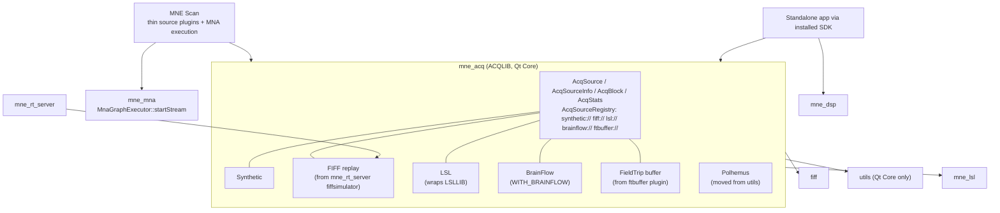
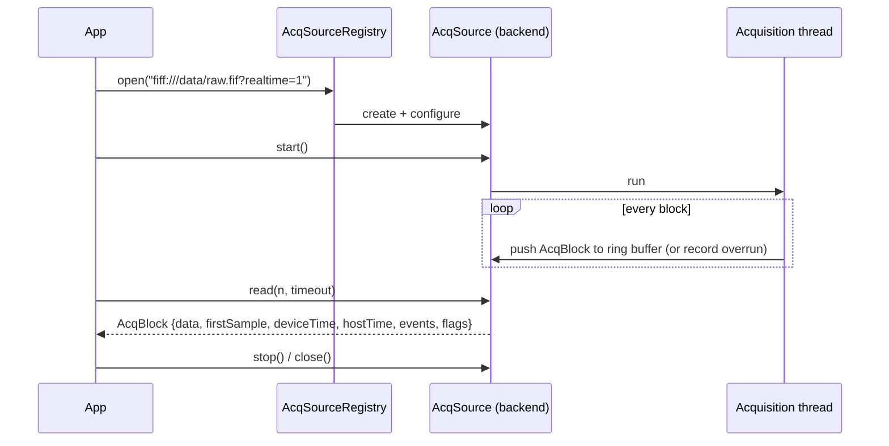

# MNE-CPP v2.5.0 - Acquisition SDK, MNE Scan Renewal, Coverage

Release target: v2.5.0
Working theme: **From scientific framework to developer-accessible SDK**
Repository: `chdinh/mne-cpp` (fork of `mne-tools/mne-cpp`). Remotes: `origin` = fork, `upstream` = mne-tools (fetch only).
Branches: feature branches `feature/<topic>` merge into fork `staging`; `main` is reserved for releases.
Target date: **Gate-driven; set after TASK 0 pins the baseline in the fork**

Last updated: 1 November 2026 - first draft. Baseline numbers are pinned from v2.4.0 (Staging run `39457390522` at `0800c9a1b`) until TASK 0 re-pins them from the first green fork run.

---

## Executive Intent

MNE-CPP's advantage over acquisition-first toolkits such as BrainFlow is scientific depth: FIFF metadata, forward/inverse modelling, anatomy and real-time source estimation. Its weakness is access: acquiring a stream requires the full MNE Scan application, every acquisition driver lives inside a GUI plugin, and the installed SDK pulls in Qt Widgets even for headless use.

v2.5.0 has three ordered goals:

1. **Raise coverage well above 80%.** Combined line coverage moves from 74.26% (Codecov 73.33%) to at least 82%, with command-line tools as the main lever: every tool reaches at least 70% line coverage, the tools scope 85%.
2. **Introduce `mne_acq`, a headless acquisition library.** One public API (`ACQLIB`) opens synthetic, FIFF-replay, LSL and (optionally) BrainFlow sources from a standalone C++ program, using `FiffInfo` metadata and Eigen blocks.
3. **Renew MNE Scan on top of it.** Acquisition plugins become thin adapters over `mne_acq` backends, and the processing pipeline is executed by MNA (`MnaGraphExecutor::startStream`) instead of only being mirrored into an `MnaGraph`.

The quality gates of v2.4.0 stay in force. A new feature that threatens a gate moves; the gate does not.

---

## Current Baseline and Known Gaps

### Coverage (pinned v2.4.0 evidence)

| Scope | Lines | Line % | Branch % | Largest gaps (missed lines) |
|-------|------:|-------:|---------:|-----------------------------|
| Libraries | 66,310 | 89.42 | 65.14 | `disp`, `disp3D`, `mne` branch paths |
| Applications | 44,350 | 55.85 | 36.13 | `mne_analyze_studio` 5,879; `mne_browse` 3,857; `mne_analyze` 2,369; `mne_scan` plugin `babymeg` 1,361 (1.9%); `mne_scan` libs 1,052 (38.0%); `mne_inspect` 940; `mne_align` 784 (46.8%); `mne_scan` app 562; `ftbuffer` 518 (6.3%) |
| Tools | 14,988 | 61.66 | 44.73 | `mne_rt_server` 854 (1.3%); `mne_compute_mne` 308; `mne_anonymize` GUI 437; `mne_flash_bem` 202; `mne_ctf2fiff` 168 (26.6%); `mne_mna_bids_converter` 154; `mne_watershed_bem` 132 (16.5%); `mne_tufts2fiff` 133 (31.8%) |
| **Combined** | 125,648 | **74.26** (Codecov 73.33) | 54.93 | |

Of 113 tool coverage units (one per tool, with `mne_rt_server` split into server and plugins), 29 are below 50% line coverage, 49 below 70% and 74 below 85%. Lifting all of them to 70% takes about 2,231 lines and to 85% about 3,688 lines. Of the 19 tool tests, 14 are shared `test_tool_*` suites and 5 are tool-specific.

### Acquisition and SDK (repository assessment, 1 Nov 2026)

| Area | Evidence | Gap |
|------|----------|-----|
| Plugin contract | `SCSHAREDLIB::AbstractPlugin` is a `QThread` with pure virtual `QWidget* setupWidget()`; `scShared` and `scMeas` link Widgets; no `sc*` target is exported. | No acquisition without MNE Scan. |
| Drivers | `BrainAMPDriver`, `GUSBAmpDriver`, `TMSIDriver`, `EEGoSportsDriver` take a producer back-pointer; producers call into the plugin (`setSampleData`). `LSLAdapterProducer`, `NatusProducer`, `FtConnector`, `BabyMEGClient` are closer to separable. | Drivers cannot be reused headless. |
| FIFF replay | Only in `src/tools/server/mne_rt_server/plugins/fiffsimulator` (`FiffProducer`, `FiffSimulator`), reached over TCP via `COMLIB::RtDataClient`. | Replay needs a second process. |
| LSL | `mne_lsl` is an in-tree reimplementation (`LSLLIB::stream_inlet` float-only), not liblsl. | Wire interoperability with liblsl/pylsl is unproven. |
| Buffering | `UTILSLIB::CircularBuffer<T>` (QSemaphore, timed `push`/`pop`), tested by `test_utils_circularbuffer`. | Reusable as the acquisition ring buffer. |
| MNA | `MnaGraphExecutor::startStream/stopStream` exist; only `test_mna_graph_execution` calls them. `PluginSceneManager` mirrors plugins into an `MnaGraph` for persistence. | MNE Scan does not execute through MNA. |
| SDK export | `install(EXPORT MNECPPTargets NAMESPACE MNE-CPP::)`; `scripts/packaging/MNECPPConfig.cmake.in` calls `find_dependency(Qt6 ... Gui Network Widgets Svg Xml OpenGL OpenGLWidgets)` for every consumer; `release-sdk.yml` packages. | No downstream `find_package(MNE-CPP)` test; headless consumers still need Widgets. |
| Qt footprint | `utils` links `Qt::Gui` only for `utils/polhemus/*` (`QVector3D`, `QMatrix4x4`); every other library is Core plus Concurrent/Network. | One device driver makes every library Gui-dependent. |
| BrainFlow | Not referenced anywhere. Local checkout `~/Programming/brainflow` (MIT, `BoardShim`, synthetic board, ANT Neuro eego and g.tec Unicorn boards). | New optional backend. |
| Python | No bindings (no pybind11/nanobind); the v2.3.0 `mne_mna` Python package was never implemented. | Out of the critical path. |

---

## Implementation Summary

| Task | Workstream | Priority | Status | Depends on |
|------|------------|----------|--------|------------|
| **0** | Fork baseline and CI parity | P0 | In progress | - |
| **1** | Coverage offensive II (tools first) | P0 | Planned | TASK 0 |
| **2** | `mne_acq` core API | P0 | Planned | TASK 0 |
| **3** | Acquisition backends | P0 (BrainFlow P0, optional build) | Planned | TASK 2 |
| **4** | MNE Scan renewal | P0 | Planned | TASKs 2-3 |
| **5** | SDK consumability | P0 | Planned | TASK 0 |
| **6** | Developer examples and documentation | P1 | Planned | TASKs 2-5 |
| **7** | Python bindings MVP | Candidate | Planned | TASKs 2, 5 |
| **8** | Example gallery: a figure for every example | P0 | Planned | TASK 0 (T8.2 also T1.11 renderer tests) |

The multi-agent model, status vocabulary, work-package contract and shared-hotspot table of v2.4.0 apply unchanged (`doc/dev-notes/v2.4.0-requirements.md`, "Multi-Agent Execution Model"). Added hotspot: `src/libraries/acq/acq_source.h` and `acq_source_registry.*` are owned by the T2 integration package; backend packages add files under `src/libraries/acq/backends/<name>/` only.

### Active assignment ledger

| Package ID | Agent | Branch/worktree | Started | Handoff / PR |
|------------|-------|-----------------|---------|--------------|
| T0.1 | Release coordinator | `staging` | 1 Nov 2026 | `6cad357711` |

---

## Release Gates

G1 and G3-G8 of v2.4.0 apply unchanged. G2 is raised; G9, G10 and G11 are new.

### G2 - Coverage (raised)

| Scope | v2.4.0 pinned | v2.5.0 minimum |
|-------|--------------:|---------------:|
| Combined (gate model) | 74.26% line / 54.93% branch | **>= 82% line / >= 62% branch** |
| Codecov project | 73.33% | **>= 81%** |
| Libraries | 89.42% / 65.14% | >= 90% line / >= 70% branch |
| Applications | 55.85% / 36.13% | >= 70% line / >= 50% branch |
| Tools | 61.66% / 44.73% | >= 85% line / >= 60% branch |

Per-unit floors (new):

- Every command-line tool >= 70% line coverage; no tool below 50% branch coverage once its line floor is met.
- Every application >= 60% line coverage; every non-hardware MNE Scan plugin >= 50% line coverage.
- Every library >= 80% line / 65% branch (deferred from v2.4.0, T2.3).

Arithmetic check: the three scope minimums give 59,679 + 31,045 + 12,740 = 103,464 of 125,648 lines = 82.35% at today's size, and 49,845 of 78,717 branches = 63.3%. New `mne_acq` code enters at >= 90% patch coverage, so it raises the combined figure.

Rules carried over: no exclusion added to reach a percentage; Codecov patch >= 90%; project may not drop more than 0.1 point; the floor in `scripts/quality/coverage_policy.json` ratchets up after every re-pin. Hardware plugins that need vendor SDKs (`brainamp`, `eegosports`, `gusbamp`, `tmsi`) stay excluded with their existing reasons; `babymeg`, `natus`, `ftbuffer` and `lsladapter` do not need hardware and are not excluded.

### G9 - SDK Consumability (new)

- A downstream CMake project outside the source tree builds and runs against the installed SDK on Ubuntu, macOS and Windows using only `find_package(MNE-CPP CONFIG REQUIRED COMPONENTS ...)`.
- A headless consumer (`fiff`, `dsp`, `acq`) configures without Qt Widgets, Gui, Svg or OpenGL installed.
- The consumer test runs in Staging and on the SDK release artifacts.

### G10 - Acquisition Integrity (new)

- FIFF replay delivers data bit-identical to `FiffRawData::read_raw_segment` of the same file, with contiguous `firstSample` values.
- Synthetic, replay, LSL and BrainFlow-synthetic sources run 10 minutes each in CI at their nominal rate with zero unreported lost samples; an injected gap is reported as a discontinuity with the exact sample count.
- Channel count, names, kinds, units, `cal`/`range` and `sfreq` of every backend are asserted against a reference description (the FIFF file, the LSL stream description, BrainFlow's board descriptor).
- Performance numbers (throughput, latency p50/p95/p99, allocations per block) are measured and published by T3.6; no target is claimed before the first measurement.

### G11 - Example Gallery (new)

- Every example built from `src/examples/CMakeLists.txt` (70 today, plus new v2.5.0 examples) publishes at least one figure on its gallery page.
- Every figure is produced by the example itself through `DISPLIB::FigureExporter` from the data it computes; no hand-made screenshots, no rendered console text, no figure that is identical for every input.
- Figures are generated on the fly: every website build runs the examples (`run_examples.py`) and publishes what they write. No gallery image or console output is committed; `doc/website/static/img/examples/` is removed from the repository and git-ignored.
- The build fails when an example writes no figure, a PNG does not decode, is smaller than 400x300, is uniform, or has no caption, or when the example exits non-zero.
- The gallery index shows a thumbnail for every example.

---

## Target Architecture

---

## TASK 0 - Fork Baseline and CI Parity

**Priority:** P0, first milestone

| ID | Status | Agent package and deliverables | Own paths | Depends on | Acceptance |
|----|--------|--------------------------------|-----------|------------|------------|
| **T0.1** | In progress | Fork CI parity. Done: toolchain downloads (`download_toolchain.{sh,bat}`, workflow `qt_binaries`) read `mne-tools/mne-cpp` instead of the running repository; guarded by `scripts/quality/tests/test_toolchain_source.py` (`6cad357711`). Fork `Release` workflow disabled (it triggers on `main`/tag pushes). Open: `CODECOV_TOKEN` for `chdinh/mne-cpp`; re-enable CodeQL (disabled for inactivity); first coverage-baseline cache in the fork; website deploy target of the fork. | `.github/workflows/*`, `scripts/ci/*` | - | **AC-T0.1-1:** Staging on the fork is green on all jobs except those needing absent secrets, each listed with its reason. **AC-T0.1-2:** Codecov receives the fork upload. |
| **T0.2** | Planned | Re-pin the baseline into `doc/release/v2.5.0/` from the first green fork Staging run; `generate_quality_report.py` takes the release directory from the version in `src/CMakeLists.txt` instead of the hard-coded `v2.4.0`; dashboard thresholds read G2/G9/G10 from this document's values. | `scripts/quality/*`, `doc/release/v2.5.0/` | T0.1 | **AC-T0.2-1:** `generate_quality_report.py --check` passes against `v2.5.0` evidence. |
| **T0.3** | Planned | Branch and upstream policy: feature branches per TASK, merged to fork `staging` after a green branch run; decide when and how fork `staging` is proposed to `mne-tools/mne-cpp` (see Open Decisions). | This document, `CONTRIBUTING`-level docs | T0.1 | **AC-T0.3-1:** policy recorded; pull-request workflow runs on fork branches. |

---

## TASK 1 - Coverage Offensive II (Tools First)

**Priority:** P0. Oracle tests over call-only tests, as in v2.4.0 T2.3: every new test asserts against MNE-C, MNE-Python or an analytic reference, and every package records the defects it found.

Tool tests run the installed binary as a subprocess (`QProcess`); its `.gcda` output counts towards coverage, as it already does today. Tools that need FreeSurfer run their orchestration against stub executables on `PATH` that record arguments and write fixture outputs, so the orchestration is covered on every platform; the real FreeSurfer runs stay as declared skips.

| ID | Status | Package | Targets (missed lines today) | Acceptance |
|----|--------|---------|------------------------------|------------|
| **T1.1** | Planned | CLI contract sweep: extend `test_tool_exit_codes` into a table over every installed tool: `--help` exits 0 and names the tool, `--version` matches `MNE_CPP_VERSION`, an unknown option and a missing required input exit non-zero with a diagnostic on stderr, a nonexistent input file exits non-zero. A tool without an entry fails the test. | All 82 tools; parser and usage branches | **AC-T1.1-1:** every tool in `src/tools/**` has a table row. **AC-T1.1-2:** sabotaging one tool's exit code fails the test. |
| **T1.2** | Planned | Conversion tools: round trips on small committed fixtures, read back with MNE-Python (`read_raw_ctf`, `read_raw_kit`, `read_dig_*`, `read_cov`). | `mne_ctf2fiff` 168, `mne_mna_bids_converter` 154, `mne_tufts2fiff` 133, `mne_kit2fiff` 117, `mne_make_cor_set` 86, `mne_convert_lspcov` 80, `mne_ctf_dig2fiff` 78, `mne_convert_ctf_markers` 37 | Each tool >= 85% line. |
| **T1.3** | Planned | Forward and surface tools, FreeSurfer stubs for orchestration. | `mne_flash_bem` 202, `mne_watershed_bem` 132, `mne_surf2bem` 189, `mne_average_forward_solutions` 64, `mne_morph_labels` 64, `mne_forward_solution` 60, `mne_volume_source_space` 58, `mne_fit_sphere_to_surf` 50, `mne_make_morph_maps` 40 | Each tool >= 80% line. |
| **T1.4** | Planned | Inverse tools against `mne.minimum_norm` and MNE-C reference outputs. | `mne_compute_mne` 308, `mne_compute_raw_inverse` 149, `mne_make_movie` 106, `mne_inverse_operator` 96, `mne_smooth` 80, `mne_map_data` 59, `mne_inverse_pipeline` 49 | Each tool >= 85% line. |
| **T1.5** | Planned | Preprocessing and info tools; `mne_anonymize` GUI offscreen (main window, settings controller). | `mne_anonymize` 681, `mne_process_raw` 132, `mne_list_bem` 75, `mne_dacq_annotator` 65, `mne_create_comp_data` 50, `mne_add_to_meas_info` 41, `mne_fix_stim14` 41, `mne_compensate_data` 36, `mne_change_baselines` 35, `mne_toggle_skips` 28, `mne_make_derivations` 19 | Each tool >= 80% line. |
| **T1.6** | Planned | `mne_rt_server` over loopback: `COMLIB::RtClient` drives the command protocol and data stream against a FIFF-replay connector. After T3.2 the server's replay uses `mne_acq`. | `mne_rt_server` 854 | >= 75% line. |
| **T1.7** | Planned | `mne_screenshot_regression` comparisons against goldens and deliberate mismatches. | 68 | >= 80% line. |
| **T1.8** | Planned | `mne_analyze_studio`: workbench actions, skill host, session persistence. | 5,879 | >= 70% line. |
| **T1.9** | Planned | `mne_browse`, `mne_analyze`, `mne_inspect`, `mne_align`: remaining workflow tests in the headless pattern of v2.4.0 (QSettings-driven state, offscreen, oracle comparisons). | 3,857 / 2,369 / 940 / 784 | Each >= 70% line (`mne_align` >= 60%). |
| **T1.10** | Planned | MNE Scan after TASK 4: plugin tests drive real data through `mne_acq` sources; `babymeg` against a fake BabyMEG TCP server; `ftbuffer` against a fake FieldTrip buffer; `natus` against a UDP sender; `hpi`, `rtfwd`, `rtclustmne`, `neuronalconnectivity` on FIFF replay. Sequenced after T4.2 so no test is written against code that TASK 4 replaces. | `babymeg` 1,361, scan libs 1,052, scan app 562, `ftbuffer` 518, `rtclustmne` 352, `rtfwd` 331, `hpi` 327, `lsladapter` 264, `neuronalconnectivity` 226, `fiffsimulator` 196, `natus` 168 | Scan app/libs >= 60%; each non-hardware plugin >= 50%. |
| **T1.11** | Planned | Library branch coverage 65% -> 70%: `disp3D` `brainview`, `fwd_bem_model`, `channelrhiview`, `mne_forward_solution`; per-library floors. | ~2,400 branches | Libraries >= 70% branch; each library >= 80% / 65%. |
| **T1.12** | Planned | Gate integration: `check_coverage_gate.py` enforces scope minimums and per-unit floors from `coverage_policy.json` (`scope_minimums`, `unit_floors` with unit = tool directory / application / plugin / library); floor ratchets after each re-pin; Codecov component statuses per scope. | `scripts/quality/*`, `codecov.yml` | **AC-T1.12-1:** a synthetic tool at 69% fails. **AC-T1.12-2:** G2 passes on the release candidate. |

Order: T1.1 and T1.12 first (cheapest broad gain and the enforcing gate), then T1.2-T1.7 in parallel (disjoint tool directories), T1.8-T1.9 in parallel, T1.10 after T4.2, T1.11 throughout.

---

## TASK 2 - `mne_acq` Core API

**Priority:** P0. New library `src/libraries/acq`, target `mne_acq`, namespace `ACQLIB`, export macro `ACQSHARED_EXPORT`, Qt Core only, links `mne_fiff` and `mne_utils`. A new library is justified because no existing library may depend on device or network backends (`fiff`, `dsp` must stay free of them), and the existing contract lives in an application (`scShared`) that requires Widgets.

| ID | Status | Package | Acceptance |
|----|--------|---------|------------|
| **T2.1** | Planned | API design review (header-only draft + this section updated): `AcqSource` (abstract; `open`, `start`, `stop`, `close`, `read(maxSamples, timeoutMs)`, `info()`, `stats()`, `state()`, `lastError()`), `AcqSourceInfo` (`FiffInfo`, clock description, backend name and parameters), `AcqBlock` (`Eigen::MatrixXd` channels x samples in FIFF physical units, `firstSample`, optional device timestamp of the first sample, host monotonic receive time, events, discontinuity flag with lost-sample count), `AcqStats` (received, delivered, lost, overruns, buffer fill), `AcqSourceRegistry` (URI scheme -> factory). Asynchronous consumption via a `blockAvailable` signal (queued) in addition to `read`. | **AC-T2.1-1:** design approved (Open Decisions D1-D4 answered). |
| **T2.2** | Planned | Core implementation: one acquisition thread per source; ring buffer = `UTILSLIB::CircularBuffer` (extend it rather than adding a second buffer if a non-blocking overrun count is missing); deterministic lifecycle (`stop` joins, `close` releases, destructor equals `close`); single-consumer `read`, documented thread safety. | **AC-T2.2-1:** lifecycle tests under `libgmalloc` (macOS) and ASan (Linux) clean. **AC-T2.2-2:** no allocation per block on the steady-state read path (counted with a test allocator). |
| **T2.3** | Planned | Registry and URI parsing: `scheme://target?key=value`, unknown scheme and invalid parameter errors with messages; backends register at static-init time behind their build flags. | Invalid-URI table test; registry lists exactly the compiled backends. |
| **T2.4** | Planned | API documentation, registry entries, snippets (`ex_acq`), website section; G3 applies to every new class. | G3 for `acq`. |

---

## TASK 3 - Acquisition Backends

| ID | Status | Package | Acceptance |
|----|--------|---------|------------|
| **T3.1** | Planned | `synthetic://` : seeded sine/noise/event generator with configurable channels (EEG/MEG/stim), `sfreq`, block size and real-time pacing on/off. | Deterministic for a seed; G10 run. |
| **T3.2** | Planned | `fiff://` : FIFF replay moved from `mne_rt_server` `FiffSimulator`/`FiffProducer` into `mne_acq` (looping, real-time pacing, start offset); `mne_rt_server` and the Scan `fiffsimulator` plugin use it. | Bit-identical to `read_raw_segment` (G10); `mne_rt_server` tests pass unchanged. |
| **T3.3** | Planned | `lsl://` : wraps `LSLLIB::stream_inlet` (resolve by name/type), maps the LSL description to `FiffInfo`, uses LSL timestamps as device clock. Adds an interoperability test against pylsl/liblsl (outlet in Python, inlet in C++ and the reverse). | Interop test passes, or the incompatibility is documented with the failing case. |
| **T3.4** | Planned | `brainflow://<board>?serial_port=..&ip_address=..` : optional backend, `WITH_BRAINFLOW` (default OFF until T3.4c), BrainFlow fetched at a pinned release tag and linked only into `mne_acq`. Board descriptor -> `FiffInfo` (EEG channels in V, sampling rate, channel names), BrainFlow timestamp channel as device clock, marker channel as events. Sub-packages: **T3.4a** dependency strategy (shared library vs static, platforms, MIT notice in third-party notices); **T3.4b** synthetic-board backend + CI; **T3.4c** default ON in release builds if T3.4a allows. | Synthetic board passes G10 in CI on three OSes; BrainFlow absent -> the rest of MNE-CPP builds and `brainflow://` reports "not compiled". |
| **T3.5** | Planned | `ftbuffer://host:port` : `FtConnector` and `FtHeaderParser` move from the Scan plugin into `mne_acq`; tested against a fake buffer server. | Fake-server round trip. |
| **T3.6** | Planned | Benchmarks: throughput, read latency p50/p95/p99, CPU, allocations per block for every backend; results published in the release evidence. | Numbers published with machine and run id. |
| **T3.7** | Planned | Polhemus: `utils/polhemus/*` moves to `mne_acq` (`ACQLIB`), so `utils` drops `Qt::Gui`. Callers (`mne_coreg`/coregistration) updated. | `utils` links Qt Core only; Polhemus tests pass in the new location. |

Hardware-in-the-loop (manual, recorded in the evidence bundle, not CI): one OpenBCI Cyton, one g.tec Unicorn or ANT Neuro eego via BrainFlow, one LSL device, one Neuromag/BabyMEG installation if available. Each run records units, sampling rate, channel order, timestamps, marker handling and a 10-minute disconnect/reconnect check.

---

## TASK 4 - MNE Scan Renewal

**Priority:** P0. The visual appearance of MNE Scan is not part of this task; the plugin and pipeline layers are.

| ID | Status | Package | Acceptance |
|----|--------|---------|------------|
| **T4.1** | Planned | Generic source plugin: one Scan plugin that hosts any `AcqSource` by URI and publishes `RealTimeMultiSampleArray`; its settings widget is generated from backend parameters. | Plays `synthetic://` and `fiff://` in Scan. |
| **T4.2** | Planned | `fiffsimulator`, `lsladapter`, `ftbuffer` become presets of the generic source plugin (saved pipelines keep loading); `brainflow` is added the same way. Vendor plugins (`brainamp`, `gusbamp`, `tmsi`, `eegosports`) and `babymeg`/`natus` stay as they are in v2.5.0; their drivers move only when a backend package for them is promoted. | Existing `.mna` pipelines load and run unchanged (regression test with the v2.4.0 example pipelines). |
| **T4.3** | Planned | Plugin contract split: `AbstractPlugin` keeps processing in a GUI-free base; widgets come from an optional interface. `scMeas` drops the Widgets/Svg link. | `scMeas` and the GUI-free plugin base link Qt Core only. |
| **T4.4** | Planned | MNA execution: the Scan pipeline is started by `MnaGraphExecutor::startStream` with a plugin factory, instead of being wired by `PluginSceneManager`; the saved graph becomes the executed graph. | A pipeline defined only as `.mna` runs headless (`mne_scan --headless pipeline.mna`). |
| **T4.5** | Planned | Headless MNE Scan: `--headless <pipeline.mna> [--duration s]` runs a pipeline without a window, used by T1.10 and CI. | CI runs a replay -> filter -> averaging pipeline headless and checks the averaged output against `FiffEvokedSet` from the same file. |

---

## TASK 5 - SDK Consumability

| ID | Status | Package | Acceptance |
|----|--------|---------|------------|
| **T5.1** | Planned | Per-component package config: `MNECPPConfig.cmake.in` resolves only the Qt components the requested `COMPONENTS` need (component -> Qt list generated from each target's link interface). | Headless `find_package(MNE-CPP COMPONENTS fiff dsp acq)` without Qt Widgets installed. |
| **T5.2** | Planned | Downstream consumer test: `src/testframes/test_sdk_consumer` (or a CI job) installs the SDK to a prefix, configures a separate project with `find_package`, builds and runs it; also run against the `release-sdk.yml` artifacts. | G9 on three OSes. |
| **T5.3** | Planned | SDK distribution profiles as install components (`core`, `signal`, `neuro`, `acquisition`, `full`) of the existing installer/SDK archives; no new repositories and no package-manager ports in v2.5.0. | Each profile archive passes T5.2 for its components. |
| **T5.4** | Planned | Debug/Release and static/dynamic consumption documented and tested where supported; unsupported combinations listed. | Matrix recorded in the SDK guide. |

---

## TASK 6 - Developer Examples and Documentation

| ID | Status | Package | Acceptance |
|----|--------|---------|------------|
| **T6.1** | Planned | `ex_acq_hello`: open `synthetic://`, read blocks, print channel metadata, band-pass with `FirFilter`, report RMS per channel; run as a CTest example. | Runs in CI on three OSes; quick-start page reaches its first output with only documented commands (checked by the onboarding extractor). |
| **T6.2** | Planned | `ex_acq_realtime_feature`: standalone app, `brainflow://synthetic_board` or `fiff://`, alpha-band power per channel as a continuous output. | CTest example; output compared to an offline computation on the same data. |
| **T6.3** | Planned | Signals-to-sources walkthrough reusing existing `ex_inv_*` and sample data, presented as the end-to-end path from a replayed stream to a source estimate. | Page builds; every code block is a `@snippet` region. |
| **T6.4** | Planned | Guides: acquisition API, BrainFlow integration, SDK quick start, MNE Scan renewal migration notes. | Website build passes G3/G4 rules. |

---

## TASK 7 - Python Bindings MVP (Candidate)

Promoted only after TASKs 2 and 5 reach Review. Scope if promoted: nanobind or pybind11 (decided by a short spike), wheel for one platform first, API = `open_stream(uri)`, `start/stop`, `read(n)` -> NumPy array, `info()` -> channel names/kinds/units/sfreq, one DSP call (`FirFilter`). No other library is bound in v2.5.0. MNE-Python interoperability: `info()` convertible to `mne.create_info`.

---

## TASK 8 - Example Gallery: A Figure for Every Example

**Priority:** P0. Baseline (1 Nov 2026): 70 built examples, **14 with figures** (37 PNGs), 39 that run in `run_examples.py` but write only console output, and 17 skipped (15 as "interactive 3D view", `ex_lsl`, `ex_connectivity_performance`). Figures are generated locally and committed under `doc/website/static/img/examples/<ex>/`; CI does not regenerate them, so they go stale silently. v2.5.0 removes the committed copies: the examples generate their figures on the fly in the docs build.

Principles: the figure shows the result the example computes (a filtered trace, a spectrum, a source map), using existing `DISPLIB`/`DISP3DLIB` views; where a known answer exists (synthetic ground truth), the figure shows estimate and truth together. Examples keep running headless; with `MNE_CPP_FIGURE_DIR` set, an example that opens an interactive window saves its figures and exits instead of entering the event loop.

| ID | Status | Package | Acceptance |
|----|--------|---------|------------|
| **T8.1** | Planned | On-the-fly pipeline and gate: a reusable `ExampleFigures` job (like `DocShots`) builds the examples, runs them with sample and test data (cached), checks the G11 rules (`run_examples.py --check`) and uploads `example-figures`; `_reusable-docs.yml` downloads it before `generate_examples.py` and the Docusaurus build, as it does for screenshots. Committed `doc/website/static/img/examples/` is deleted and git-ignored; local builds run `run_examples.py` first (`check-docs.sh` does it). `generate_examples.py` fails on a page without a figure; gallery index thumbnails for every example. Progress ratchet in `scripts/quality` (examples without figure may only shrink, from 56) until G11 is met. | **AC-T8.1-1:** removing one figure call fails the docs build. **AC-T8.1-2:** no file under `doc/website/static/img/examples/` is tracked. **AC-T8.1-3:** the ratchet value is shown on the quality dashboard. |
| **T8.2** | Planned | Offscreen 3-D figures: `BrainView::savePng` uses `QRhiWidget::grabFramebuffer`, which has no QRhi under the offscreen platform. Add an offscreen `BrainRenderer` frame path (like `ChannelRhiView::renderFrame`: own `QRhi` + texture render target + readback), exposed as `BrainView::renderToImage(QSize)`, and `FigureExporter::save(const QImage&)` from it. CI renders 3-D figures on the macOS runner (Metal) and Windows (D3D11 WARP), as `test_disp_viewers2` already does for `ChannelRhiView`; Linux uses Mesa llvmpipe through Vulkan or OpenGL if a spike shows it works, otherwise 3-D figures come from macOS only. Absorbs v2.4.0 T5.6 (3-D content in `mne_doc_shots`). | **AC-T8.2-1:** `renderToImage` of a fixed scene is non-uniform and matches a golden on macOS. **AC-T8.2-2:** all 3-D examples below produce figures in CI. |
| **T8.3** | Planned | `DISPLIB::TopoMap` widget (2-D sensor topography with head outline, contours and sensor markers), the counterpart of `mne.viz.plot_topomap`; needed by at least six examples below and by MNE Scan/`mne_browse`. Interpolation reuses the existing sensor interpolation (`GeometryInfo`/`Interpolation`) on the 2-D layout from `MNELayout`/`LayoutMaker`. | Registered public API with test (values compared to `mne.viz.plot_topomap` interpolation on a fixed grid), example and docs (G3). |
| **T8.4** | Planned | 2-D figures for the 39 console-only examples (table below), in batches by library. | Each listed example produces its figure(s) in CI. |
| **T8.5** | Planned | 3-D figures for the 17 skipped examples (table below); `ex_lsl` runs over loopback in CI (it already publishes and receives locally); `ex_connectivity_performance` gets a default short sweep (minutes) and keeps the full sweep behind an option. | Each listed example produces its figure(s) in CI. |
| **T8.6** | Planned | New v2.5.0 examples (`ex_acq_*`, TASK 6) and every future example are created with figures; the example template and `contr-examples` guide require one. | New examples pass G11 at merge. |

### Planned figure per example

2-D figures with existing widgets (`Plot`, `LinePlot`, `Bar`, `ImageSc`, `TFplot`, `ButterflyView`, `ChannelDataView::renderToImage`, `SpectrumView`) unless TopoMap (T8.3) or 3-D (T8.2) is named.

| Example | Figure(s) |
|---------|-----------|
| `ex_bids` | Raw traces read back from the BrainVision and EDF round trips, overlaid on the original. |
| `ex_cancel_noise` | Butterfly of one MEG channel group at compensation grades 0 and 3. |
| `ex_compute_forward` | Gain-matrix column norms on the cortex (3-D); field of one dipole (TopoMap). |
| `ex_decoding` | CSP/SPoC patterns vs ground truth; ICA source traces vs true sources. |
| `ex_disp3d_scene` | Sensor-to-surface interpolation, sEEG electrodes and MRI slice (3-D). |
| `ex_dsp_analysis` | Welch PSD with detected peaks; envelope correlation matrix (`ImageSc`). |
| `ex_dsp_artifacts` | Raw with planted defects, detected spans marked, repaired trace below. |
| `ex_dsp_maxwell` | Raw before/after SSS; detected bad channels highlighted. |
| `ex_dsp_preprocessing` | Estimated vs true components for each preprocessing step. |
| `ex_dsp_rt` | Real-time average converging over blocks; noise spectrum. |
| `ex_evoked_grad_amp` | Tangential gradient amplitude (TopoMap) at the response peak. |
| `ex_fiff_api` | Sensor and digitizer positions (3-D) in head coordinates. |
| `ex_fiff_io` | Raw segment of the source file and of the written copy. |
| `ex_fiff_sniffer` | Raw traces decoded from the memory buffer in both byte orders. |
| `ex_fiff_structure` | Fixed-length epochs average; CTF compensated vs uncompensated trace. |
| `ex_filtering` | Raw before/after band-pass; filter magnitude response. |
| `ex_find_evoked` | Butterfly of every condition found in the file. |
| `ex_fs` | Parcellation on the inflated surface (3-D); curvature histogram. |
| `ex_fwd_api` | BEM surfaces (3-D); field map of one dipole for sphere vs BEM (TopoMap). |
| `ex_hpiFit` | Head position (x, y, z, rotation) over time, MNE-CPP vs MaxFilter. |
| `ex_ieeg` | Lead with contacts and painted values on the surface (3-D); bipolar traces. |
| `ex_interpolation` | Evoked MEG values interpolated onto the head surface (3-D). |
| `ex_inv_api` | dSPM estimate on the cortex (3-D); label time courses. |
| `ex_inv_beamformer` | LCMV power on the cortex (3-D); RAP-MUSIC dipoles. |
| `ex_inv_dipole_fit` | Fitted dipole position and goodness of fit over time. |
| `ex_inv_hpi` | Fitted coil positions vs true positions. |
| `ex_make_inverse_operator` | Noise-normalized sensitivity per operator (MEG+EEG, MEG, EEG) on the cortex (3-D). |
| `ex_make_layout` | The projected 2-D layout with channel names. |
| `ex_math` | Inputs and results with known answers (e.g. SVD spectrum, fitted sphere). |
| `ex_ml` | ONNX model output vs reference on the example tensors. |
| `ex_mna` | Signal before/after the executed graph. |
| `ex_mne_api` | BEM and source space (3-D); ICP fit residuals per iteration. |
| `ex_mri` | Orthogonal slices of the T1 volume with the RAS cursor. |
| `ex_read_bem` | BEM surfaces (3-D). |
| `ex_read_fwd` | Clustered source space coloured by parcel (3-D). |
| `ex_read_write_raw` | Raw segment of the source and of the copy. |
| `ex_sts_statistics` | Cluster test statistic map with significant clusters. |
| `ex_utils` | Standard montage (TopoMap layout) and circular-buffer throughput. |
| `ex_warp` | Source, target and warped point sets. |
| `ex_clustered_inverse_mne`, `ex_clustered_inverse_mne_raw`, `ex_disp_3D`, `ex_inverse_mne_raw` | Source estimate at the response peak on the cortex (3-D). |
| `ex_clustered_inverse_pwl_rap_music_raw`, `ex_clustered_inverse_rap_music_raw`, `ex_inverse_pwl_rap_music`, `ex_inverse_rap_music`, `ex_roi_clustered_inverse_pwl_rap_music`, `ex_st_clustered_inverse_pwl_rap_music` | Localized dipole pairs on the cortex (3-D). |
| `ex_connectivity`, `ex_connectivity_comparison` | Connectivity network (3-D) and matrix (`ImageSc`) per metric. |
| `ex_connectivity_performance` | Run time vs channel and sample count per method. |
| `ex_coreg` | Digitizer points on the head surface before and after ICP (3-D). |
| `ex_fs_surface` | Pial, inflated, original and white surfaces (3-D). |
| `ex_read_fwd_disp_3D` | Source space with the FreeSurfer parcellation (3-D). |
| `ex_lsl` | Published vs received samples. |

The 14 examples that already have figures (`ex_averaging`, `ex_connectivity_metrics`, `ex_disp`, `ex_disp_plots`, `ex_dsp_filter`, `ex_dsp_spectral`, `ex_histogram`, `ex_inverse_cmne`, `ex_inverse_mne`, `ex_read_epochs`, `ex_read_evoked`, `ex_read_raw`, `ex_spectral`, `ex_tf_plot`) are re-checked against the G11 rules only.

Order: T8.1 first (gate as ratchet), T8.3 and the T8.2 spike next, then T8.4 batches in parallel with T8.2/T8.5. 3-D figures depend on T8.2; if Linux cannot render, the CI figure job for 3-D runs on macOS.

---

## Open Decisions

| ID | Question | Recommendation |
|----|----------|----------------|
| D1 | `AcqBlock` data type: `MatrixXd` (consistent with Scan and `fiff`) or `MatrixXf` (half the bandwidth, LSL/BrainFlow deliver float/double). | `MatrixXd`, matching every downstream consumer. |
| D2 | Asynchronous API: Qt queued signal only, or also a `std::function` callback on the acquisition thread. | Signal only in v2.5.0; callbacks invite blocking the acquisition thread. |
| D3 | URI scheme vs typed config structs as the primary open API. | Both: `AcqSourceRegistry::open(uri)` builds a typed config; typed configs are public for programmatic use. |
| D4 | BrainFlow build: shared library loaded at runtime, or linked. | Linked into `mne_acq` behind `WITH_BRAINFLOW`, shared BrainFlow libraries shipped with the installer; decided by T3.4a. |
| D5 | When fork `staging` is proposed upstream to `mne-tools/mne-cpp`. | After each milestone exit, as one PR per milestone. |
| D7 | Committed gallery figures vs on-the-fly generation. | **Decided 1 Nov 2026: on the fly.** The examples generate their figures in every docs build; nothing is committed. Consequence: the website build needs the built examples plus sample/test data (cached in CI). |
| D6 | Whether vendor drivers (`brainamp`, `gusbamp`, `tmsi`, `eegosports`) move into `mne_acq` in v2.5.0. | No; overlapping devices are reachable through BrainFlow; move them when a maintainer with hardware owns the package. |

---

## Delivery Order and Scope Control

| Milestone | Content | Exit |
|-----------|---------|------|
| **A - Baseline** | TASK 0, T1.1, T1.12, T2.1, T8.1 | Fork CI green; v2.5.0 baseline pinned; per-unit floors enforced as ratchets; `mne_acq` API approved. |
| **B - Headless acquisition** | T2.2-T2.4, T3.1-T3.3, T3.7, T5.1-T5.2; T1.2-T1.7, T8.2-T8.4 in parallel | `synthetic://`, `fiff://`, `lsl://` pass G10; headless SDK consumer passes G9; tools >= 85%. |
| **C - BrainFlow and Scan renewal** | T3.4-T3.6, TASK 4; T1.8-T1.9 in parallel | BrainFlow synthetic board in CI; Scan runs pipelines through MNA, headless mode in CI. |
| **D - Scan coverage and examples** | T1.10, T1.11, TASK 6, T5.3-T5.4, T8.5-T8.6 | G2 and G11 met; examples run in CI. |
| **E - Release candidate** | Evidence bundle, onboarding, signing as in v2.4.0 | G1-G11 pass. |

Scope rules: coverage work never waits for features (TASK 1 runs from Milestone A); TASK 7 starts only if Milestones B and C exit on schedule; any package that would need a new coverage exclusion stops and is re-planned.

---

## Explicitly Deferred

- Migration of vendor-SDK plugins (`brainamp`, `gusbamp`, `tmsi`, `eegosports`) and `babymeg`/`natus` drivers into `mne_acq`.
- vcpkg and Conan ports; mobile SDKs.
- Python bindings beyond the TASK 7 MVP; other language bindings.
- MNE Scan visual redesign.
- Removal of Qt from libraries beyond `utils` (`QString`/`QList` are part of the public API).
- New scientific algorithms unrelated to acquisition or coverage; the v2.4.0 parity backlog (T8.x) stays deferred unless promoted.
