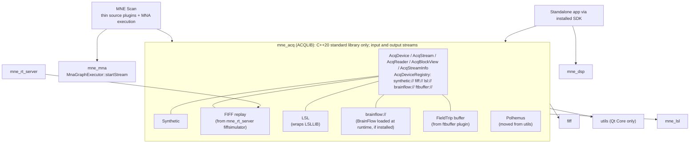
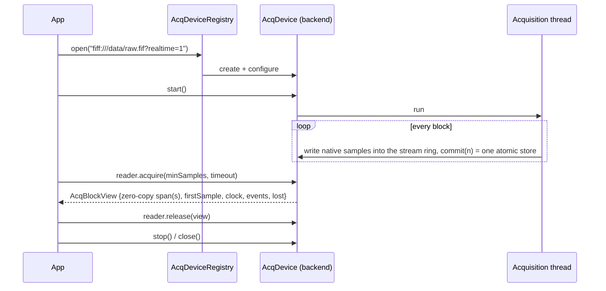

# MNE-CPP v2.5.0 - Acquisition SDK, MNE Scan Renewal, Coverage

Release target: v2.5.0
Working theme: **From scientific framework to developer-accessible SDK**
Repository: `chdinh/mne-cpp` (fork of `mne-tools/mne-cpp`). Remotes: `origin` = fork, `upstream` = mne-tools (fetch only).
Branches: feature branches `feature/<topic>` merge into fork `staging`; `main` is reserved for releases.
Target date: **Gate-driven; set after TASK 0 pins the baseline in the fork**

Last updated: 1 November 2026 - first draft. Baseline numbers are pinned from v2.4.0 (Staging run `39457390522` at `0800c9a1b`) until TASK 0 re-pins them from the first green fork run.

---

## Executive Intent

MNE-CPP's advantage over acquisition-first toolkits such as BrainFlow is scientific depth: FIFF metadata, forward/inverse modelling, anatomy and real-time source estimation. Its weakness is access: acquiring a stream requires the full MNE Scan application, every acquisition driver lives inside a GUI plugin, and the installed SDK pulls in Qt Widgets even for headless use.

The guiding aim of v2.5.0 is the user's experience, not a market claim: someone who acquires biosignals with MNE-CPP should get started in minutes, never wonder whether their data is correct, and find the path from first sample to scientific result shorter than with any other toolkit they have used, including BrainFlow. We do not advertise this; we measure it (G12) and fix every obstacle we observe.

v2.5.0 has four ordered goals:

1. **Raise coverage well above 80%.** Combined line coverage moves from 74.26% (Codecov 73.33%) to at least 82%, with command-line tools as the main lever: every tool reaches at least 70% line coverage, the tools scope 85%.
2. **Introduce `mne_acq`, a headless acquisition and stimulation library.** One public API (`ACQLIB`) in standard C++20 only (builds on embedded targets), for input and output streams, independent of any third-party acquisition toolkit, opens synthetic, FIFF-replay, LSL and FieldTrip-buffer sources from a standalone C++ program, and BrainFlow devices when a BrainFlow installation is found at runtime, using `FiffInfo` metadata and Eigen blocks.
3. **Make it effortless.** The existing installer and SDK as the entry point, a `mne_acq` command-line tool, zero-configuration defaults, device discovery, actionable error messages, direct FIFF recording, and a Qt-free public API (D9, D10, TASK 9).
4. **Renew MNE Scan on top of it.** Every acquisition plugin becomes a thin adapter over an `mne_acq` source (vendor drivers included), the plugin contract is split into a GUI-free processing base and optional widgets, and the pipeline is executed by MNA (`MnaGraphExecutor::startStream`), headless or with the GUI (D11).

The quality gates of v2.4.0 stay in force. A new feature that threatens a gate moves; the gate does not.

---

## Current Baseline and Known Gaps

### Coverage (pinned v2.4.0 evidence)

| Scope | Lines | Line % | Branch % | Largest gaps (missed lines) |
|-------|------:|-------:|---------:|-----------------------------|
| Libraries | 66,310 | 89.42 | 65.14 | `disp`, `disp3D`, `mne` branch paths |
| Applications | 44,350 | 55.85 | 36.13 | `mne_analyze_studio` 5,879; `mne_browse` 3,857; `mne_analyze` 2,369; `mne_scan` plugin `babymeg` 1,361 (1.9%); `mne_scan` libs 1,052 (38.0%); `mne_inspect` 940; `mne_align` 784 (46.8%); `mne_scan` app 562; `ftbuffer` 518 (6.3%) |
| Tools | 14,988 | 61.66 | 44.73 | `mne_rt_server` 854 (1.3%); `mne_compute_mne` 308; `mne_anonymize` GUI 437; `mne_flash_bem` 202; `mne_ctf2fiff` 168 (26.6%); `mne_mna_bids_converter` 154; `mne_watershed_bem` 132 (16.5%); `mne_tufts2fiff` 133 (31.8%) |
| **Combined** | 125,648 | **74.26** (Codecov 73.33) | 54.93 | |

Of 113 tool coverage units (one per tool, with `mne_rt_server` split into server and plugins), 29 are below 50% line coverage, 49 below 70% and 74 below 85%. Lifting all of them to 70% takes about 2,231 lines and to 85% about 3,688 lines. Of the 19 tool tests, 14 are shared `test_tool_*` suites and 5 are tool-specific.

### Acquisition and SDK (repository assessment, 1 Nov 2026)

| Area | Evidence | Gap |
|------|----------|-----|
| Plugin contract | `SCSHAREDLIB::AbstractPlugin` is a `QThread` with pure virtual `QWidget* setupWidget()`; `scShared` and `scMeas` link Widgets; no `sc*` target is exported. | No acquisition without MNE Scan. |
| Drivers | `BrainAMPDriver`, `GUSBAmpDriver`, `TMSIDriver`, `EEGoSportsDriver` take a producer back-pointer; producers call into the plugin (`setSampleData`). `LSLAdapterProducer`, `NatusProducer`, `FtConnector`, `BabyMEGClient` are closer to separable. | Drivers cannot be reused headless. |
| FIFF replay | Only in `src/tools/server/mne_rt_server/plugins/fiffsimulator` (`FiffProducer`, `FiffSimulator`), reached over TCP via `COMLIB::RtDataClient`. | Replay needs a second process. |
| LSL | `mne_lsl` is an in-tree reimplementation (`LSLLIB::stream_inlet` float-only), not liblsl. | Wire interoperability with liblsl/pylsl is unproven. |
| Buffering | `UTILSLIB::CircularBuffer<T>` (QSemaphore, timed `push`/`pop`), tested by `test_utils_circularbuffer`. | Kept for MNE Scan; too slow for the acquisition data path (per-element copies, semaphores, single consumer) -> new ring (T2.2). |
| MNA | `MnaGraphExecutor::startStream/stopStream` exist; only `test_mna_graph_execution` calls them. `PluginSceneManager` mirrors plugins into an `MnaGraph` for persistence. | MNE Scan does not execute through MNA. |
| SDK export | `install(EXPORT MNECPPTargets NAMESPACE MNE-CPP::)`; `scripts/packaging/MNECPPConfig.cmake.in` calls `find_dependency(Qt6 ... Gui Network Widgets Svg Xml OpenGL OpenGLWidgets)` for every consumer; `release-sdk.yml` packages. | No downstream `find_package(MNE-CPP)` test; headless consumers still need Widgets. |
| Qt footprint | `utils` links `Qt::Gui` only for `utils/polhemus/*` (`QVector3D`, `QMatrix4x4`); every other library is Core plus Concurrent/Network. | One device driver makes every library Gui-dependent. |
| BrainFlow | Not referenced anywhere. Local checkout `~/Programming/brainflow` (MIT, `BoardShim`, synthetic board, ANT Neuro eego and g.tec Unicorn boards). | Runtime-loaded backend and compatibility layer; never a build or packaging dependency. |
| Python | No bindings (no pybind11/nanobind); the v2.3.0 `mne_mna` Python package was never implemented. | Not part of v2.5.0 (D8); the Qt-free `ACQLIB` API (D9) keeps later bindings cheap. |

---

## Implementation Summary

| Task | Workstream | Priority | Status | Depends on |
|------|------------|----------|--------|------------|
| **0** | Fork baseline and CI parity | P0 | In progress | - |
| **1** | Coverage offensive II (tools first) | P0 | Planned | TASK 0 |
| **2** | `mne_acq` core API | P0 | Planned | TASK 0 |
| **3** | Acquisition backends and BrainFlow compatibility | P0 | Planned | TASK 2 |
| **4** | MNE Scan renewal (all sources via `mne_acq`, GUI-free plugin base, MNA execution, headless mode) | P0 | Planned | TASKs 2-3 |
| **5** | SDK consumability | P0 | Planned | TASK 0 |
| **6** | Developer examples and documentation | P1 | Planned | TASKs 2-5 |
| **7** | Python package `mne-cpp-acq` | - | Deferred (D8) | TASK 2 |
| **8** | Example gallery: a figure for every example | P0 | Planned | TASK 0 (T8.2 also T1.11 renderer tests) |
| **9** | Developer experience: getting started, CLI, errors, usability sessions | P0 | Planned | TASKs 2, 7 |
| **10** | Qt dependency reduction in the libraries (pragmatic; all except `disp`, `disp3D`) | P1 | Planned | TASK 0; T10.1 before the library waves |
| **11** | One access header per library (`<lib>/<lib>.h`) and clean includes everywhere | P1 | Planned | TASK 0; before TASK 6 and T8.4 touch the examples |

The multi-agent model, status vocabulary, work-package contract and shared-hotspot table of v2.4.0 apply unchanged (`doc/dev-notes/v2.4.0-requirements.md`, "Multi-Agent Execution Model"). Added hotspot: `src/libraries/acq/acq_device.h` and `acq_device_registry.*` are owned by the T2 integration package; backend packages add files under `src/libraries/acq/backends/<name>/` only.

### Active assignment ledger

| Package ID | Agent | Branch/worktree | Started | Handoff / PR |
|------------|-------|-----------------|---------|--------------|
| T0.1 | Release coordinator | `staging` | 1 Nov 2026 | `6cad357711` |

---

## Release Gates

G1 and G3-G8 of v2.4.0 apply unchanged. G2 is raised; G9-G14 are new.

### G2 - Coverage (raised)

| Scope | v2.4.0 pinned | v2.5.0 minimum |
|-------|--------------:|---------------:|
| Combined (gate model) | 74.26% line / 54.93% branch | **>= 82% line / >= 62% branch** |
| Codecov project | 73.33% | **>= 81%** |
| Libraries | 89.42% / 65.14% | >= 90% line / >= 70% branch |
| Applications | 55.85% / 36.13% | >= 70% line / >= 50% branch |
| Tools | 61.66% / 44.73% | >= 85% line / >= 60% branch |

Per-unit floors (new):

- Every command-line tool >= 70% line coverage; no tool below 50% branch coverage once its line floor is met.
- Every application >= 60% line coverage; every non-hardware MNE Scan plugin >= 50% line coverage.
- Every library >= 80% line / 65% branch (deferred from v2.4.0, T2.3).

Arithmetic check: the three scope minimums give 59,679 + 31,045 + 12,740 = 103,464 of 125,648 lines = 82.35% at today's size, and 49,845 of 78,717 branches = 63.3%. New `mne_acq` code enters at >= 90% patch coverage, so it raises the combined figure.

Rules carried over: no exclusion added to reach a percentage; Codecov patch >= 90%; project may not drop more than 0.1 point; the floor in `scripts/quality/coverage_policy.json` ratchets up after every re-pin. The coverage exclusions for `brainamp`, `eegosports`, `gusbamp` and `tmsi` are removed by T3.12: their drivers move into `mne_acq`, load the vendor SDK at runtime, build on every platform and are tested against stub SDK libraries. `babymeg`, `natus`, `ftbuffer` and `lsladapter` do not need hardware and are not excluded.

### G9 - SDK Consumability (new)

- A downstream CMake project outside the source tree builds and runs against the installed SDK on Ubuntu, macOS and Windows using only `find_package(MNE-CPP CONFIG REQUIRED COMPONENTS ...)`.
- A headless consumer (`fiff`, `dsp`, `acq`) configures without Qt Widgets, Gui, Svg or OpenGL installed.
- The consumer test runs in Staging and on the SDK release artifacts.

### G10 - Acquisition Integrity (new)

- FIFF replay delivers data bit-identical to `FiffRawData::read_raw_segment` of the same file, with contiguous `firstSample` values.
- Synthetic, replay, LSL and runtime-loaded BrainFlow synthetic-board sources run 10 minutes each in CI at their nominal rate with zero unreported lost samples; an injected gap is reported as a discontinuity with the exact sample count.
- Channel count, names, kinds, units, `cal`/`range` and `sfreq` of every backend are asserted against a reference description (the FIFF file, the LSL stream description, BrainFlow's board descriptor).
- Performance (T2.9, measured in CI and on reference machines, published per release): with the synthetic source and the in-memory DMA emulation, no lost samples at 1,000 channels x 20 kHz float32 for 10 minutes; >= 2 GB/s sustained through one lossless reader plus one latest-only reader; added latency from producer commit to consumer wake-up <= 50 us p99 with a busy-polling reader on a pinned core (reported p50/p99/p99.9 also for blocking readers); 0 heap allocations and 0 locks per block after `start()`. Targets are validated by T2.9 before they become release criteria; until then they are tracked, not claimed.

### G11 - Example Gallery (new)

- Every example built from `src/examples/CMakeLists.txt` (70 today, plus new v2.5.0 examples) publishes at least one figure on its gallery page.
- Every figure is produced by the example itself through `DISPLIB::FigureExporter` from the data it computes; no hand-made screenshots, no rendered console text, no figure that is identical for every input.
- Figures are generated on the fly: every website build runs the examples (`run_examples.py`) and publishes what they write. No gallery image or console output is committed; `doc/website/static/img/examples/` is removed from the repository and git-ignored.
- The build fails when an example writes no figure, a PNG does not decode, is smaller than 400x300, is uniform, or has no caption, or when the example exits non-zero.
- The gallery index shows a thumbnail for every example.

---

### G12 - Developer Experience (new)

Measured, not claimed. Every number below is produced by CI or recorded in the evidence bundle.

- **Time to first data:** on clean CI runners (Linux, macOS, Windows), two documented paths are timed: the installer followed by `mne_acq info synthetic://` prints channel information and a data block in under 5 minutes; the SDK archive with `find_package` and the C++ quick start builds and prints a data block in under 15 minutes. The commands are extracted from the documentation, as in G8.
- **Size of the first program:** the C++ quick start is at most 25 lines including `main`, without configuration beyond a URI.
- **Zero-configuration defaults:** `open("synthetic://")`, `open("fiff://<file>")` and `open("lsl://<name>")` work without further parameters; `discover()` lists every source reachable on the machine (LSL streams, BrainFlow availability, serial ports, FieldTrip buffers on localhost).
- **Actionable errors:** every error the public API can return has a catalogue entry (code, message naming the cause, the fix, documentation link); a test fails when an error path has no entry or an entry has no test.
- **Usability sessions:** at each milestone exit at least five developers who have not used MNE-CPP before complete scripted tasks (install, stream, record, filter, plot) while thinking aloud; time per task and every obstacle go into a friction log. Each obstacle is fixed or explicitly accepted before release; median task completion improves from milestone to milestone.
- **No regression in correctness for convenience:** shortcuts (defaults, auto-discovery) never guess units, channel types or sampling rates; anything not known is reported as unknown.

### G13 - Less Qt in the Libraries (new)

Pragmatic, not radical. `disp` and `disp3D` keep Qt by design, as do the applications and tools. In every other library, Qt is replaced where the C++20 standard library (or Eigen) has a good equivalent, and kept where it has none or where Qt is clearly more convenient (D16):

- **Replaced** (standard library is equivalent): containers, smart pointers, file system and plain file I/O, threads and synchronisation, random numbers, time, logging calls (through a facade), signals/slots inside libraries, 3-D math (Eigen).
- **Kept, Qt Core only, preferably private:** JSON/CBOR, sockets, regular expressions, Unicode-aware text processing, and any other spot where a std replacement would need a new dependency or substantially more code. Kept uses are listed in the T10.1 report with a one-line reason; no exit condition is required.
- **Qt Gui never in these libraries** (the only case today, `utils`/Polhemus, moves with T3.7).
- **Ratchet:** per-library Qt usage from T10.1 may only fall; libraries that become Qt-free stay Qt-free. G13 is met when T10.3-T10.6 are done and every remaining Qt use is a listed D16 case.
- **No behaviour change:** tests stay green, oracle tests (MNE-Python/MNE-C) stay within their recorded tolerances, and file formats written before and after the change are byte-identical.

### G14 - Header Management (new)

- Every library has exactly one access header `<lib>/<lib>.h` that includes its complete public API and nothing private; it is generated or checked by script, so a new public header that is missing from it fails CI.
- Examples, guides and API pages use the access headers: one `#include` per library used (today: median 8, maximum 45 library includes per example).
- Inside `src/libraries`, code includes the specific headers it needs, never an access header (compile time and dependency hygiene); checked by the same script.
- Every public header is self-contained (compiles on its own) and every access header compiles on its own, both checked in CI.
- Include style is uniform: `<lib/file.h>` across library boundaries, `"file.h"` within a library, no relative `../` includes.

## Target Architecture





### Data-path design (performance)

The same API serves 64-channel consumer EEG (256 KB/s), high-density EEG/OPM-MEG (~20 MB/s), Neuropixels-class probes (~23 MB/s per probe) and, from v2.6, MR receivers and digitizer cards (1-2 GB/s). Rules for the data path:

1. **Control path and data path are separate; both are standard C++20 only** (no Qt, no Eigen, builds with `-fno-exceptions -fno-rtti` and standalone for embedded targets, D9). The data path performs no heap allocation and takes no lock per block after `start()`, in either direction. Eigen is an optional header-only adapter (`acq_eigen.h`); FIFF conversion and Qt adapters live in separate libraries.
2. **Native samples, no forced conversion.** Rings store the device format (int16 ... complex float32) with per-channel scale/offset; physical units are produced on request by vectorised converters (T2.8).
3. **One producer, many independent readers** per stream (T2.2): recorder, display and closed-loop processing read the same ring at their own pace with exact per-reader loss accounting; the producer never waits, unless the application attaches a gating reader for lossless replay or conversion (T2.13).
4. **Zero copy.** `acquire`/`release` hands out spans into the ring; a backend may adopt its device's DMA buffer as the ring.
5. **Sample index is the time base.** Device clock = sample index; device and host timestamps are related by a clock model with stated uncertainty; events refer to sample indices.
6. **Streams, not one matrix.** A source exposes several streams (EEG + accelerometer + markers), each with its own rate, format and ring; metadata changes are versioned at a sample index.
7. **Continuous and segmented.** Blocks can carry per-segment headers, so triggered acquisition (MR readouts in v2.6) needs no API change.
8. **Tunable real-time behaviour.** Thread pinning, real-time priority, memory locking, pre-faulting, mirror-mapped rings (every view one contiguous part), NUMA placement and huge pages are options measured in T2.9, never required for correctness.
9. **Throughput independent of reader count.** Producer and reader positions on separate cache lines; the producer publishes one position per commit and touches no per-reader state; readers derive loss from positions; wake-ups only for readers that announced a wait; converters fuse format, layout and scaling in one cache-blocked pass and split by channel range across threads.
10. **Both directions (D13).** Output streams (electrical, magnetic, acoustic and optical stimulation, trigger lines, MR RF and gradient waveforms) use the same ring with roles swapped: the application is the single writer, the device consumes through a gating reader. The writer waits for space and never overwrites unplayed samples; the device emits a declared underrun fill (zero or hold) and late data is reported with its exact count, never shifted in time. Output events and segments are scheduled at device sample indices; `mapSample()` relates input and output clocks for closed loop. Monitor readers record what was sent.
11. **Sample-exact clock domains (D14).** Streams whose sample clocks derive from one oscillator share a clock domain: integer domain ticks per sample (the common clock all sample clocks are integer divisions of) and an origin tick that includes converter and trigger latencies. As on Spectrum cards, every timing quantity is an integer number of clock cycles in a fixed step, so each stream also states its schedulable step (`sampleAlignment`, e.g. `SPC_GATE_LEN_ALIGNMENT`, `SPC_TRIG_AVAILDELAY_STEP`); `mapSampleExact()` maps between streams by integer arithmetic and returns `NotOnGrid` for an off-grid instant (or rounds on request) instead of interpolating. `beginWriteAt()` places output at an exact sample; `earliestWritableSample()` states the device lead. Membership: one device = one domain named by its backend (`<scheme>:<serial>`); hardware-synchronised devices (star-hub) share the hub's domain; hand-wired clocks are declared with `clock_from=<device id>` or `clock_domain=<name>` and stay `Declared` until `verify()` has seen loop-back sync markers with zero drift, so wiring errors cannot produce wrong samples; everything else is free-running and uses the host-time `AcqClockModel`. Digital lines in the sample word (T/R switch, RF blanking, ADC gate, sync markers) are `AcqBitField`s in the top `digitalBits` bits of a channel word, allocated from the MSB down with the analog value in the remaining low bits (Spectrum `DIGOUTSRC_BIT15..12` / `SPC_DIGMODE` packing), read and written sample-synchronously with `decodeBits()`/`encodeBits()`.
12. **DMA-first memory (D17).** The ring is where the hardware writes, not a copy of it. (a) *Memory location* is part of the stream: `AcqMemoryKind` = `Host` (pageable), `HostPinned` (page-locked and registered with the device or GPU, the usual PCIe DMA target), `Device` (GPU memory, GPUDirect RDMA target; not CPU-addressable) or `Managed`, plus a device ordinal; views report it, and the core never dereferences sample memory it is not allowed to touch (no prefault, mlock, underrun fill or converter on `Device` memory; the backend or a GPU kernel does those). Ring positions, events and segment headers always live in host memory, so the protocol is identical for every location. (b) *Device-owned writes:* a DMA engine writes continuously into space it has been granted; the producer grants ring space ahead of the data (`grant(n)` advances the overwrite horizon, which is what readers' loss accounting already uses) and commits as the card reports progress (Spectrum `SPC_DATA_AVAIL_USER_LEN`, XDMA/QDMA descriptors, RDMA completion), with several notify blocks in flight and no CPU copy. (c) *Placement:* ring alignment is configurable up to the IOMMU/GPU page (4 KiB host, 64 KiB GPU, 2 MiB huge pages, which also cut IOMMU TLB misses); the ring is allocated on the NUMA node of the PCIe device; backends pass the device's own DMA buffer through `AcqExternalBuffer` when the driver must allocate it (coherent, cache-maintained memory on non-coherent SoCs). (d) *Interop without dependencies:* the core stays standard C++; an optional header-only `acq_dlpack.h` (like `acq_eigen.h`, the user supplies `dlpack.h`) exposes a view as a DLPack tensor (`kDLCPU`, `kDLCUDAHost`, `kDLCUDA`; shape channels x samples; strides from the view; complex types), so CuPy, PyTorch, MatX, CV-CUDA and Holoscan tensors consume ring memory without a copy. (e) *Holoscan SDK 5:* an optional bridge target `mne_acq_holoscan` (built only when `find_package(holoscan 5)` succeeds) provides a source operator that emits `holoscan::Tensor` blocks with `capture_time` from the stream's clock model, and a HoloMQ publisher for standalone acquisition processes (`ChannelRuntime`, `emit_captured`, clock health from the lock state, explicit `close()` at end of stream). The Holoscan Sensor Bridge (FPGA to GPU over RoCE) is a backend candidate for v2.6.

---

## TASK 0 - Fork Baseline and CI Parity

**Priority:** P0, first milestone

| ID | Status | Agent package and deliverables | Own paths | Depends on | Acceptance |
|----|--------|--------------------------------|-----------|------------|------------|
| **T0.1** | In progress | Fork CI parity. Done: toolchain downloads (`download_toolchain.{sh,bat}`, workflow `qt_binaries`) read `mne-tools/mne-cpp` instead of the running repository; guarded by `scripts/quality/tests/test_toolchain_source.py` (`6cad357711`). Fork `Release` workflow disabled (it triggers on `main`/tag pushes). Open: `CODECOV_TOKEN` for `chdinh/mne-cpp`; re-enable CodeQL (disabled for inactivity); first coverage-baseline cache in the fork; website deploy target of the fork. | `.github/workflows/*`, `scripts/ci/*` | - | **AC-T0.1-1:** Staging on the fork is green on all jobs except those needing absent secrets, each listed with its reason. **AC-T0.1-2:** Codecov receives the fork upload. |
| **T0.2** | Planned | Re-pin the baseline into `doc/release/v2.5.0/` from the first green fork Staging run; `generate_quality_report.py` takes the release directory from the version in `src/CMakeLists.txt` instead of the hard-coded `v2.4.0`; dashboard thresholds read G2/G9/G10 from this document's values. | `scripts/quality/*`, `doc/release/v2.5.0/` | T0.1 | **AC-T0.2-1:** `generate_quality_report.py --check` passes against `v2.5.0` evidence. |
| **T0.3** | Planned | Branch and upstream policy: feature branches per TASK, merged to fork `staging` after a green branch run; decide when and how fork `staging` is proposed to `mne-tools/mne-cpp` (see Open Decisions). | This document, `CONTRIBUTING`-level docs | T0.1 | **AC-T0.3-1:** policy recorded; pull-request workflow runs on fork branches. |

---

## TASK 1 - Coverage Offensive II (Tools First)

**Priority:** P0. Oracle tests over call-only tests, as in v2.4.0 T2.3: every new test asserts against MNE-C, MNE-Python or an analytic reference, and every package records the defects it found.

Tool tests run the installed binary as a subprocess (`QProcess`); its `.gcda` output counts towards coverage, as it already does today. Tools that need FreeSurfer run their orchestration against stub executables on `PATH` that record arguments and write fixture outputs, so the orchestration is covered on every platform; the real FreeSurfer runs stay as declared skips.

| ID | Status | Package | Targets (missed lines today) | Acceptance |
|----|--------|---------|------------------------------|------------|
| **T1.1** | Planned | CLI contract sweep: extend `test_tool_exit_codes` into a table over every installed tool: `--help` exits 0 and names the tool, `--version` matches `MNE_CPP_VERSION`, an unknown option and a missing required input exit non-zero with a diagnostic on stderr, a nonexistent input file exits non-zero. A tool without an entry fails the test. | All 82 tools; parser and usage branches | **AC-T1.1-1:** every tool in `src/tools/**` has a table row. **AC-T1.1-2:** sabotaging one tool's exit code fails the test. |
| **T1.2** | Planned | Conversion tools: round trips on small committed fixtures, read back with MNE-Python (`read_raw_ctf`, `read_raw_kit`, `read_dig_*`, `read_cov`). | `mne_ctf2fiff` 168, `mne_mna_bids_converter` 154, `mne_tufts2fiff` 133, `mne_kit2fiff` 117, `mne_make_cor_set` 86, `mne_convert_lspcov` 80, `mne_ctf_dig2fiff` 78, `mne_convert_ctf_markers` 37 | Each tool >= 85% line. |
| **T1.3** | Planned | Forward and surface tools, FreeSurfer stubs for orchestration. | `mne_flash_bem` 202, `mne_watershed_bem` 132, `mne_surf2bem` 189, `mne_average_forward_solutions` 64, `mne_morph_labels` 64, `mne_forward_solution` 60, `mne_volume_source_space` 58, `mne_fit_sphere_to_surf` 50, `mne_make_morph_maps` 40 | Each tool >= 80% line. |
| **T1.4** | Planned | Inverse tools against `mne.minimum_norm` and MNE-C reference outputs. | `mne_compute_mne` 308, `mne_compute_raw_inverse` 149, `mne_make_movie` 106, `mne_inverse_operator` 96, `mne_smooth` 80, `mne_map_data` 59, `mne_inverse_pipeline` 49 | Each tool >= 85% line. |
| **T1.5** | Planned | Preprocessing and info tools; `mne_anonymize` GUI offscreen (main window, settings controller). | `mne_anonymize` 681, `mne_process_raw` 132, `mne_list_bem` 75, `mne_dacq_annotator` 65, `mne_create_comp_data` 50, `mne_add_to_meas_info` 41, `mne_fix_stim14` 41, `mne_compensate_data` 36, `mne_change_baselines` 35, `mne_toggle_skips` 28, `mne_make_derivations` 19 | Each tool >= 80% line. |
| **T1.6** | Planned | `mne_rt_server` over loopback: `COMLIB::RtClient` drives the command protocol and data stream against a FIFF-replay connector. After T3.2 the server's replay uses `mne_acq`. | `mne_rt_server` 854 | >= 75% line. |
| **T1.7** | Planned | `mne_screenshot_regression` comparisons against goldens and deliberate mismatches. | 68 | >= 80% line. |
| **T1.8** | Planned | `mne_analyze_studio`: workbench actions, skill host, session persistence. | 5,879 | >= 70% line. |
| **T1.9** | Planned | `mne_browse`, `mne_analyze`, `mne_inspect`, `mne_align`: remaining workflow tests in the headless pattern of v2.4.0 (QSettings-driven state, offscreen, oracle comparisons). | 3,857 / 2,369 / 940 / 784 | Each >= 70% line (`mne_align` >= 60%). |
| **T1.10** | Planned | MNE Scan after TASK 4: plugin tests drive real data through `mne_acq` sources; `babymeg` against a fake BabyMEG TCP server; `ftbuffer` against a fake FieldTrip buffer; `natus` against a UDP sender; `hpi`, `rtfwd`, `rtclustmne`, `neuronalconnectivity` on FIFF replay. Sequenced after T4.2 so no test is written against code that TASK 4 replaces. | `babymeg` 1,361, scan libs 1,052, scan app 562, `ftbuffer` 518, `rtclustmne` 352, `rtfwd` 331, `hpi` 327, `lsladapter` 264, `neuronalconnectivity` 226, `fiffsimulator` 196, `natus` 168 | Scan app/libs >= 60%; each non-hardware plugin >= 50%. |
| **T1.11** | Planned | Library branch coverage 65% -> 70%: `disp3D` `brainview`, `fwd_bem_model`, `channelrhiview`, `mne_forward_solution`; per-library floors. | ~2,400 branches | Libraries >= 70% branch; each library >= 80% / 65%. |
| **T1.12** | Planned | Gate integration: `check_coverage_gate.py` enforces scope minimums and per-unit floors from `coverage_policy.json` (`scope_minimums`, `unit_floors` with unit = tool directory / application / plugin / library); floor ratchets after each re-pin; Codecov component statuses per scope. | `scripts/quality/*`, `codecov.yml` | **AC-T1.12-1:** a synthetic tool at 69% fails. **AC-T1.12-2:** G2 passes on the release candidate. |

Order: T1.1 and T1.12 first (cheapest broad gain and the enforcing gate), then T1.2-T1.7 in parallel (disjoint tool directories), T1.8-T1.9 in parallel, T1.10 after T4.2, T1.11 throughout.

---

## TASK 2 - `mne_acq` Core API

**Priority:** P0. New library `src/libraries/acq`, target `mne_acq`, namespace `ACQLIB`, export macro `ACQSHARED_EXPORT`. `mne_acq` depends on the C++20 standard library only (D9): no Qt, no Eigen, no MNE-CPP library; its `CMakeLists.txt` also works as a top-level project for embedded and cross builds. Eigen adapters are header-only (`acq_eigen.h`). `toFiffInfo()`/`fromFiffInfo()` live in the bridge library `mne_acq_fiff` (`acq/fiff/acq_fiff.h`), which also hosts the `fiff://` replay and the FIFF recorder; backends that need Qt-based in-tree libraries (`LSLLIB`) are separate targets that register their scheme with the standard-C++ registry. A new library is justified because no existing library may depend on device or network backends (`fiff`, `dsp` must stay free of them), and the existing contract lives in an application (`scShared`) that requires Widgets.

| ID | Status | Package | Acceptance |
|----|--------|---------|------------|
| **T2.1** | Done (approved 1 Nov 2026) | API design review (header-only draft + this section updated), following the data-path design below. Control path: `AcqDevice` (`open`, `start`, `stop`, `close`, `streams()`, `stats()`, `state()`, `lastError()`), `AcqDeviceRegistry` (URI scheme -> factory). Data path: `AcqStream` (one per sample rate, format and direction: `info()`, `direction()`, `reader(mode)`, `writer()` for output streams), `AcqReader` (`acquire(minSamples, timeout)` -> `AcqBlockView`, `release(view)`, `consumeIdle(n)` for the device side of output streams, convenience `read()` into caller-owned `AcqMatrixRef` storage, `callback` and Qt-signal adapters on top), `AcqWriter` (single producer for both directions: `beginWrite(n, timeout)` -> `AcqWriteView`, `commit(n)`, `pushEvent`, `pushSegment`, `setClock`, `updateInfo`, `finish`; output streams report underrun and reject late events), `AcqBlockView` (one or two contiguous spans of native samples, `firstSample`, clock model reference, events, `lost` since last view, optional per-segment headers), `AcqStreamInfo` (sample format, layout, `sfreq`, per-channel name, kind, unit, scale and offset, range; FIFF extension with coil type and position; lossless conversion to and from `FiffInfo`; metadata changes versioned at a sample index). | **AC-T2.1-1:** design approved (D1-D4, D9, D12 answered). **AC-T2.1-2:** `AcqStreamInfo` <-> `FiffInfo` round trip is lossless for the sample, CTF and BrainVision test files. **AC-T2.1-3:** an MR-style segmented stream (complex int16, per-segment header) can be described and read through the same API in a test, without a backend (keeps v2.6 MR non-breaking). **AC-T2.1-5:** in the in-memory emulation, an output and an input stream of one domain with different rates (e.g. 8 and 125 ticks per sample) and an unknown origin are promoted from `Declared` to `PhaseLocked` by `verify()` from loop-back markers; afterwards every scheduled output marker appears at exactly the input sample `mapSampleExact()` predicts, over 10^9 samples; an injected 1 ppm clock mismatch makes `verify()` fail. **AC-T2.1-6:** decode/encode of channels with 1-4 digital bits reproduce Spectrum's packing (bits from bit 15 down, analog shifted right) bit-exactly against a reference built from the `spcm` package rules. **AC-T2.1-4:** `mne_acq` configures and builds standalone with no Qt and no Eigen, static, with `-fno-exceptions -fno-rtti`, on GCC and Clang. |
| **T2.2** | In review (`feature/mne-acq`; ASan/UBSan/TSan clean on Linux CI and macOS; mirror mapping, NUMA and huge pages implemented with T2.10) | Stream ring: new lock-free single-producer / multi-reader ring per stream in `ACQLIB` (not `UTILSLIB::CircularBuffer`, whose per-element copies, `QSemaphore` synchronisation and single consumer cannot meet G10). Page-aligned, power-of-two capacity, memory-locked; can adopt an externally owned buffer (device DMA buffer) instead of allocating. Producer commits with one release store and never waits; each reader has its own position, overflow counter and mode (`Lossless`: overflow reported with exact count, producer not throttled; `Latest`: skips to newest data; `LowLatency`: busy-poll or `std::atomic::wait`). Output streams: the same ring with a gating device reader; the writer waits for space (`std::atomic::wait` or spin), underrun samples and late events counted exactly. Optional mirror mapping, pre-faulting and NUMA placement. Deterministic lifecycle (`stop` joins, `close` releases, destructor equals `close`). | **AC-T2.2-1:** lifecycle and concurrency tests under ASan/TSan (Linux) and `libgmalloc` (macOS) clean. **AC-T2.2-2:** 0 heap allocations and 0 mutex acquisitions per block after `start()` (counting allocator and lock instrumentation in tests). **AC-T2.2-3:** lost-sample counts exact under injected reader stalls. **AC-T2.2-4:** output underrun counts exact under injected writer stalls; no unplayed sample is ever overwritten. |
| **T2.8** | In review | Native sample formats and conversion: int16, packed int24, int32, float32, float64, complex int16, complex float32; interleaved and planar layouts; per-channel scale/offset applied only on request by `decode()` into caller-owned buffers and, for output, `encode()` from physical values with saturation to the channel range and native type (round to nearest even, clipping counted); fused, cache-blocked, compiler-vectorised loops in standard C++ (no Eigen dependency); strided `Eigen::Map` views without copy in `acq_eigen.h`. | Decode and encode results bit-exact vs a scalar reference for every format; throughput of each converter in the T2.9 report. |
| **T2.9** | In progress (`feature/mne-acq`; suite, G10 rows, regression and target gates, rate sweep and RT knobs done; reference machines open) | Performance suite and G10 performance targets: synthetic source and in-memory DMA emulation (acquire/release protocol like a DMA FIFO), sweeps over channels (1-4,096), rates (250 Hz-250 MS/s aggregate) and formats; reports throughput, producer-commit-to-reader-wake latency histograms (p50/p99/p99.9), allocations, lost samples, CPU per GB; for output streams write throughput, writer-commit-to-device-consume latency and underruns. Runs in CI as a regression check (relative to the previous run, tolerance recorded) and on two reference machines (Linux workstation, macOS arm64) for the absolute numbers. Real-time tuning knobs measured here: thread pinning, real-time priority (`SCHED_FIFO`, MMCSS, macOS time-constraint policy), memory locking, huge pages. **Done:** tool `mne_acq_bench` (per-call cost for 1-8 readers, commit-to-wake p50/p99/p99.9 for spinning and blocking readers, verified end-to-end ring throughput for 1-4,096 int16 channels, decode/encode rates; JSON report). Costs are minimum time per call over many short trials and stream rates the best of several streams, since interruptions only add time; a stream that loses or corrupts a sample makes the run fail. CI job `AcqBench` (pull requests and feature branches) builds the suite of the base and the head commit with `scripts/ci/acq_bench`, runs them alternately five times on one runner and fails when a throughput, per-call or converter metric is more than 20% worse (`compare.py`); wake-up latencies are reported only, because they depend on the runner's scheduler. Without a base that has the suite, the commit is compared with itself to record the runner's noise floor. Rows added: in-memory DMA card (4 int16 channels, granted space of an adopted buffer, 8 blocks in flight), output stream to a gating device reader (throughput and commit-to-consume latency, no underrun allowed), ring knobs on 1,024 channels (memory locking, unmirrored, huge pages), and the G10 targets as rows with their target printed: 1,000 float32 channels through a lossless recorder plus a Latest display (target >= 2 GB/s, CPU s/GB reported), a paced 1,000-channel 20 kHz run that must not lose a sample (`--paced-seconds 600` for the 10-minute soak), spin wake p99 (target <= 50 us). Macbook M4 (quick): 10.5 GB/s sustained, 20.0 kS/s per channel paced, spin p99 32 us, DMA 1.8-2.6 GB/s, output 7.6-9.2 GB/s; two runs of the same binary agree within 7% on every new gated row. Real-time knobs: public `acq_thread.h` (`acqPinThisThread`, `acqSetThisThreadPriority` with Normal/High/Realtime, `acqApplyThreadPolicy`, `acqCurrentCpu`, `acqNumaNodeCpus` to place threads on the ring's NUMA node; Linux affinity + nice/`SCHED_FIFO`, Windows group affinity + `THREAD_PRIORITY_*`/MMCSS "Pro Audio", macOS QoS + time-constraint policy, no affinity on macOS -> `PlatformUnsupported`; missing rights -> new code `PermissionDenied`), URI parameters `cpus=` and `priority=` for backend producer threads (synthetic: applied before the first block, a refused policy fails `start()`), and `ex_acq_performance` pins its closed-loop controller. Bench rows with producer and consumer pinned to two CPUs of NUMA node 0 where pinning exists (`wake_spin_pinned_*`, `sustained_float32_1000_ch_pinned`); paced rate sweep 64 ch x 1 kHz, 1,000 ch x 20 kHz, 4 int16 ch x 62.5 MHz (250 MS/s aggregate), all lossless with a 99% rate target; `compare.py` now also fails any head metric that misses its target (status TARGET), which makes spin p99 <= 50 us a CI gate (runner p99 0.45 us). **Open:** the two reference machines and the release-evidence report. | Report in the evidence bundle; a 20% throughput or p99 regression fails CI. |
| **T2.10** | In review (`feature/mne-acq`; Linux NUMA and huge-page paths verified in CI only, no Linux machine locally) | DMA-first memory (data-path rule 12 a-c): `AcqMemoryKind` and device ordinal on `AcqExternalBuffer`, `AcqStreamInfo` and every view; the core touches sample memory only where the location allows it; `AcqWriter::grant(n)` for device-owned writes with several blocks in flight; configurable ring alignment; NUMA node and huge pages implemented; an in-memory DMA engine simulator (a thread that writes granted space at a set rate, like a card) for the tests. | A ring declared `Device` over a `PROT_NONE` mapping runs commit/acquire/release/grant without a fault (the core never touches it); the DMA simulator sustains the T2.9 digitizer rate with zero CPU copies and exact loss counts; alignment and NUMA placement verified on Linux. |
| **T2.11** | In review (`feature/mne-acq`) | `acq_dlpack.h`: header-only `toDLPack(view, part)` -> `DLManagedTensorVersioned*` (DLPack >= 1.0, read-only flag): int16/int32/float32/float64/complex64 (packed int24 and complex int16 have no DLPack type and return `UnsupportedFormat`), shape channels x samples with element strides of either layout, device from the memory kind (CPU, CUDA host, CUDA, CUDA managed with the ring's ordinal); the tensor points into the ring, so the view is released after the consumer is done. DLPack 1.3 header vendored in `src/external/dlpack` for tests only. | `test_acq_dlpack`: descriptors per format, layout and memory kind; NumPy `from_dlpack` round trip of every format and layout through a ctypes-loaded probe (bit-exact values, read-only array); a wrong stride fails it (mutation-checked). |
| **T2.3** | In review (`feature/mne-acq`) | Registry and URI parsing: `scheme://target?key=value`, unknown scheme and invalid parameter errors with messages; backends register at static-init time behind their build flags. | Invalid-URI table test; registry lists exactly the compiled backends. |
| **T2.4** | Planned | API documentation, registry entries, snippets (`ex_acq`), website section; G3 applies to every new class. | G3 for `acq`. |
| **T2.5** | Planned | Discovery: `AcqDeviceRegistry::discover(timeout)` returns reachable sources with ready-to-use URIs (LSL streams on the network, BrainFlow found or not and its version, serial ports, FieldTrip buffers on localhost, FIFF files given a directory). | Discovery finds an LSL outlet and a fake FieldTrip buffer started by the test; reports BrainFlow absence correctly. |
| **T2.6** | Planned | Error catalogue: `AcqError` codes with cause, fix and documentation link; generated documentation page; catalogue test (G12). | Every public error path covered by a test asserting its code and message. |
| **T2.7** | Planned | API stability: `ACQLIB` follows semantic versioning from v2.5.0; a public-header ABI check (`abi-compliance-checker` or `libabigail`) runs against the previous release in CI from v2.5.1 on; deprecation policy documented. | ABI report artifact in CI; policy page published. |
| **T2.12** | In review (`feature/mne-acq`) | Scoped views: `AcqReader::lease()` returns a move-only `AcqViewLease` that releases its view on scope exit, so no early return or error path leaves a reader blocked; `AcqViewLease::release()` still reports `Overrun`, and an overrun at scope exit is counted in `AcqReaderStats`. Per-reader cache of clock and timebase, refreshed by their 64-bit sequence number (interleaved A/B: write+commit+acquire+release 95.6 -> 70.9 ns). | Lease scope exit, move, reader move, explicit and implicit overrun covered in `test_acq_stream`; `ex_acq_oddball` uses the lease. |
| **T2.13** | In review (`feature/mne-acq`) | Backpressure for input streams: a gating reader on an input stream (one per stream) makes the producer wait instead of overwriting, as on the device side of output streams; `beginWrite()` waits, `grant()` returns `Timeout`, `AcqWriter::waitForSpace()` lets a multi-stream producer wait for room in every stream before reserving any. For replay and offline conversion (`fiff://`, `synthetic://?realtime=0`); a live device cannot wait, so its backends keep overwriting and readers keep exact loss counts. | Stress run with random blocks and stalls complete and intact; a slow multi-rate synthetic replay bit-identical to a fast one, while a non-gating reader loses exactly committed - capacity samples; `stop()` ends a producer blocked by a reader that never reads. |
| **T2.14** | In review (`feature/mne-acq`) | Device control: `AcqDevice::measureImpedances(timeout)` -> `AcqImpedance` (stream, channel, ohm) per electrode, allowed while not `Running` (amplifiers inject a test current); backends without an impedance mode return `NotSupported` (new error code). Synthetic backend: seeded values in the typical range of EEG, ECoG and ERG electrodes. Further runtime controls (gain, reference, test signal) are added with the first driver that offers them (T3.12), not speculatively. | State rules, seeding and ranges tested in `test_acq_device`; `ex_acq_oddball` flags electrodes above 10 kOhm. |
| **T2.15** | In review (`feature/mne-acq`) | Time-aligned windows across rates: `mapRangeExact(from, to, first, end)` returns the samples of `to` whose instants lie in the time span of [first, end) of `from` (e.g. the ECoG or fNIRS samples of an EEG epoch), integer arithmetic only; adjacent windows map to adjacent ranges. | Brute-force oracle over all windows for coprime rates and both origin signs; a day of samples; the synthetic multi-rate session. |
| **T2.16** | In review (`feature/mne-acq`) | Streaming filters on the data path: `UTILSLIB::IirStreamFilter` (`mne_dsp`) keeps the second-order-section state per channel between blocks; `IirFilter::applySos()` and the stream filter share one section kernel. | Any split into blocks bit-identical to the one-pass result; `applySos()` bit-identical to its previous implementation for all filter types. |

---

## TASK 3 - Acquisition Backends

Every backend ships with a simulator that runs in CI without hardware: the synthetic source, recorded-packet fake servers (BabyMEG, Natus, FieldTrip buffer, BrainFlow streamer), stub vendor SDK libraries (BrainAmp, g.USBamp, TMSi, eego, Spectrum) and the in-memory DMA emulation. A backend without its simulator is not mergeable.

| ID | Status | Package | Acceptance |
|----|--------|---------|------------|
| **T3.1** | In review (`feature/mne-acq`) | `synthetic://` : seeded auditory-oddball session (noise, alpha rhythm, N100/P200 with a P300 on targets, dipolar topography, trigger channel and events) with configurable EEG/MEG/stim channels, `sfreq`, block size, real-time pacing on/off and a replay `speed`; every sample is a pure function of seed, sample index and channel. Multi-rate sessions: optional `fnirs`, `ecog` and `erg` streams at their own whole-Hz rates (defaults 10 Hz, 2 kHz, 2 kHz) on one PhaseLocked clock domain (tick = least common multiple of the rates), each with the trial events on its first sample at or after the onset: haemodynamic response with Mayer, respiratory and cardiac components (HbO/HbR), ERP plus focal high-gamma burst (ECoG), flash ERG with a-wave, b-wave and oscillatory potentials. | Deterministic for a seed across block sizes, pacing and restarts; averaged components match the model; events of all streams map onto each other with `mapSampleExact`; a live multi-rate session read at real-time pace with a stop and restart is complete (no gap, no overrun, delivered = committed per stream) and bit-identical to the offline session; G10 run. |
| **T3.2** | In review (`feature/mne-acq`; `test_acq_fiff_replay` bit-identical to `read_raw_segment` and `mne.find_events`; `mne_rt_server` FiffSimulator replays through `fiff://`, `test_rt_server_fiff_replay` 100x; Scan `fiffsimulator` plugin still on the server protocol) | `fiff://` : FIFF replay moved from `mne_rt_server` `FiffSimulator`/`FiffProducer` into `mne_acq` (looping, real-time pacing, start offset); `mne_rt_server` and the Scan `fiffsimulator` plugin use it. | Bit-identical to `read_raw_segment` (G10); `mne_rt_server` tests pass unchanged. |
| **T3.3** | In review (`feature/mne-acq`; `test_acq_lsl` against liblsl, pylsl and the in-tree LSL in both directions, clock within 5 ms; the in-tree `LSLLIB` now speaks liblsl's discovery, time-correction and stream-feed protocol) | `lsl://` (D10): loads liblsl at runtime when installed (`MNE_CPP_LIBLSL`, a liblsl installed with pylsl, system paths), the same pattern as T3.4a; falls back to the in-tree `LSLLIB` implementation otherwise and reports which one is active. Maps the LSL stream description to channels, uses LSL timestamps with `time_correction` as device clock. Interoperability test against pylsl in both directions for both paths. | Both paths pass the pylsl interop test; any in-tree incompatibility is fixed or documented with the failing case. |
| **T3.4a** | Planned | `brainflow://<board>?serial_port=..&ip_address=..` (BrainFlow parameter names and board ids): `mne_acq` loads BrainFlow's `BoardController` shared library at runtime with `dlopen`/`LoadLibraryW` (internal helper, no Qt) and resolves its C API (`prepare_session`, `start_stream`, `get_board_data_count`, `get_board_data`, `get_board_descr`, `insert_marker`, `stop_stream`, `release_session`, `get_version_board_controller`) through its own declarations; no BrainFlow header, library or license notice is part of the build or the installer. Search order: `MNE_CPP_BRAINFLOW_LIB`, the `brainflow` Python package's `lib/` (`pip install brainflow`), system library paths. Board descriptor -> `FiffInfo` (EEG/EMG/ECG/accelerometer kinds, units in V, sampling rate, names), timestamp row as device clock, marker row as events. | No BrainFlow installed: MNE-CPP builds and runs; `brainflow://` fails with "BrainFlow not found" and the search paths. With `pip install brainflow`: the synthetic board passes G10 in CI on three OSes. |
| **T3.4b** | Planned | Version contract: read `get_version_board_controller` at load; supported range declared (start: 5.x); an unsupported version is refused with a clear message. CI job installs the oldest and newest supported BrainFlow and runs the T3.4a tests. | **AC-T3.4b-1:** both ends of the range pass; an out-of-range version is refused. |
| **T3.4c** | Planned | BrainFlow streams without BrainFlow: native receiver for BrainFlow's multicast streamer (`streaming_board://<ip>:<port>?board=<id>`: batches of `double` rows, layout from the board id) and reader for BrainFlow's file streamer (tab-separated rows) as `fiff`-style replay plus tool `mne_brainflow2fiff`. Board layouts the receiver needs without BrainFlow come from a table generated from BrainFlow's descriptors by a script, for the boards we test. | Recorded multicast stream and file decoded identically to BrainFlow's own `STREAMING_BOARD`/`PLAYBACK_FILE_BOARD` (CI, BrainFlow from pip as test-only oracle). |
| **T3.8** | Planned | Compatibility facade `ACQLIB::compat::BoardShim` (`acq/compat/`): BrainFlow's call sequence and data layout (`prepare_session`, `start_stream`, `get_board_data`, `get_current_board_data`, `insert_marker`, `stop_stream`, `release_session`, `get_eeg_channels`, `get_timestamp_channel`, `get_marker_channel`, `get_sampling_rate`, ...) on top of `AcqDevice`. BrainFlow board ids pass to T3.4a; MNE-CPP sources are opened through an additional URI constructor (no reserved integer ids). Porting BrainFlow C++ code = include and namespace change. Not a drop-in replacement of BrainFlow's shared library. | One test program runs the same calls against real BrainFlow (synthetic board) and the facade: identical shapes, row indices, sampling rate, units and marker positions. |
| **T3.9** | Planned | BrainFlow-format output: any `AcqDevice` can be published in BrainFlow's multicast format, so BrainFlow's `STREAMING_BOARD` in Python, C#, Julia or Java consumes FIFF replay, MEG or LSL sources without MNE-CPP bindings. | BrainFlow (pip) `STREAMING_BOARD` receives a `fiff://` source sample-exactly in CI. |
| **T3.5** | Planned | `ftbuffer://host:port` : `FtConnector` and `FtHeaderParser` move from the Scan plugin into `mne_acq`; tested against a fake buffer server. | Fake-server round trip. |
| **T3.6** | Planned | Per-backend benchmarks on the T2.9 suite: throughput, latency p50/p99/p99.9, CPU, allocations per block for every backend; results published in the release evidence. | Numbers published with machine and run id. |
| **T3.7** | Planned | Polhemus: `utils/polhemus/*` moves to `mne_acq` (`ACQLIB`), so `utils` drops `Qt::Gui`. Callers (`mne_coreg`/coregistration) updated. | `utils` links Qt Core only; Polhemus tests pass in the new location. |
| **T3.10** | In review (`feature/mne-acq`; AC-T3.10-1 and AC-T3.10-2 pass locally on macOS: `test_acq_recorder` reads every recording, the SIGKILLed one included, with `mne.io.read_raw_fif` (warnings as errors) bit-exact against a second Lossless reader times the stored calibration, and validates the BIDS output with `bids-validator-deno` 3.0.2 and `mne_bids.read_raw_bids`; TSan and ASan/UBSan clean; MSVC and the `FILE_FLAG_NO_BUFFERING` path verified in CI only. Bench: `record_float32_256_ch_20_khz` meets 20 kS/s per channel without loss. Defects fixed on the way, each with a regression test: synthetic UTC offset, FIFF annotation I/O, `start_writing_raw` with a missing source file, BIDS sidecars per datatype, unknown line frequency written as -1, BIDS label validation, nested libraries in the dependency audit, `FiffInfo::clear` through the base. Scaling rule: integer and float samples stored natively, read as raw * float32(scale * 10^unitExponent); streams with an offset or digital bits stored as float64 physical values) | Recording: `AcqRecorder` writes any source to FIFF while acquiring (events as stim channel and annotations, measurement date, device and clock provenance in `FiffInfo`), fed by a `Lossless` reader so recording never slows acquisition, written with aligned double-buffered direct I/O (`O_DIRECT` / `FILE_FLAG_NO_BUFFERING`, `F_NOCACHE` on macOS) in the stream's native format, with file splitting at 2 GB and a crash-safe layout (data flushed per buffer, a file cut off by a crash or power loss stays readable up to the last complete buffer). BIDS output (`sub-/ses-/task-` path, sidecars via `mne_bids`) as an option. | **AC-T3.10-1:** `mne.io.read_raw_fif` reads every recording, including one whose writer was killed with `SIGKILL`, with data identical to what `read` returned. **AC-T3.10-2:** BIDS output passes the BIDS validator. |
| **T3.12** | Planned | Vendor drivers into `mne_acq`: `brainamp://`, `gusbamp://`, `tmsi://`, `eego://`. The producer back-pointers are removed; each driver becomes an `AcqDevice` that loads its vendor SDK at runtime (`BrainAmpIoCtl` device driver, `gUSBamp.dll`, `TMSiSDK.dll`, eemagine `eego-SDK`) with its own declarations, like T3.4a, so the code builds on every platform without `WITH_*` flags and reports "not available on this platform" or "SDK not found" where applicable. Impedance measurement (eego, gUSBamp) implements `AcqBackend::measureImpedances()` (T2.14). Tested against stub SDK libraries built in the test tree that replay recorded device responses. | Drivers build on all three OSes; stub-SDK tests reach the tool/plugin floors; coverage exclusions for the four plugins removed; hardware-in-the-loop run per device where hardware is available, otherwise recorded as unverified on hardware. |
| **T3.13** | Planned | `babymeg://host:port` and `natus://host:port`: `BabyMEGClient`/`BabyMEGInfo` and `NatusProducer` move into `mne_acq` (TCP and UDP protocols unchanged), tested against fake servers that replay recorded packets. | Fake-server round trips; channel info compared with the recorded headers. |
| **T3.14** | Planned | Holoscan SDK 5 bridge `mne_acq_holoscan` (optional target, data-path rule 12e): source operator emitting `holoscan::Tensor` with capture time and clock health; HoloMQ publisher for standalone acquisition processes; example graph `synthetic://` -> Holoscan operator. | Builds and runs in the Holoscan 5 container in CI; capture times equal the clock model's; end of stream reaches the graph as producer EOS. |
| **T3.11** | Planned | Comparison runs (internal, informs fixes, not marketing): the same synthetic and hardware-in-the-loop sessions through `mne_acq`, BrainFlow and liblsl; latency p50/p95/p99, jitter, lost samples, CPU, lines of user code, time to first data. Every case where `mne_acq` is worse becomes a work item. | Report in the evidence bundle with versions, machine and run ids; open work items listed. |

Hardware-in-the-loop (manual, recorded in the evidence bundle, not CI): one OpenBCI Cyton, one g.tec Unicorn or ANT Neuro eego via BrainFlow, one LSL device, one Neuromag/BabyMEG installation if available. Each run records units, sampling rate, channel order, timestamps, marker handling and a 10-minute disconnect/reconnect check.

---

## TASK 4 - MNE Scan Renewal

**Priority:** P0, all packages.

| ID | Status | Package | Acceptance |
|----|--------|---------|------------|
| **T4.1** | Planned | Generic source plugin: one Scan plugin that hosts any `AcqDevice` by URI and publishes `RealTimeMultiSampleArray`; its settings widget is generated from backend parameters. | Plays `synthetic://` and `fiff://` in Scan. |
| **T4.2** | Planned | `fiffsimulator`, `lsladapter`, `ftbuffer` become presets of the generic source plugin (saved pipelines keep loading); `brainflow` is added the same way. After T3.12/T3.13, `brainamp`, `gusbamp`, `tmsi`, `eegosports`, `babymeg` and `natus` become presets as well; device-specific panels (impedance view, BabyMEG settings) stay as optional widgets of the preset. | Existing `.mna` pipelines load and run unchanged (regression test with the v2.4.0 example pipelines); no Scan acquisition plugin keeps its own driver code. |
| **T4.3** | Planned | Plugin contract split: `AbstractPlugin` keeps processing in a GUI-free base; widgets come from an optional interface. `scMeas` drops the Widgets/Svg link. | `scMeas` and the GUI-free plugin base link Qt Core only. |
| **T4.4** | Planned | MNA execution: the Scan pipeline is started by `MnaGraphExecutor::startStream` with a plugin factory, instead of being wired by `PluginSceneManager`; the saved graph becomes the executed graph. | A pipeline defined only as `.mna` runs headless (`mne_scan --headless pipeline.mna`). |
| **T4.5** | Planned | Headless MNE Scan: `--headless <pipeline.mna> [--duration s]` runs a pipeline through MNA (T4.4) without a window, used by T1.10 and CI. Until T4.4 lands it uses the existing `PluginSceneManager` path, so T1.10 is not blocked. | CI runs a replay -> filter -> averaging pipeline headless and checks the averaged output against `FiffEvokedSet` from the same file. |

---

## TASK 5 - SDK Consumability

| ID | Status | Package | Acceptance |
|----|--------|---------|------------|
| **T5.1** | Planned | Per-component package config: `MNECPPConfig.cmake.in` resolves only the Qt components the requested `COMPONENTS` need (component -> Qt list generated from each target's link interface). | Headless `find_package(MNE-CPP COMPONENTS fiff dsp acq)` without Qt Widgets installed. |
| **T5.2** | Planned | Downstream consumer test: `src/testframes/test_sdk_consumer` (or a CI job) installs the SDK to a prefix, configures a separate project with `find_package`, builds and runs it; also run against the `release-sdk.yml` artifacts. | G9 on three OSes. |
| **T5.3** | Planned | SDK distribution profiles as install components (`core`, `signal`, `neuro`, `acquisition`, `full`) of the existing installer/SDK archives; no new repositories and no package-manager ports in v2.5.0. | Each profile archive passes T5.2 for its components. |
| **T5.5** | Planned | Package managers: a vcpkg port (overlay port in the repository first, then submitted to `microsoft/vcpkg`) and a conda-forge recipe (`mne-cpp` C++ SDK), both built from the release tag, with the consumer test of T5.2 run against each. | `vcpkg install mne-cpp` and `conda install -c conda-forge mne-cpp` followed by the T5.2 consumer build pass on three OSes; submissions opened before release. |
| **T5.4** | Planned | Debug/Release and static/dynamic consumption documented and tested where supported; unsupported combinations listed. | Matrix recorded in the SDK guide. |

---

## TASK 6 - Developer Examples and Documentation

| ID | Status | Package | Acceptance |
|----|--------|---------|------------|
| **T6.1** | In review (`feature/mne-acq`) | `ex_acq_oddball`: open a source by URI (default `synthetic://` at 100x real time), cut epochs around triggers from a Lossless reader as the stream arrives, average per condition with running sums, report the N100, the P300 of the difference wave with its standard error, the residual noise against the 1/sqrt(N) law, and export the ERP figure; `--list` prints the registered schemes and discovered sources; run as a CTest example. | Runs in CI on three OSes and exits non-zero unless the P300 is significant; quick-start page reaches its first output with only documented commands (checked by the onboarding extractor). |
| **T6.2** | Planned | `ex_acq_realtime_feature`: standalone app on `fiff://` (or `brainflow://synthetic_board` when BrainFlow is installed), alpha-band power per channel as a continuous output. | CTest example; output compared to an offline computation on the same data. |
| **T6.3** | Planned | Signals-to-sources walkthrough reusing existing `ex_inv_*` and sample data, presented as the end-to-end path from a replayed stream to a source estimate. | Page builds; every code block is a `@snippet` region. |
| **T6.4** | Planned | Guides: acquisition API, BrainFlow compatibility (runtime load, facade, streams), SDK quick start, MNE Scan renewal migration notes. | Website build passes G3/G4 rules. |

---

## TASK 7 - Python Package `mne-cpp-acq`

**Deferred (D8, 1 Nov 2026).** v2.5.0 ships through the existing installer and SDK. The design below is kept for a later release: the package would bind `ACQLIB` only; it would not duplicate MNE-Python, it would feed it.

```python
import mne_cpp_acq as acq
with acq.open("synthetic://") as src:
    print(src.info, src.read(256).shape)
```

| ID | Status | Package | Acceptance |
|----|--------|---------|------------|
| **T7.1** | Deferred | Binding spike: nanobind vs pybind11 on `AcqDevice`/`AcqBlock` (zero-copy NumPy views of block data, GIL released during blocking `read`, callbacks re-acquire the GIL on the delivery thread, exceptions mapped from the error catalogue). | Decision recorded with measured copy/latency numbers. |
| **T7.2** | Deferred | API: `open(uri, **params)` (context manager), `discover()`, `read(n, timeout)` -> NumPy `(n_channels, n_samples)` in SI units plus `first_sample`/timestamps/events, `iter_blocks(n)`, `on_block(callback)`, `stats`, `record(path)`, `info` with `to_mne()` -> `mne.Info` and `RawArray` helpers. | Unit tests in pytest; `to_mne()` result equals `mne.io.read_info` for a replayed FIFF file. |
| **T7.3** | Deferred | Wheels: `cibuildwheel` for Linux (manylinux x86_64/aarch64), macOS (arm64/x86_64) and Windows x64, Python 3.10-3.14; Qt Core bundled privately (no Qt in the public API, D9); BrainFlow and liblsl loaded at runtime as in C++. Published to TestPyPI on staging, PyPI on release. | `pip install mne-cpp-acq` in a clean venv on each OS runs the quick start (G12). |
| **T7.4** | Deferred | Python documentation and gallery examples (figures generated on the fly, G11). | Pages build; examples run in CI. |

---

## TASK 8 - Example Gallery: A Figure for Every Example

**Priority:** P0. Baseline (1 Nov 2026): 70 built examples, **14 with figures** (37 PNGs), 39 that run in `run_examples.py` but write only console output, and 17 skipped (15 as "interactive 3D view", `ex_lsl`, `ex_connectivity_performance`). Figures are generated locally and committed under `doc/website/static/img/examples/<ex>/`; CI does not regenerate them, so they go stale silently. v2.5.0 removes the committed copies: the examples generate their figures on the fly in the docs build.

Principles: the figure shows the result the example computes (a filtered trace, a spectrum, a source map), using existing `DISPLIB`/`DISP3DLIB` views; where a known answer exists (synthetic ground truth), the figure shows estimate and truth together. Examples keep running headless; with `MNE_CPP_FIGURE_DIR` set, an example that opens an interactive window saves its figures and exits instead of entering the event loop.

| ID | Status | Package | Acceptance |
|----|--------|---------|------------|
| **T8.1** | Planned | On-the-fly pipeline and gate: a reusable `ExampleFigures` job (like `DocShots`) builds the examples, runs them with sample and test data (cached), checks the G11 rules (`run_examples.py --check`) and uploads `example-figures`; `_reusable-docs.yml` downloads it before `generate_examples.py` and the Docusaurus build, as it does for screenshots. Committed `doc/website/static/img/examples/` is deleted and git-ignored; local builds run `run_examples.py` first (`check-docs.sh` does it). `generate_examples.py` fails on a page without a figure; gallery index thumbnails for every example. Progress ratchet in `scripts/quality` (examples without figure may only shrink, from 56) until G11 is met. | **AC-T8.1-1:** removing one figure call fails the docs build. **AC-T8.1-2:** no file under `doc/website/static/img/examples/` is tracked. **AC-T8.1-3:** the ratchet value is shown on the quality dashboard. |
| **T8.2** | Planned | Offscreen 3-D figures: `BrainView::savePng` uses `QRhiWidget::grabFramebuffer`, which has no QRhi under the offscreen platform. Add an offscreen `BrainRenderer` frame path (like `ChannelRhiView::renderFrame`: own `QRhi` + texture render target + readback), exposed as `BrainView::renderToImage(QSize)`, and `FigureExporter::save(const QImage&)` from it. CI renders 3-D figures on the macOS runner (Metal) and Windows (D3D11 WARP), as `test_disp_viewers2` already does for `ChannelRhiView`; Linux uses Mesa llvmpipe through Vulkan or OpenGL if a spike shows it works, otherwise 3-D figures come from macOS only. Absorbs v2.4.0 T5.6 (3-D content in `mne_doc_shots`). | **AC-T8.2-1:** `renderToImage` of a fixed scene is non-uniform and matches a golden on macOS. **AC-T8.2-2:** all 3-D examples below produce figures in CI. |
| **T8.3** | Planned | `DISPLIB::TopoMap` widget (2-D sensor topography with head outline, contours and sensor markers), the counterpart of `mne.viz.plot_topomap`; needed by at least six examples below and by MNE Scan/`mne_browse`. Interpolation reuses the existing sensor interpolation (`GeometryInfo`/`Interpolation`) on the 2-D layout from `MNELayout`/`LayoutMaker`. | Registered public API with test (values compared to `mne.viz.plot_topomap` interpolation on a fixed grid), example and docs (G3). |
| **T8.4** | Planned | 2-D figures for the 39 console-only examples (table below), in batches by library. | Each listed example produces its figure(s) in CI. |
| **T8.5** | Planned | 3-D figures for the 17 skipped examples (table below); `ex_lsl` runs over loopback in CI (it already publishes and receives locally); `ex_connectivity_performance` gets a default short sweep (minutes) and keeps the full sweep behind an option. | Each listed example produces its figure(s) in CI. |
| **T8.6** | Planned | New v2.5.0 examples (`ex_acq_*`, TASK 6) and every future example are created with figures; the example template and `contr-examples` guide require one. | New examples pass G11 at merge. |

### Planned figure per example

2-D figures with existing widgets (`Plot`, `LinePlot`, `Bar`, `ImageSc`, `TFplot`, `ButterflyView`, `ChannelDataView::renderToImage`, `SpectrumView`) unless TopoMap (T8.3) or 3-D (T8.2) is named.

| Example | Figure(s) |
|---------|-----------|
| `ex_bids` | Raw traces read back from the BrainVision and EDF round trips, overlaid on the original. |
| `ex_cancel_noise` | Butterfly of one MEG channel group at compensation grades 0 and 3. |
| `ex_compute_forward` | Gain-matrix column norms on the cortex (3-D); field of one dipole (TopoMap). |
| `ex_decoding` | CSP/SPoC patterns vs ground truth; ICA source traces vs true sources. |
| `ex_disp3d_scene` | Sensor-to-surface interpolation, sEEG electrodes and MRI slice (3-D). |
| `ex_dsp_analysis` | Welch PSD with detected peaks; envelope correlation matrix (`ImageSc`). |
| `ex_dsp_artifacts` | Raw with planted defects, detected spans marked, repaired trace below. |
| `ex_dsp_maxwell` | Raw before/after SSS; detected bad channels highlighted. |
| `ex_dsp_preprocessing` | Estimated vs true components for each preprocessing step. |
| `ex_dsp_rt` | Real-time average converging over blocks; noise spectrum. |
| `ex_evoked_grad_amp` | Tangential gradient amplitude (TopoMap) at the response peak. |
| `ex_fiff_api` | Sensor and digitizer positions (3-D) in head coordinates. |
| `ex_fiff_io` | Raw segment of the source file and of the written copy. |
| `ex_fiff_sniffer` | Raw traces decoded from the memory buffer in both byte orders. |
| `ex_fiff_structure` | Fixed-length epochs average; CTF compensated vs uncompensated trace. |
| `ex_filtering` | Raw before/after band-pass; filter magnitude response. |
| `ex_find_evoked` | Butterfly of every condition found in the file. |
| `ex_fs` | Parcellation on the inflated surface (3-D); curvature histogram. |
| `ex_fwd_api` | BEM surfaces (3-D); field map of one dipole for sphere vs BEM (TopoMap). |
| `ex_hpiFit` | Head position (x, y, z, rotation) over time, MNE-CPP vs MaxFilter. |
| `ex_ieeg` | Lead with contacts and painted values on the surface (3-D); bipolar traces. |
| `ex_interpolation` | Evoked MEG values interpolated onto the head surface (3-D). |
| `ex_inv_api` | dSPM estimate on the cortex (3-D); label time courses. |
| `ex_inv_beamformer` | LCMV power on the cortex (3-D); RAP-MUSIC dipoles. |
| `ex_inv_dipole_fit` | Fitted dipole position and goodness of fit over time. |
| `ex_inv_hpi` | Fitted coil positions vs true positions. |
| `ex_make_inverse_operator` | Noise-normalized sensitivity per operator (MEG+EEG, MEG, EEG) on the cortex (3-D). |
| `ex_make_layout` | The projected 2-D layout with channel names. |
| `ex_math` | Inputs and results with known answers (e.g. SVD spectrum, fitted sphere). |
| `ex_ml` | ONNX model output vs reference on the example tensors. |
| `ex_mna` | Signal before/after the executed graph. |
| `ex_mne_api` | BEM and source space (3-D); ICP fit residuals per iteration. |
| `ex_mri` | Orthogonal slices of the T1 volume with the RAS cursor. |
| `ex_read_bem` | BEM surfaces (3-D). |
| `ex_read_fwd` | Clustered source space coloured by parcel (3-D). |
| `ex_read_write_raw` | Raw segment of the source and of the copy. |
| `ex_sts_statistics` | Cluster test statistic map with significant clusters. |
| `ex_utils` | Standard montage (TopoMap layout) and circular-buffer throughput. |
| `ex_warp` | Source, target and warped point sets. |
| `ex_clustered_inverse_mne`, `ex_clustered_inverse_mne_raw`, `ex_disp_3D`, `ex_inverse_mne_raw` | Source estimate at the response peak on the cortex (3-D). |
| `ex_clustered_inverse_pwl_rap_music_raw`, `ex_clustered_inverse_rap_music_raw`, `ex_inverse_pwl_rap_music`, `ex_inverse_rap_music`, `ex_roi_clustered_inverse_pwl_rap_music`, `ex_st_clustered_inverse_pwl_rap_music` | Localized dipole pairs on the cortex (3-D). |
| `ex_connectivity`, `ex_connectivity_comparison` | Connectivity network (3-D) and matrix (`ImageSc`) per metric. |
| `ex_connectivity_performance` | Run time vs channel and sample count per method. |
| `ex_coreg` | Digitizer points on the head surface before and after ICP (3-D). |
| `ex_fs_surface` | Pial, inflated, original and white surfaces (3-D). |
| `ex_read_fwd_disp_3D` | Source space with the FreeSurfer parcellation (3-D). |
| `ex_lsl` | Published vs received samples. |

The 14 examples that already have figures (`ex_averaging`, `ex_connectivity_metrics`, `ex_disp`, `ex_disp_plots`, `ex_dsp_filter`, `ex_dsp_spectral`, `ex_histogram`, `ex_inverse_cmne`, `ex_inverse_mne`, `ex_read_epochs`, `ex_read_evoked`, `ex_read_raw`, `ex_spectral`, `ex_tf_plot`) are re-checked against the G11 rules only.

Order: T8.1 first (gate as ratchet), T8.3 and the T8.2 spike next, then T8.4 batches in parallel with T8.2/T8.5. 3-D figures depend on T8.2; if Linux cannot render, the CI figure job for 3-D runs on macOS.

---

## TASK 9 - Developer Experience

**Priority:** P0. Owns G12.

| ID | Status | Package | Acceptance |
|----|--------|---------|------------|
| **T9.1** | In progress (`feature/mne-acq`; `list`, `info`, `record`, `stream --lsl` with `test_mne_acq_tool` and `test_tool_exit_codes`; `view` and `--brainflow-multicast` open) | `mne_acq` command-line tool: `mne_acq list` (discovery), `mne_acq info <uri>`, `mne_acq view <uri>` (live traces with `ChannelDataView`), `mne_acq record <uri> <file.fif> [--duration]`, `mne_acq stream <uri> --lsl|--brainflow-multicast` (re-publish). Covered by TASK 1 tool floors from the start. | Each subcommand has a CLI test; `record` output verified as in T3.10. |
| **T9.2** | Planned | Quick starts measured in CI: the onboarding job (G8) gains an installer path and an SDK path that run the documented quick starts on clean runners and record time to first data. | G12 timings on the dashboard. |
| **T9.3** | Planned | Usability sessions at each milestone exit (G12): task script, recruitment of five first-time developers, friction log under `doc/release/v2.5.0/usability/`, fixes tracked as work items. | Five sessions per milestone recorded; every obstacle fixed or accepted with reason. |
| **T9.4** | Planned | Getting-started page restructured around "first data in five minutes" (installer + `mne_acq` tool) and "first data in fifteen minutes" (C++ SDK), with the BrainFlow porting guide (facade, URIs, streams) next to it. | Page commands are the ones T9.2 executes. |

---

## TASK 10 - Qt Dependency Reduction in the Libraries

**Priority:** P1. Scope: every library in `src/libraries` except `disp` and `disp3D`; applications and tools keep Qt. Aim: keep Qt out where that makes sense, not at any cost. Rule of thumb: replace Qt when the standard library (or Eigen) does the same job with comparable code; keep Qt Core when the standard library has no equivalent or the replacement would be clearly less convenient (D16). No new third-party dependency is introduced to remove Qt.

**Baseline (1 Nov 2026, lexical scan of `src/libraries`, excluding `disp`/`disp3D`/`acq`):** about 11,800 Qt tokens in 19 libraries. By category: logging (`qInfo`/`qWarning`/...) 2,095; file I/O (`QFile`, `QDir`, `QIODevice`, `QDataStream`, `QTextStream`) 892; JSON/CBOR 527 (407 in `mna`); Gui math types (`QVector3D`, `QQuaternion`, `QMatrix4x4`) 222 (all in `utils`, mostly Polhemus); threads and futures 193; regular expressions 92; networking 61 (`lsl`, `com`, `fiff`); `Q_OBJECT` classes 24 (`dsp` 12, `com` 7, `utils` 4, `fiff` 1). Largest users: `mna` 1,802, `fiff` 1,744, `mne` 1,720, `bids` 1,083, `utils` 1,074, `inv` 974, `dsp` 871. `acq` is already Qt-free (D9).

**Replacement map (guidance; deviations are fine with a one-line reason in the T10.1 report):**

| Qt | Replacement |
|----|-------------|
| `QString`, `QStringList`, `QLatin1String`, `QStringLiteral` | `std::string` (UTF-8), `std::string_view`, `std::vector<std::string>` for names, paths and identifiers; keep `QString` where Unicode-aware processing (case folding, normalisation) is actually needed |
| `QList`, `QVector`, `QPair`, `QHash`, `QMap`, `QSet` | `std::vector`, `std::pair`, `std::unordered_map`, `std::map`, `std::set` |
| `QSharedPointer`, `QScopedPointer` | `std::shared_ptr`, `std::unique_ptr` (existing `SPtr`/`UPtr` typedefs retargeted) |
| `QFile`, `QDir`, `QFileInfo`, `QSaveFile` | `std::filesystem`, `std::fstream`; atomic save via temp file + `std::filesystem::rename` |
| `QIODevice`, `QDataStream`, `QBuffer` (FIFF) | `UTILSLIB` byte-stream interface over `std::istream`/`std::ostream` and memory spans, with explicit big-endian helpers (`std::byteswap`-style) |
| `QTextStream`, `QString::arg`, `QString::number` | `std::format` / `std::to_chars` / `std::from_chars` |
| `qDebug`/`qInfo`/`qWarning`/`qCritical` | `UTILSLIB` logging facade (levels, categories, `std::format`); applications install a sink that forwards to Qt's message handler, so `MNELogger` and existing GUI log views keep working |
| `QtConcurrent`, `QFuture`, `QThreadPool`, `QThread`, `QMutex`, `QWaitCondition`, `QSemaphore` | `std::jthread`, `std::mutex`, `std::condition_variable`, `std::counting_semaphore`, `std::latch`; one `UTILSLIB` thread pool with `parallel_for`/`submit` returning `std::future` |
| `QObject` signals/slots in libraries | plain classes with `std::function` callbacks or listener interfaces; Qt adapters (if needed) live in the application or in `disp` |
| `QRegularExpression` | hand-written parsing where the grammar is trivial; otherwise keep `QRegularExpression` (D16) |
| `QRandomGenerator` | `<random>` with explicit seeds |
| `QDateTime` | `std::chrono` (`sys_time`, `year_month_day`) |
| `QVector3D`, `QMatrix4x4`, `QQuaternion` | Eigen (`Vector3f`, `Matrix4f`, `Quaternionf`) |
| `QJson*`, `QCbor*` (`mna`, `bids`, `com`) | keep Qt Core (D16) |
| `QTcpSocket`, `QUdpSocket`, `QHostAddress` (`lsl`, `com`, `fiff`) | keep Qt Core (D16) |

| ID | Status | Package | Acceptance |
|----|--------|---------|------------|
| **T10.1** | Planned | Baseline and ratchet: `scripts/quality/audit_qt_usage.py` (per library: Qt tokens by category, Qt includes in public headers, linked Qt modules, `Q_OBJECT` count, kept D16 uses with reason), JSON/Markdown report in `doc/release/v2.5.0/`, ratchet in the Quality job (no library may increase; Qt-free libraries may not regain any Qt). | **AC-T10.1-1:** adding one `QString` to a Qt-free library fails CI. **AC-T10.1-2:** dashboard row for G13. |
| **T10.2** | Planned | Foundations in `utils` (before any library wave): logging facade with Qt-forwarding sink and a test capture sink (replaces `QTest::ignoreMessage` in library tests), thread pool, byte-stream interface with endian helpers, string/path helpers, `std::chrono` helpers; Polhemus moved to `acq` (T3.7) and remaining Gui math types to Eigen, so `utils` drops Qt Gui. Each foundation unit-tested and benchmarked against the Qt code it replaces (thread pool and byte stream at least as fast). | `utils` links Qt Core at most; facade and pool covered >= 90%; benchmark report. |
| **T10.3** | Planned | Wave 1, small leaf libraries: `math`, `sts`, `decoding`, `ieeg`, `ml`, `mri` (low usage; most should become Qt-free). | Each library Qt-free or its remaining uses listed under D16. |
| **T10.4** | Planned | Wave 2, `fiff`: `FiffStream` moves from `QDataStream` to the byte-stream interface; `FiffInfo`, `FiffChInfo`, names and paths become `std::string`/`std::filesystem::path` where it simplifies the API; network access stays Qt (D16). Characterization first: byte-identical write/read round trips for every FIFF fixture and the MNE-Python oracle tests unchanged. All callers in applications and tools updated at their boundary in the same package. | Byte-identical FIFF output on the fixture set; all tests green; remaining Qt uses listed under D16. |
| **T10.5** | Planned | Wave 3, libraries on top of `fiff`: `fs`, `fwd`, `inv`, `mne`, `connectivity`, `bids`, `dsp` (`QObject` real-time workers become std-thread classes with callbacks; MNE Scan plugins adapt). Parallel per library once `fiff` has landed. | Numeric results unchanged within recorded tolerances; remaining Qt uses listed under D16. |
| **T10.6** | Planned | Wave 4: `mna`, `lsl`, `com` - replace only the std-equivalent parts (containers, files, threads, logging); JSON/CBOR and sockets stay Qt Core (D16). | Remaining Qt uses listed under D16. |
| **T10.7** | Planned | Packaging consequence: `MNECPPConfig.cmake.in` (T5.1) requires only the Qt modules a requested component still links (typically Qt Core or none); consumers of Qt-free components need no Qt. | T5.2 consumer test for a Qt-free component passes without Qt; for the others with Qt Core only. |

Order and safety: T10.1 and T10.2 first; one library per commit series with its characterization tests before the change (v2.4.0 rule); applications and tools are updated in the same package as the library they consume so `staging` always builds; no compatibility shims or deprecated Qt overloads are kept (pre-1.0 refactoring policy). Coordinate with TASK 1 (tests touched by both) and TASK 4 (MNE Scan adapts to `dsp` workers without `QObject`).

---

## TASK 11 - One Access Header per Library

**Priority:** P1. Goal: using MNE-CPP feels like using a modern library: `#include <fiff/fiff.h>` gives the whole FIFF API, an example needs one include per library it uses, and the API pages show that one line.

**Baseline (2 Nov 2026):** 20 libraries, 6 have a `<lib>.h`, but with three different meanings:

| Kind | Libraries | Content |
|------|-----------|---------|
| Access header (the model) | `acq` (13 includes), `lsl` (5) | includes the public API, no own types |
| MATLAB-style facade class with the library's name | `fiff` (`class Fiff`, includes 17 of 38 headers), `mne` (`class MNE`, 6 of 60), `fwd` (`class Fwd`, 1 of 15) | static wrappers for MNE-MATLAB parity, partial includes |
| Partial header | `connectivity` (1 of 21; also defines classes) | mixed |
| None | `bids`, `com`, `decoding`, `disp`, `disp3D`, `dsp`, `fs`, `ieeg`, `inv`, `math`, `ml`, `mna`, `mri`, `sts`, `utils` | - |

72 examples include a median of 8 and up to 45 library headers (`ex_mne_api` 45, `ex_fiff_api` 23, `ex_connectivity_metrics` 23); 121 files include `fiff/fiff.h` or `mne/mne.h` today (they get more, never less, after T11.2).

| ID | Status | Package | Acceptance |
|----|--------|---------|------------|
| **T11.1** | Planned | Rules and checker: `scripts/quality/check_headers.py` derives each library's public header set from its CMake install list (the same list `install(FILES ...)` uses), and checks: access header present and complete (no missing public header, no private header such as `*_p.h`, `detail/`, `backends/`), no access-header include inside `src/libraries`, uniform include style, no relative includes. `--fix` regenerates the access headers (sorted, grouped by subdirectory, one Doxygen `@file` block naming the library). Runs in the Quality job; fixture tests in `scripts/quality/tests`. | **AC-T11.1-1:** adding a public header without updating the access header fails CI; `--fix` repairs it. **AC-T11.1-2:** including `<fiff/fiff.h>` from `src/libraries/mne` fails CI. |
| **T11.2** | Planned | Access headers for all 20 libraries (including `disp`, `disp3D`). The three facade classes move to their own headers (D18), and `<lib>.h` becomes a pure access header that also includes the facade, so existing `#include <fiff/fiff.h>` keeps compiling with more, not less, available. `connectivity.h`'s own classes move to their own files. Library code that relied on a facade header for transitive includes is fixed to include what it uses. | Every library has a complete, generated `<lib>.h`; full build and tests green; API registry and Doxygen updated for moved classes (`doc/build-api-docs.sh --no-site`). |
| **T11.3** | Planned | Self-contained headers: CI compiles every public header and every access header on its own (generated one-line TUs, a CMake target per library); missing includes and forward-declaration gaps fixed. Compile time of each access header measured and reported (ceiling per library recorded as a ratchet). | Header self-containment target builds on Linux, macOS and Windows; compile-time report in the evidence bundle. |
| **T11.4** | Planned | Examples, guides and snippets switched to access headers; namespace usage unified (D19); include blocks in examples reduced to one line per library. Applications and tools keep specific includes (compile time) unless they use most of a library. | Median example library includes <= 3, maximum <= number of libraries used; G11/G3 pages regenerate unchanged except for the include lines. |
| **T11.5** | Planned | Documentation: every API page shows `#include <lib/lib.h>` as the include line (doxy2mdx), plus the specific header for users who want minimal includes; contributor guide gets the header rules. | API pages and contributor guide updated; docs build passes. |

Order: T11.1 first (rules and generator), then T11.2 and T11.3 per library in parallel, then T11.4 before TASK 6 and T8.4 rewrite the examples, so examples are touched once. Coordinate with TASK 10: a library migrated in T10 keeps its access header Qt-free where its public headers are.

---

## Open Decisions

| ID | Question | Recommendation |
|----|----------|----------------|
| D1 | Sample data type in the data path. | **Decided 1 Nov 2026:** the device's native format (T2.8) stored in the ring; `MatrixXf`/`MatrixXd` in physical units only as conversion targets in caller-owned storage. |
| D2 | Delivery model. | **Decided 1 Nov 2026:** pull with zero-copy `acquire`/`release` is primary; `std::function` callback on a delivery thread and the Qt signal adapter (batched to the display rate) are built on top and never block acquisition. |
| D3 | URI scheme vs typed config structs as the primary open API. | Both: `AcqDeviceRegistry::open(uri)` builds a typed config; typed configs are public for programmatic use. |
| D4 | BrainFlow: linked dependency or runtime load. | **Decided 1 Nov 2026:** `mne_acq` is a complete acquisition library of its own and never depends on BrainFlow. BrainFlow is only loaded at runtime when the user has installed it (T3.4a); compatibility is provided at the API (T3.8), network and file level (T3.4c, T3.9). No BrainFlow code is vendored or redistributed. |
| D5 | When fork `staging` is proposed upstream to `mne-tools/mne-cpp`. | After each milestone exit, as one PR per milestone. |
| D7 | Committed gallery figures vs on-the-fly generation. | **Decided 1 Nov 2026: on the fly.** The examples generate their figures in every docs build; nothing is committed. Consequence: the website build needs the built examples plus sample/test data (cached in CI). |
| D6 | Whether vendor drivers (`brainamp`, `gusbamp`, `tmsi`, `eegosports`) move into `mne_acq` in v2.5.0. | **Decided 1 Nov 2026: yes** (T3.12), with runtime-loaded vendor SDKs and stub-SDK tests. |
| D8 | Python package in v2.5.0. | **Decided 1 Nov 2026: no.** The existing installer and SDK are the entry points; TASK 7 is kept as a deferred design. |
| D9 | Public `ACQLIB` API free of Qt types. | **Decided 1 Nov 2026, tightened the same day:** `mne_acq` uses the C++20 standard library only, in headers and implementation (embedded targets); Eigen through the optional header-only `acq_eigen.h`; lossless `FiffInfo` conversion in the separate library `mne_acq_fiff`. Note 3 Nov 2026: `mne_acq` stays in the core layer, the device-facing base the rest builds on, and must keep building standalone with C++20 only. `mne_acq_fiff` (FiffInfo conversion, `AcqRecorder`) exists so that dependencies point from FIFF/BIDS to acquisition, never the reverse; it sits in its own layer above `model` only because of `mne_bids`. Eigen is no obstacle for embedded targets (header-only, works with `-fno-exceptions -fno-rtti`, fixed-size types do not allocate); the problem is Eigen types in public headers, which tie every consumer to the same Eigen configuration (alignment, vectorization). Folding the FIFF writer into `mne_acq` therefore needs a FIFF core with a standard-C++ public API (Eigen private at most) and no MNE-CPP dependency outside the core layer, plus a separate home for BIDS output; a Qt-free `mne_fiff` alone is not enough. |
| D14 | Sample-exact synchronisation of input and output (MR RF transmit, T/R switch, receive; closed-loop stimulation). | **Decided 1 Nov 2026: in the v2.5.0 API** as clock domains with integer tick arithmetic on the hardware's step grid, no fractional delays; domains named by the backend, manual wiring declared and verified by loop-back markers (data-path rule 11). The Spectrum backend comes with v2.6 (D12). Free-running devices need no configuration. |
| D15 | Name of the handle class. | **Decided 1 Nov 2026:** `AcqDevice` (it reads and writes), registry `AcqDeviceRegistry`; one `AcqWriter` type for backend-side input and application-side output. |
| D13 | Output direction (stimulation, triggers, RF). | **Decided 1 Nov 2026: in the v2.5.0 API.** Output streams share ring, views, formats and clock model with input streams (data-path rule 10); output backends follow per device. |
| D10 | LSL path. | **Decided 1 Nov 2026:** liblsl loaded at runtime when installed, in-tree `LSLLIB` as fallback (T3.3). |
| D12 | MR acquisition (Spectrum digitizer cards via runtime-loaded `spcm`, segmented MR readouts, ISMRMRD/HDF5 writer, external 10 MHz clock and sequence triggers). | **Decided 1 Nov 2026: v2.6.** v2.5.0 makes the data path MR-capable (native complex formats, adoptable DMA buffers, segment headers in `AcqBlockView`, GB/s performance targets) and proves it with T2.1 AC-3 and T2.9, so the v2.6 backend is additive. |
| D16 | Where Qt stays in the libraries. | **Decided 1 Nov 2026: pragmatic.** Keep Qt Core where the C++20 standard library has no equivalent or Qt is clearly more convenient: JSON/CBOR (`mna`, `bids`, `com`), sockets (`lsl`, `com`, `fiff`), regular expressions, Unicode-aware text. No in-tree reimplementations and no new third-party dependencies just to remove Qt. Qt Gui stays out of these libraries. |
| D17 | DMA, GPU and Holoscan readiness. | **Proposed 2 Nov 2026:** data-path rule 12: memory location as part of the stream, device-owned writes with granted space, placement options, DLPack as the zero-copy interop standard (header-only, no dependency), Holoscan SDK 5 bridge as an optional separate target. The core stays standard C++ with no CUDA dependency; GPU memory is handled as opaque, never dereferenced, memory. |
| D18 | `<lib>.h` naming collision: `fiff.h`, `mne.h` and `fwd.h` hold MATLAB-style facade classes (`Fiff`, `MNE`, `Fwd`). | Recommendation: `<lib>.h` becomes the access header in every library; the facade classes keep their names and move to `<lib>_facade.h` (e.g. `fiff/fiff_facade.h`), included by the access header, so no user code breaks. Alternative: keep the facade in `<lib>.h` and add the full include list around it (no file move, but the access header then defines types, unlike the other 17 libraries). |
| D19 | Namespace ergonomics. Today examples carry a median of 3 `using namespace XXXLIB;` lines. | Recommendation: keep the `XXXLIB` namespaces (no API break, pre-1.0 policy still allows it but the churn is large); each access header adds a short alias inside one umbrella namespace, `namespace mnecpp { namespace fiff = ::FIFFLIB; }`, so examples can write `mnecpp::fiff::FiffRawData` or `namespace fiff = mnecpp::fiff;`. A full rename to `mnecpp::fiff` is a separate decision, not part of v2.5.0 unless approved. |
| D11 | Scope split v2.5 / v2.6. | **Decided 1 Nov 2026: no split.** v2.5 includes foundation, experience and breadth: vendor drivers and `babymeg`/`natus` in `mne_acq` (T3.12, T3.13), Scan plugin contract split and MNA execution (T4.3, T4.4), vcpkg and conda-forge (T5.5). |

---

## Delivery Order and Scope Control

| Milestone | Content | Exit |
|-----------|---------|------|
| **A - Baseline** | TASK 0, T1.1, T1.12, T2.1, T8.1, T9.3 (first session on today's state), T10.1, T11.1 | Fork CI green; v2.5.0 baseline pinned; per-unit floors enforced as ratchets; `mne_acq` API approved; friction baseline recorded. |
| **B - Headless acquisition** | T2.2-T2.16, T3.1-T3.3, T3.7, T3.10, T5.1-T5.2, T9.1, T10.2-T10.4, T11.2-T11.4; T1.2-T1.7, T8.2-T8.4 in parallel | `synthetic://`, `fiff://`, `lsl://` pass G10; recording passes T3.10; headless SDK consumer passes G9; `mne_acq` tool usable; tools >= 85%. |
| **C - Device breadth and Scan renewal** | T3.4a-T3.4c, T3.5, T3.6, T3.8, T3.9, T3.11, T3.12, T3.13, TASK 4, T9.2, T10.5; T1.8-T1.9 in parallel | Runtime-loaded BrainFlow synthetic board and facade comparison in CI; vendor, BabyMEG and Natus sources pass their stub/fake-server tests; installer and SDK quick starts timed in CI; every Scan acquisition plugin is an `mne_acq` preset; pipelines execute through MNA, headless in CI. |
| **D - Scan coverage, packaging and examples** | T1.10, T1.11, TASK 6, T5.3-T5.5, T8.5-T8.6, T9.4, T10.6, T10.7, T11.5 | G2, G11, G12, G13 and G14 met; examples run in CI; vcpkg and conda-forge consumers pass. |
| **E - Release candidate** | Evidence bundle, onboarding, signing as in v2.4.0 | G1-G14 pass. |

Scope rules: coverage work never waits for features (TASK 1 runs from Milestone A); every milestone exits with a usability session (T9.3) and its friction log; any package that would need a new coverage exclusion stops and is re-planned; the release date follows the scope (gate-driven), so nothing is cut to hold a date; within each milestone, experience packages (quick starts, errors, recording) are finished before breadth packages start.

---

## Explicitly Deferred

- Event-based (neuromorphic) acquisition: asynchronous delta-modulation or level-crossing front ends that emit an event (time, channel, polarity) only when a signal changes by a threshold, for energy-efficient long-term and implant recordings. There is no adopted data standard yet: Address-Event Representation (AER) is a widely used communication scheme between neuromorphic chips but defines no file or stream format for biosignals; a UDP packet format for AER was proposed in 2025 (arXiv:2501.09128); vision sensors use vendor formats (e.g. Prophesee EVT); biosignal front ends (event-based multi-electrode arrays, event-based EEG/ECG front ends) are research prototypes with their own encodings. Revisit when a device or a format is adopted. The API can already carry such data without change: events on an integer device clock are `AcqEvent`s (sample = tick, code = channel and polarity) of a stream in a clock domain, so a backend and a reconstruction converter would be additive.
- v2.6 (D12): MR acquisition - Spectrum digitizer backend (`spectrum://`, runtime-loaded `spcm`, stub-SDK tests), segmented MR readouts with ISMRMRD headers, ISMRMRD/HDF5 writer, external reference clock and sequence-trigger gating.
- Conan ports; mobile SDKs.
- Python package `mne-cpp-acq` and `pip install` (TASK 7, D8); other language bindings. Python, C#, Julia and Java users can consume `mne_acq` sources through LSL or the BrainFlow-format output (T3.9) meanwhile.
- MNE Scan visual redesign.
- Qt removal from `disp`, `disp3D`, the applications and the tools (they keep Qt by design; TASK 10 covers every other library).
- New scientific algorithms unrelated to acquisition or coverage; the v2.4.0 parity backlog (T8.x) stays deferred unless promoted.
