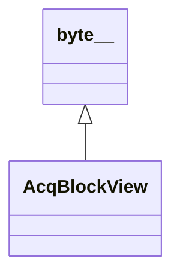

# AcqBlockView

**Namespace:** `ACQLIB` &nbsp;·&nbsp; **Library:** Acquisition Library &nbsp;·&nbsp; **Source:** [`acq/acq_block_view.h`](https://github.com/mne-tools/mne-cpp/blob/staging/src/libraries/acq/acq_block_view.h)

`#include <acq/acq_block_view.h>`

```cpp
class ACQLIB::AcqBlockView
```

Read view returned by `AcqReader::acquire()`.

```cpp title="src/examples/ex_acq_performance/main.cpp"
std::uint64_t s = view->firstSample();
std::uint64_t mismatches = 0;
for (std::size_t p = 0; p < view->partCount(); ++p) {
    const AcqBlockPart& part = view->part(p);
    for (std::size_t i = 0; i < part.samples; ++i, ++s) {
        const auto* frame = reinterpret_cast<const std::int16_t*>(part.at(0, i));
        for (std::size_t c = 0; c < kChannels; ++c) {
            mismatches += frame[c] != gen.value(s, c) ? 1U : 0U;
        }
    }
}
for (std::size_t e = 0; e < view->events().size(); ++e) {
    const AcqEvent& marker = view->events()[e];
    const bool ok = SignalGenerator::isSpikeStart(marker.sample) && marker.duration == kSpikeWidth;
    (ok ? st.markersVerified : st.markerMismatches).fetch_add(1, std::memory_order_relaxed);
}
```

### Inheritance



---

## Public Methods

### empty()

**Returns:**

- *bool* — true when the view holds no samples, events or segments.

---

### lost()

**Returns:**

- *std::uint64_t* — Samples lost to overrun between the previous view of this reader and this one.

---

### skipped()

**Returns:**

- *std::uint64_t* — Samples skipped on purpose by a Latest reader before this view (not a loss).

---

### events()

**Returns:**

- *const [AcqSpanPair](/docs/api/acq/acq-span-pair)&lt; const [AcqEvent](/docs/api/acq/acq-event) &gt; &* — Events with sample index in [`firstSample()`, `firstSample()` + `sampleCount()`).

---

### segments()

**Returns:**

- *const [AcqSpanPair](/docs/api/acq/acq-span-pair)&lt; const [AcqSegmentHeader](/docs/api/acq/acq-segment-header) &gt; &* — Headers of the segments that start inside this view.

---

### segmentPayload(i)

**Parameters:**

- **i** : *std::size_t*
  Segment index.

**Returns:**

- *std::span&lt; const std::byte &gt;* — The device-specific header payload of the segment.

---

## Example

- Start here: [ex_acq_performance](../../examples/acq/ex_acq_performance.mdx) — Closed-loop acquisition and stimulation with ACQLIB, and its sustained throughput per device class.
- Full source: [`src/examples/ex_acq_performance/main.cpp`](https://github.com/mne-tools/mne-cpp/tree/staging/src/examples/ex_acq_performance/main.cpp)
- Build target: `ex_acq_performance` (runs under CTest)

## Used in examples

### [ex_acq_oddball](../../examples/acq/ex_acq_oddball.mdx)

Recover the P300 from a streaming oddball session by trigger-locked averaging.

````cpp title="src/examples/ex_acq_oddball/main.cpp, line 297"
// Native samples to volts in one pass, whatever the device's format and layout.
const AcqBlockView& samples = **view;
const std::size_t n = samples.sampleCount();
if (const AcqError error = decode(samples, AcqMatrixRef<float>::columnMajor(block.data(), frame, n));
    !error.ok()) {
    std::fprintf(stderr, "Cannot decode %s: %s\n", uri.c_str(), error.text().c_str());
    break; // the lease returns the view
}
std::uint64_t s = samples.firstSample();
for (std::size_t i = 0; i < n; ++i, ++s) {
    std::memcpy(&history[(s & (capacity - 1)) * frame], &block[i * frame], frame * sizeof(float));
}
for (std::size_t e = 0; e < samples.events().size(); ++e) {
    const AcqEvent& event = samples.events()[e];
````

## Authors of this file

- Christoph Dinh &lt;christoph.dinh@mne-cpp.org&gt;
