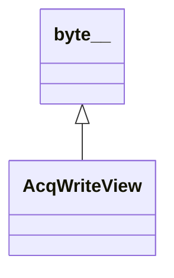

# AcqWriteView

**Namespace:** `ACQLIB` &nbsp;·&nbsp; **Library:** Acquisition Library &nbsp;·&nbsp; **Source:** [`acq/acq_block_view.h`](https://github.com/mne-tools/mne-cpp/blob/staging/src/libraries/acq/acq_block_view.h)

`#include <acq/acq_block_view.h>`

```cpp
class ACQLIB::AcqWriteView
```

Write view returned by `AcqWriter::beginWrite()`: reserved ring space for the next samples.

```cpp title="src/examples/ex_acq_performance/main.cpp"
auto view = input.beginWrite(kBlock);
std::uint64_t s = view->firstSample();
for (std::size_t p = 0; p < view->partCount(); ++p) {
    const AcqWritePart& part = view->part(p);
    for (std::size_t i = 0; i < part.samples; ++i, ++s) {
        auto* frame = reinterpret_cast<std::int16_t*>(part.at(0, i));
        for (std::size_t c = 0; c < kChannels; ++c) {
            frame[c] = gen.value(s, c);
        }
        if (SignalGenerator::isSpikeStart(s)) {
            AcqEvent marker;
            marker.sample = s;
            marker.duration = kSpikeWidth;
            marker.code = 1;
            input.pushEvent(marker);
            st.spikesInjected.fetch_add(1, std::memory_order_relaxed);
        }
    }
}
st.commitNs[k % kCommitSlots].store(nowNs(), std::memory_order_relaxed);
input.commit(kBlock);
```

### Inheritance



---

## Public Methods

### underrun()

**Returns:**

- *std::uint64_t* — Output streams: samples the device emitted as `AcqUnderrunFill` since the previous beginWrite() because they were not committed in time. `firstSample()` already accounts for them. Always 0 for input streams.

---

## Example

- Start here: [ex_acq_performance](../../examples/acq/ex_acq_performance.mdx) — Closed-loop acquisition and stimulation with ACQLIB, and its sustained throughput per device class.
- Full source: [`src/examples/ex_acq_performance/main.cpp`](https://github.com/mne-tools/mne-cpp/tree/staging/src/examples/ex_acq_performance/main.cpp)
- Build target: `ex_acq_performance` (runs under CTest)

## Authors of this file

- Christoph Dinh &lt;christoph.dinh@mne-cpp.org&gt;
