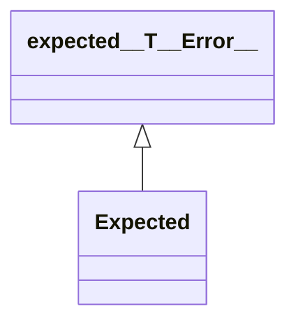

# Expected

**Namespace:** `BASELIB` &nbsp;·&nbsp; **Library:** Base Library &nbsp;·&nbsp; **Source:** [`base/error.h`](https://github.com/mne-tools/mne-cpp/blob/staging/src/libraries/base/error.h)

`#include <base/error.h>`

```cpp
template <class T>
class BASELIB::Expected
```

A value or the [`Error`](/docs/api/base/error) why there is none; std::expected whose `value()` throws that [`Error`](/docs/api/base/error).

```cpp title="src/examples/ex_fiff_api/main.cpp"
if (auto mriToDevice = FiffCoordTrans::read(trans, FIFFV_COORD_MRI, FIFFV_COORD_DEVICE)) {
    ok = false; // all-trans.fif holds no MRI -> device transform
} else {
    std::println("  ok   {}", mriToDevice.error().what()); // No MRI (surface RAS) -> MEG device coordinate transform in ...
}
```

### Inheritance



---

## Public Methods

### Expected(other)

---

### value()

**Returns:**

- *decltype(auto)* — The value; throws the [`Error`](/docs/api/base/error), rather than std::bad_expected_access, if there is none.

---

### value()

**Returns:**

- *decltype(auto)* — The value; throws the [`Error`](/docs/api/base/error), rather than std::bad_expected_access, if there is none.

---

### value()

**Returns:**

- *decltype(auto)* — The value; throws the [`Error`](/docs/api/base/error), rather than std::bad_expected_access, if there is none.

---

## Example

- Start here: [ex_fiff_api](../../examples/fiff/ex_fiff_api.mdx) — FIFF library: measurement info, channels, digitizer, transforms, projectors, covariance, events, annotations, evoked sets and the low-level file structure.
- Full source: [`src/examples/ex_fiff_api/main.cpp`](https://github.com/mne-tools/mne-cpp/tree/staging/src/examples/ex_fiff_api/main.cpp)
- Build target: `ex_fiff_api` (runs under CTest)

## Authors of this file

- Christoph Dinh &lt;christoph.dinh@mne-cpp.org&gt;
