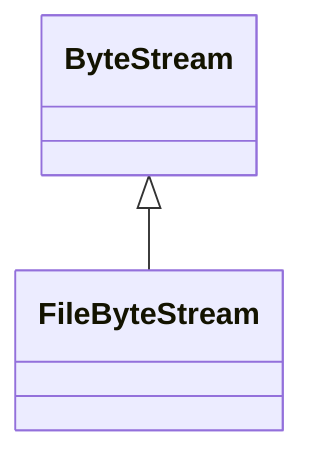

# FileByteStream

**Namespace:** `BASELIB` &nbsp;·&nbsp; **Library:** Base Library &nbsp;·&nbsp; **Source:** [`base/byte_stream.h`](https://github.com/mne-tools/mne-cpp/blob/staging/src/libraries/base/byte_stream.h)

`#include <base/byte_stream.h>`

```cpp
class BASELIB::FileByteStream
```

A buffered byte stream over a file, with 64-bit positions.

```cpp title="src/examples/ex_base/main.cpp"
const std::vector<float> samples = {1.5f, -0.25f};
{
    auto out = FileByteStream::open(dir / "data.bin", FileByteStream::Mode::Write);
    out->writeBigEndian(std::int32_t(samples.size())); // FIFF byte order
    out->writeBigEndian(samples.data(), samples.size());
}
auto in = FileByteStream::open(dir / "data.bin", FileByteStream::Mode::Read);
std::int32_t count = 0;
in->readBigEndian(count);
std::vector<float> back(static_cast<std::size_t>(count));
in->readBigEndian(back.data(), back.size());
```

### Inheritance



---

## Public Methods

### ~FileByteStream()

---

### FileByteStream()

---

### operator=()

---

### read(data, bytes)

Reads up to `bytes` bytes at the current position and advances past them.

**Parameters:**

- **data** : *void **
  Destination of at least `bytes` bytes.

- **bytes** : *std::size_t*
  Number of bytes wanted.

**Returns:**

- *std::size_t* — The number of bytes read; fewer than `bytes` at the end of the stream.

---

### write(data, bytes)

Writes `bytes` bytes at the current position, overwriting or extending the stream.

**Parameters:**

- **data** : *const void **
  Source of `bytes` bytes.

- **bytes** : *std::size_t*
  Number of bytes.

**Returns:**

- *std::size_t* — The number of bytes written; fewer than `bytes` if the stream cannot be written.

---

### seek(position)

**Parameters:**

- **position** : *std::uint64_t*
  New position, at most `size()`.

**Returns:**

- *bool* — Whether the position changed; it stays put on failure.

---

### pos()

**Returns:**

- *std::uint64_t* — The current position.

---

### size()

**Returns:**

- *std::uint64_t* — The number of bytes in the stream.

---

### close()

Releases the underlying resource; later reads, writes and seeks fail.

---

### isOpen()

**Returns:**

- *bool* — Whether the stream has not been closed.

---

### reopen()

Opens a closed stream again at position 0, keeping its contents.

**Returns:**

- *bool* — Whether the stream is open.

---

### flush()

**Returns:**

- *bool* — Whether everything written has reached the operating system.

---

### resize(size)

Cuts the file to, or extends it with zeros to, `size` bytes; the position moves back to the new end if it was past it.

**Parameters:**

- **size** : *std::uint64_t*
  New length in bytes.

**Returns:**

- *bool* — Whether the file has the new length; never for a read-only stream.

---

## Static Methods

### open(path, mode)

**Parameters:**

- **path** : *const std::filesystem::path &*
  The file.

- **mode** : *Mode*
  How to open it.

**Returns:**

- *std::unique_ptr&lt; FileByteStream &gt;* — The stream, positioned at 0, or nullptr if the file cannot be opened.

---

## Example

- Start here: [ex_base](../../examples/base/ex_base.mdx) — Base library: logging, byte streams, string and path helpers, the thread pool and the circular buffer.
- Full source: [`src/examples/ex_base/main.cpp`](https://github.com/mne-tools/mne-cpp/tree/staging/src/examples/ex_base/main.cpp)
- Build target: `ex_base` (runs under CTest)

## Used in examples

### [ex_base](../../examples/base/ex_base.mdx)

Base library: logging, byte streams, string and path helpers, the thread pool and the circular buffer.

````cpp title="src/examples/ex_base/main.cpp, line 97"
    auto out = FileByteStream::open(dir / "data.bin", FileByteStream::Mode::Write);
    out->writeBigEndian(std::int32_t(samples.size())); // FIFF byte order
    out->writeBigEndian(samples.data(), samples.size());
}
auto in = FileByteStream::open(dir / "data.bin", FileByteStream::Mode::Read);
std::int32_t count = 0;
in->readBigEndian(count);
std::vector<float> back(static_cast<std::size_t>(count));
in->readBigEndian(back.data(), back.size());
ok &= expect(back == samples && in->atEnd(), "FileByteStream read back the big-endian samples");
````

## Authors of this file

- Christoph Dinh &lt;christoph.dinh@mne-cpp.org&gt;
