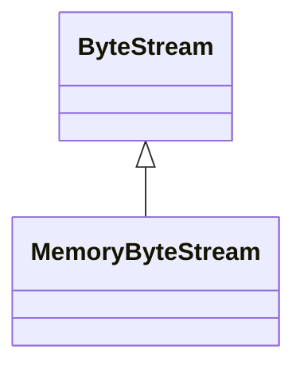

# MemoryByteStream

**Namespace:** `BASELIB` &nbsp;·&nbsp; **Library:** Base Library &nbsp;·&nbsp; **Source:** [`base/byte_stream.h`](https://github.com/mne-tools/mne-cpp/blob/staging/src/libraries/base/byte_stream.h)

`#include <base/byte_stream.h>`

```cpp
class BASELIB::MemoryByteStream
```

A byte stream over a growable buffer in memory.

```cpp title="src/examples/ex_base/main.cpp"
MemoryByteStream memory;
memory.writeBigEndian(std::int16_t{0x0102});
const bool bigEndian = memory.data()[0] == std::byte{0x01}; // most significant byte first
```

### Inheritance



---

## Public Methods

### MemoryByteStream(data)

**Parameters:**

- **data** : *std::vector&lt; std::byte &gt;*
  Initial contents; the position starts at 0.

---

### read(data, bytes)

Reads up to `bytes` bytes at the current position and advances past them.

**Parameters:**

- **data** : *void **
  Destination of at least `bytes` bytes.

- **bytes** : *std::size_t*
  Number of bytes wanted.

**Returns:**

- *std::size_t* — The number of bytes read; fewer than `bytes` at the end of the stream.

---

### write(data, bytes)

Writes `bytes` bytes at the current position, overwriting or extending the stream.

**Parameters:**

- **data** : *const void **
  Source of `bytes` bytes.

- **bytes** : *std::size_t*
  Number of bytes.

**Returns:**

- *std::size_t* — The number of bytes written; fewer than `bytes` if the stream cannot be written.

---

### seek(position)

**Parameters:**

- **position** : *std::uint64_t*
  New position, at most `size()`.

**Returns:**

- *bool* — Whether the position changed; it stays put on failure.

---

### pos()

**Returns:**

- *std::uint64_t* — The current position.

---

### size()

**Returns:**

- *std::uint64_t* — The number of bytes in the stream.

---

### data()

**Returns:**

- *const std::vector&lt; std::byte &gt; &* — The contents.

---

## Example

- Start here: [ex_base](../../examples/base/ex_base.mdx) — Base library: logging, byte streams, string and path helpers, the thread pool and the circular buffer.
- Full source: [`src/examples/ex_base/main.cpp`](https://github.com/mne-tools/mne-cpp/tree/staging/src/examples/ex_base/main.cpp)
- Build target: `ex_base` (runs under CTest)

## Used in examples

### [ex_base](../../examples/base/ex_base.mdx)

Base library: logging, byte streams, string and path helpers, the thread pool and the circular buffer.

````cpp title="src/examples/ex_base/main.cpp, line 110"
MemoryByteStream memory;
memory.writeBigEndian(std::int16_t{0x0102});
const bool bigEndian = memory.data()[0] == std::byte{0x01}; // most significant byte first
ok &= expect(bigEndian && memory.size() == 2, "MemoryByteStream stores values most significant byte first");
````

## Authors of this file

- Christoph Dinh &lt;christoph.dinh@mne-cpp.org&gt;
