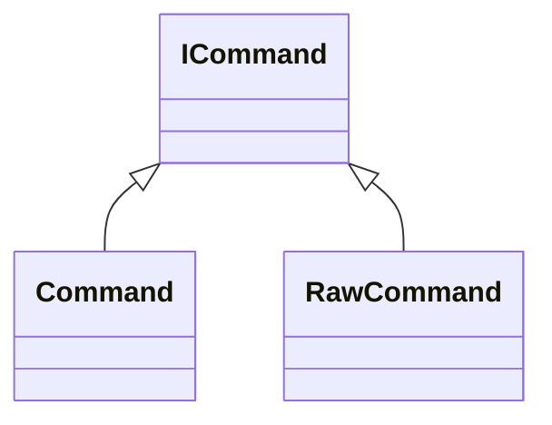

# ICommand

**Namespace:** `COMLIB` &nbsp;·&nbsp; **Library:** Communication Library &nbsp;·&nbsp; **Source:** [`com/rt_command/command_pattern.h`](https://github.com/mne-tools/mne-cpp/blob/staging/src/libraries/com/rt_command/command_pattern.h)

`#include <com/command_pattern.h>`

```cpp
class COMLIB::ICommand
```

Base of every command: an action that can be queued and executed later.

```cpp title="src/examples/ex_com/main.cpp"
// A command wraps an action so it can be queued or replayed later
class AppendCommand : public ICommand
{
public:
    AppendCommand(std::vector<std::string>& target, std::string text)
    : m_target(target)
    , m_text(std::move(text))
    {
    }
    void execute() override
    {
        m_target.push_back(m_text);
    }

private:
    std::vector<std::string>& m_target;
    std::string m_text;
};
```

### Inheritance



---

## Public Methods

### ~ICommand()

---

### execute()

Performs the action.

---

## Example

- Start here: [ex_com](../../examples/com/ex_com.mdx) — Communication library: the observer and command patterns behind the real-time command dispatch.
- Full source: [`src/examples/ex_com/main.cpp`](https://github.com/mne-tools/mne-cpp/tree/staging/src/examples/ex_com/main.cpp)
- Build target: `ex_com` (runs under CTest)

## Used in examples

### [ex_com](../../examples/com/ex_com.mdx)

Communication library: the observer and command patterns behind the real-time command dispatch.

````cpp title="src/examples/ex_com/main.cpp, line 99"
// A command wraps an action so it can be queued or replayed later
class AppendCommand : public ICommand
{
public:
    AppendCommand(std::vector<std::string>& target, std::string text)
    : m_target(target)
    , m_text(std::move(text))
    {
    }
    void execute() override
    {
        m_target.push_back(m_text);
    }
````

## Authors of this file

- Christoph Dinh &lt;christoph.dinh@mne-cpp.org&gt;
- Lorenz Esch &lt;lorenz.esch@tu-ilmenau.de&gt;
- Gabriel Motta &lt;gabrielbenmotta@gmail.com&gt;
