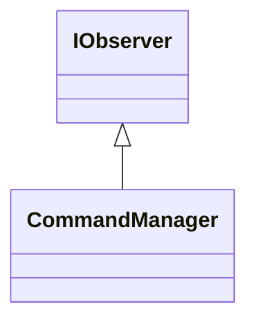

# IObserver

**Namespace:** `COMLIB` &nbsp;·&nbsp; **Library:** Communication Library &nbsp;·&nbsp; **Source:** [`com/rt_command/observer_pattern.h`](https://github.com/mne-tools/mne-cpp/blob/staging/src/libraries/com/rt_command/observer_pattern.h)

`#include <com/observer_pattern.h>`

```cpp
class COMLIB::IObserver
```

Receives the notifications of the subjects it is attached to.

```cpp title="src/examples/ex_com/main.cpp"
// A subject notifies every attached observer; observers pull the state they need
class Counter : public Subject
{
public:
    void increment()
    {
        ++m_value;
        notify();
    }
    int value() const
    {
        return m_value;
    }

private:
    int m_value = 0;
};

class LastSeen : public IObserver
{
public:
    void update(Subject* subject) override
    {
        m_seen = static_cast<Counter*>(subject)->value();
    }
    int seen() const
    {
        return m_seen;
    }

private:
    int m_seen = -1;
};
```

### Inheritance



---

## Public Methods

### ~IObserver()

---

### update(subject)

Called by `Subject::notify`.

**Parameters:**

- **subject** : *[Subject](/docs/api/com/subject) **
  The notifying subject; observers read the state they need from it.

---

## Example

- Start here: [ex_com](../../examples/com/ex_com.mdx) — Communication library: the observer and command patterns behind the real-time command dispatch.
- Full source: [`src/examples/ex_com/main.cpp`](https://github.com/mne-tools/mne-cpp/tree/staging/src/examples/ex_com/main.cpp)
- Build target: `ex_com` (runs under CTest)

## Used in examples

### [ex_com](../../examples/com/ex_com.mdx)

Communication library: the observer and command patterns behind the real-time command dispatch.

````cpp title="src/examples/ex_com/main.cpp, line 81"
class LastSeen : public IObserver
{
public:
    void update(Subject* subject) override
    {
        m_seen = static_cast<Counter*>(subject)->value();
    }
    int seen() const
    {
        return m_seen;
    }
````

## Authors of this file

- Christoph Dinh &lt;christoph.dinh@mne-cpp.org&gt;
- Lorenz Esch &lt;lorenz.esch@tu-ilmenau.de&gt;
- Juan GPC &lt;jgarciaprieto@mgh.harvard.edu&gt;
- Gabriel Motta &lt;gabrielbenmotta@gmail.com&gt;
