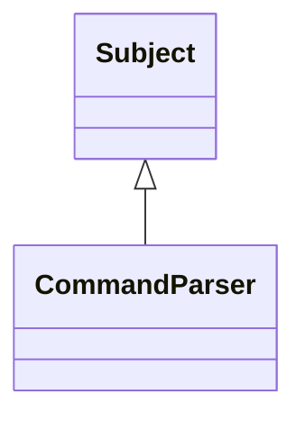

# Subject

**Namespace:** `COMLIB` &nbsp;·&nbsp; **Library:** Communication Library &nbsp;·&nbsp; **Source:** [`com/rt_command/observer_pattern.h`](https://github.com/mne-tools/mne-cpp/blob/staging/src/libraries/com/rt_command/observer_pattern.h)

`#include <com/observer_pattern.h>`

```cpp
class COMLIB::Subject
```

Notifies its attached observers, in the order they were attached.

The subject does not own its observers; detach an observer before it is destroyed.

```cpp title="src/examples/ex_com/main.cpp"
// A subject notifies every attached observer; observers pull the state they need
class Counter : public Subject
{
public:
    void increment()
    {
        ++m_value;
        notify();
    }
    int value() const
    {
        return m_value;
    }

private:
    int m_value = 0;
};

class LastSeen : public IObserver
{
public:
    void update(Subject* subject) override
    {
        m_seen = static_cast<Counter*>(subject)->value();
    }
    int seen() const
    {
        return m_seen;
    }

private:
    int m_seen = -1;
};
```

### Inheritance



---

## Public Methods

### ~Subject()

---

### attach(observer)

Attaches an observer.

Attaching an observer twice or attaching a null pointer has no effect.

**Parameters:**

- **observer** : *[IObserver](/docs/api/com/i-observer) **
  Observer to notify from now on.

---

### detach(observer)

Detaches an observer.

Detaching an observer that is not attached has no effect.

**Parameters:**

- **observer** : *[IObserver](/docs/api/com/i-observer) **
  Observer to stop notifying.

---

### notify()

Calls `IObserver::update` of every attached observer, unless notifications are disabled.

Observers may attach or detach observers while they are notified; the change applies from the next notification on.

---

### set_notify_enabled(enabled)

Suspends or resumes notifications, e.g.

while a batch of changes is applied.

**Parameters:**

- **enabled** : *bool*
  False makes `notify` a no-op until notifications are enabled again.

---

### notify_enabled()

**Returns:**

- *bool* — True if `notify` reaches the observers.

---

### observers()

**Returns:**

- *const std::vector&lt; [IObserver](/docs/api/com/i-observer) * &gt; &* — The attached observers, in the order they were attached.

---

## Example

- Start here: [ex_com](../../examples/com/ex_com.mdx) — Communication library: the observer and command patterns behind the real-time command dispatch.
- Full source: [`src/examples/ex_com/main.cpp`](https://github.com/mne-tools/mne-cpp/tree/staging/src/examples/ex_com/main.cpp)
- Build target: `ex_com` (runs under CTest)

## Used in examples

### [ex_com](../../examples/com/ex_com.mdx)

Communication library: the observer and command patterns behind the real-time command dispatch.

````cpp title="src/examples/ex_com/main.cpp, line 63"
// A subject notifies every attached observer; observers pull the state they need
class Counter : public Subject
{
public:
    void increment()
    {
        ++m_value;
        notify();
    }
    int value() const
    {
        return m_value;
    }
````

## Authors of this file

- Christoph Dinh &lt;christoph.dinh@mne-cpp.org&gt;
- Lorenz Esch &lt;lorenz.esch@tu-ilmenau.de&gt;
- Juan GPC &lt;jgarciaprieto@mgh.harvard.edu&gt;
- Gabriel Motta &lt;gabrielbenmotta@gmail.com&gt;
