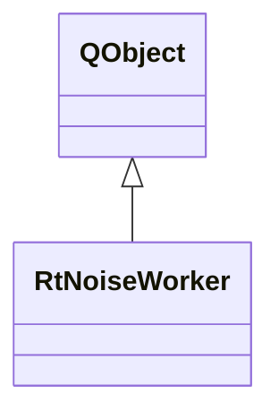

# RtNoiseWorker

**Namespace:** `RTPROCESSINGLIB` &nbsp;·&nbsp; **Library:** DSP Library &nbsp;·&nbsp; **Source:** [`dsp/rt/rt_noise.h`](https://github.com/mne-tools/mne-cpp/blob/staging/src/libraries/dsp/rt/rt_noise.h)

`#include <dsp/rt_noise.h>`

```cpp
class RTPROCESSINGLIB::RtNoiseWorker
```

Background worker that computes a noise power spectral density estimate from accumulated data blocks.

```cpp title="src/examples/ex_dsp_rt/main.cpp"
RtNoiseWorker noiseWorker(64, info200, 10); // 64-point FFT over 10 accumulated blocks
MatrixXd spectrum;
QObject::connect(&noiseWorker, &RtNoiseWorker::resultReady, [&](const MatrixXd& psd) { spectrum = psd; });
for (int b = 0; b < 10; ++b) {
    noiseWorker.doWork(tones.middleCols(64 * b, 64)); // dB re unit^2/Hz, channels x (fft/2 + 1)
}
```

### Inheritance



---

## Public Methods

### RtNoiseWorker(iFftLength, pFiffInfo, iDataLength)

Creates the worker.

**Parameters:**

- **iFftLength** : *qint32*
  FFT length (number of samples per window).

- **pFiffInfo** : *const std::shared_ptr&lt; [FiffInfo](/docs/api/fiff/fiff-info) &gt; &*
  Associated Fiff Information.

- **iDataLength** : *qint32*
  Number of blocks to accumulate before computing the spectrum.

---

### doWork(matData)

Process one data block, accumulate, and emit the spectrum when enough blocks are collected.

**Parameters:**

- **matData** : *const Eigen::MatrixXd &*
  The incoming data block (channels x samples).

---

## Example

- Start here: [ex_dsp_rt](../../examples/dsp/ex_dsp_rt.mdx) — DSP real-time workers: averaging, covariance, noise spectrum, connectivity, HPI fitting and inverse operators.
- Full source: [`src/examples/ex_dsp_rt/main.cpp`](https://github.com/mne-tools/mne-cpp/tree/staging/src/examples/ex_dsp_rt/main.cpp)
- Build target: `ex_dsp_rt` (runs under CTest)
- Data: [mne-cpp-test-data](https://github.com/mne-tools/mne-cpp-test-data)

## Used in examples

### [ex_dsp_rt](../../examples/dsp/ex_dsp_rt.mdx)

DSP real-time workers: averaging, covariance, noise spectrum, connectivity, HPI fitting and inverse operators.

````cpp title="src/examples/ex_dsp_rt/main.cpp, line 221"
RtNoiseWorker noiseWorker(64, info200, 10); // 64-point FFT over 10 accumulated blocks
MatrixXd spectrum;
QObject::connect(&noiseWorker, &RtNoiseWorker::resultReady, [&](const MatrixXd& psd) { spectrum = psd; });
for (int b = 0; b < 10; ++b) {
    noiseWorker.doWork(tones.middleCols(64 * b, 64)); // dB re unit^2/Hz, channels x (fft/2 + 1)
}
// scipy.signal.welch(x, 200, window=hann(66)[1:-1], nperseg=64, noverlap=0, detrend=False): 25 Hz -9.6521 dB, 50 Hz -29.6587 dB
ok &= expect(spectrum.cols() == 33 && std::fabs(spectrum(0, 8) + 9.652129129685868) < 1e-6 && std::fabs(spectrum(0, 16) + 29.658719433796943) < 1e-6,
             std::format("RtNoiseWorker: 25 Hz at {:.4f} dB, 50 Hz at {:.4f} dB match scipy.signal.welch", spectrum(0, 8), spectrum(0, 16)));
````

## Authors of this file

- Christoph Dinh &lt;christoph.dinh@mne-cpp.org&gt;
