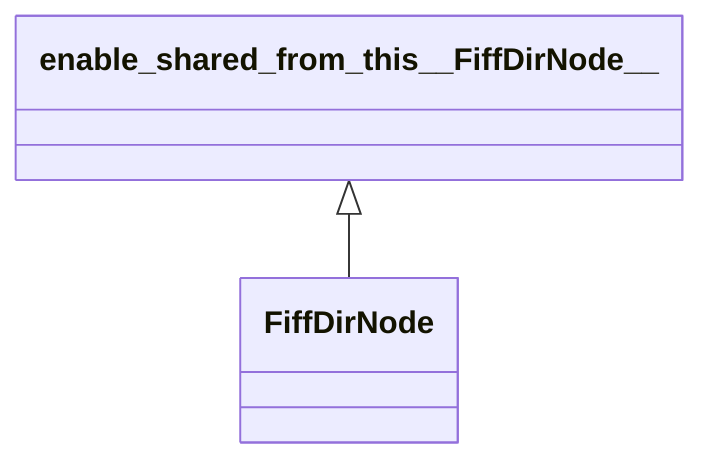

# FiffDirNode

**Namespace:** `FIFFLIB` &nbsp;·&nbsp; **Library:** FIFF Library &nbsp;·&nbsp; **Source:** [`fiff/fiff_dir_node.h`](https://github.com/mne-tools/mne-cpp/blob/staging/src/libraries/fiff/fiff_dir_node.h)

`#include <fiff/fiff_dir_node.h>`

```cpp
class FIFFLIB::FiffDirNode
```

Recursive FIFF block-tree node: block kind, block ID, directly contained directory entries and child sub-blocks.

Each node corresponds to one `FIFFB_BLOCK_START` ... `FIFFB_BLOCK_END` pair in the on-disk tag stream. The full tree is built once by `FiffStream::make_dir_tree` after the directory tag is parsed, and is then traversed by every higher-level reader ([`FiffInfo`](/docs/api/fiff/fiff-info), [`FiffRawData`](/docs/api/fiff/fiff-raw-data), [`FiffEvoked`](/docs/api/fiff/fiff-evoked), [`FiffCov`](/docs/api/fiff/fiff-cov), ...) via `dir_tree_find`. The static `copy_tree` helper streams an entire sub-tree from one [`FiffStream`](/docs/api/fiff/fiff-stream) to another preserving block IDs, which is how MNE-CPP writes derived files that keep provenance back to the source recording.

```cpp title="src/examples/ex_fiff_api/main.cpp"
FiffStream stream(QString(dir + "/sample_audvis-ave.fif").toStdU16String());
const bool opened = stream.open();
const std::vector<std::shared_ptr<FiffDirNode>> measNodes = stream.dirtree()->dir_tree_find(FIFFB_MEAS_INFO);
const std::optional<FiffTag> nchan = measNodes.front()->find_tag(stream, FIFF_NCHAN); // raw tag access
const FiffId fileId = stream.id();
stream.close();
```

```cpp title="src/examples/ex_fiff_api/main.cpp"
// The block tree of a transform file, as MNE-C fiff_dir_tree prints it, with the names of tags and units
FiffStream transStream(QString(dir + "/all-trans.fif").toStdU16String());
transStream.open();
QString tree;
QTextStream treeOut(&tree);
transStream.dirtree()->print(treeOut);
transStream.close();
const std::string transformTag = FiffExplain::tag(FIFF_COORD_TRANS);                                              // "transform"
const std::string gradiometerUnit = FiffExplain::unitMultiplier(FIFF_UNITM_F) + FiffExplain::unit(FIFF_UNIT_T_M); // "fT/m"
```

### Inheritance



---

## Public Methods

### FiffDirNode()

Constructors the directory tree structure.

---

### ~FiffDirNode()

Destroys the fiffDirTree.

---

### empty()

Returns true if directory tree structure contains no data.

**Returns:**

- *bool* — true if directory tree structure is empty.

---

### dir_tree_find(p_kind)

Finds the blocks of a kind in this block and its sub-blocks, in file order.

**Parameters:**

- **p_kind** : *fiff_int_t*
  the given kind.

**Returns:**

- *std::vector&lt; std::shared_ptr&lt; [FiffDirNode](/docs/api/fiff/fiff-dir-node) &gt; &gt;* — The blocks of the tree itself, not copies.

---

### find_tag(stream, findkind)

Reads the first tag of a kind among the tags of this block.

**Parameters:**

- **stream** : *[FiffStream](/docs/api/fiff/fiff-stream) &*
  The file the block belongs to.

- **findkind** : *fiff_int_t*
  The tag kind.

**Returns:**

- *std::optional&lt; [FiffTag](/docs/api/fiff/fiff-tag) &gt;* — The tag, or nothing if the block holds none of that kind.

---

### has_tag(findkind)

Definition of the has_tag function in fiff_read_named_matrix.m.

**Parameters:**

- **findkind** : *fiff_int_t*
  kind to find.

**Returns:**

- *bool* — true when fiff_dir_node contains kind.

---

### has_kind(p_kind)

Checks whether a [`FiffDirNode`](/docs/api/fiff/fiff-dir-node) has a specific kind.

**Parameters:**

- **p_kind** : *fiff_int_t*
  kind to find.

**Returns:**

- *bool* — true when fiff_dir_node contains kind.

---

### print(out, indent)

Prints this block and its sub-blocks like MNE-C's fiff_dir_tree: one line per block with its id, one line per run of equal tag kinds with the run length in brackets, sub-blocks indented by five.

**Parameters:**

- **out** : *QTextStream &*
  Stream to print to.

- **indent** : *int*
  Indentation of this block.

---

### nent()

Returns the number of entries in this node.

**Returns:**

- *fiff_int_t* — Number of entries in this node.

---

### nchild()

Returns the number of child nodes.

**Returns:**

- *fiff_int_t* — Number of child nodes.

---

## Static Methods

### copy_tree(source, in_id, p_Nodes, target)

Copies directory subtrees from fidin to fidout.

**Parameters:**

- **source** : *[FiffStream](/docs/api/fiff/fiff-stream) &*
  fiff file to copy from.

- **in_id** : *const [FiffId](/docs/api/fiff/fiff-id) &*
  file id description.

- **p_Nodes** : *std::span&lt; const std::shared_ptr&lt; [FiffDirNode](/docs/api/fiff/fiff-dir-node) &gt; &gt;*
  subtree directories to be copied.

- **target** : *[FiffStream](/docs/api/fiff/fiff-stream) &*
  fiff file to write to.

**Returns:**

- *bool* — true if succeeded, false otherwise.

---

## Example

- Start here: [ex_fiff_api](../../examples/fiff/ex_fiff_api.mdx) — FIFF library: measurement info, channels, digitizer, transforms, projectors, covariance, events, annotations, evoked sets and the low-level file structure.
- Full source: [`src/examples/ex_fiff_api/main.cpp`](https://github.com/mne-tools/mne-cpp/tree/staging/src/examples/ex_fiff_api/main.cpp)
- Build target: `ex_fiff_api` (runs under CTest)
- Data: [mne-cpp-test-data](https://github.com/mne-tools/mne-cpp-test-data)

## Used in examples

### [ex_fiff_api](../../examples/fiff/ex_fiff_api.mdx)

FIFF library: measurement info, channels, digitizer, transforms, projectors, covariance, events, annotations, evoked sets and the low-level file structure.

````cpp title="src/examples/ex_fiff_api/main.cpp, line 226"
FiffStream stream(QString(dir + "/sample_audvis-ave.fif").toStdU16String());
const bool opened = stream.open();
const std::vector<std::shared_ptr<FiffDirNode>> measNodes = stream.dirtree()->dir_tree_find(FIFFB_MEAS_INFO);
const std::optional<FiffTag> nchan = measNodes.front()->find_tag(stream, FIFF_NCHAN); // raw tag access
const FiffId fileId = stream.id();
stream.close();
ok &= expect(opened && measNodes.size() == 1 && nchan && *nchan->toInt() == 376 && !fileId.empty() && fileId.version > 0,
             "FiffStream/FiffDirNode/FiffTag/FiffId: the FIFF_NCHAN tag of the measurement block reads 376");
````

### [ex_fiff_sniffer](../../examples/fiff/ex_fiff_sniffer.mdx)

Read a FIFF file from a memory buffer with a chosen byte order and summarise its contents.

````cpp title="src/examples/ex_fiff_sniffer/main.cpp, line 109"
FIFFLIB::FiffInfo FifInfo;
std::shared_ptr<FIFFLIB::FiffDirNode> DirNode;
````

## Authors of this file

- Christoph Dinh &lt;christoph.dinh@mne-cpp.org&gt;
- Lorenz Esch &lt;lorenz.esch@tu-ilmenau.de&gt;
- Juan GPC &lt;jgarciaprieto@mgh.harvard.edu&gt;
- Andreas Griesshammer &lt;ag@fieldlineinc.com&gt;
- Gabriel Motta &lt;gabrielbenmotta@gmail.com&gt;
