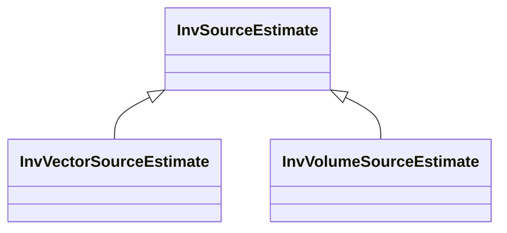

# InvSourceEstimate

**Namespace:** `INVLIB` &nbsp;·&nbsp; **Library:** Inverse Library &nbsp;·&nbsp; **Source:** [`inv/inv_source_estimate.h`](https://github.com/mne-tools/mne-cpp/blob/staging/src/libraries/inv/inv_source_estimate.h)

:::info[Python equivalent]
`mne.SourceEstimate` in MNE-Python.
:::

`#include <inv/inv_source_estimate.h>`

<Connections topics={["minimum-norm"]} context="api" current="InvSourceEstimate" />

```cpp
class INVLIB::InvSourceEstimate
```

Central source-space container produced by every `INVLIB` inverse solver.

Carries the dense (n_sources × n_times) data matrix plus vertex indices, time origin and step, and optional focal dipoles, coupling groups and connectivity layers so one value can represent the output of any algorithm in `INVLIB`. Replaces `mneStcDataRec` of MNE-C and implements round-trip STC / W binary I/O with mne-python and mne-c.

Source-space inverse-solution container with dense grid plus optional focal-dipole, coupling and connectivity layers.

```cpp title="src/examples/ex_inv_api/main.cpp"
FsLabel v1;
FsLabel::read(data + "/subjects/sample/label/lh.V1.label", v1);
QFile fwdFile(data + "/Result/ref-sample_audvis-meg-eeg-oct-6-fwd.fif");
const MNEForwardSolution fwd = MNEForwardSolution(fwdFile).pick_regions({v1}); // 70 sources x 3 orientations
const FiffCov noiseCov((data + "/MEG/sample/sample_audvis-cov.fif").toStdString());
const FiffEvoked evoked((data + "/MEG/sample/sample_audvis-ave.fif").toStdU16String(), 0); // "Left Auditory"

const MNEInverseOperator inverse = MNEInverseOperator::make_inverse_operator(evoked.info, fwd, noiseCov, 0.2f, 0.8f);
const float lambda2 = 1.0f / 9.0f; // SNR 3
InvMinimumNorm dspm(inverse, lambda2, "dSPM");
const InvSourceEstimate stc = dspm.calculateInverse(evoked); // one row per source, combined over orientations
```

```cpp title="src/examples/ex_inv_api/main.cpp"
InvSourceEstimateIO::writeCsv(stc, tmp.filePath("v1-dspm.csv"));
const InvSourceEstimate fromCsv = InvSourceEstimateIO::readCsv(tmp.filePath("v1-dspm.csv"));
const std::filesystem::path stcPath = tmp.filePath("v1-dspm-lh.stc").toStdU16String();
const bool stcWritten = stc.write(stcPath).has_value(); // MNE .stc format, readable by mne.read_source_estimate
const InvSourceEstimate fromStc(stcPath);
```

### Inheritance



---

## Public Methods

### InvSourceEstimate()

Constructs an empty source estimate.

---

### InvSourceEstimate(data, vertices, tmin, tstep)

Constructs a source estimate from its data.

**Parameters:**

- **data** : *Eigen::MatrixXd*
  Source amplitudes (sources x time points).

- **vertices** : *Eigen::VectorXi*
  Source space vertex numbers of the rows of `data`.

- **tmin** : *float*
  Time of the first sample in seconds.

- **tstep** : *float*
  Time between samples in seconds.

---

### InvSourceEstimate(path)

Reads an .stc file like `read()`; throws [`Error`](/docs/api/utils/error) if it cannot.

**Parameters:**

- **path** : *const std::filesystem::path &*
  The .stc file.

---

### write(path)

Writes the estimate as an .stc file, as MNE-C's mne_write_stc_file and mne.SourceEstimate.save do.

**Parameters:**

- **path** : *const std::filesystem::path &*
  The .stc file.

**Returns:**

- *[Expected](/docs/api/utils/expected)&lt; void &gt;* — Nothing, or why the file cannot be written (Io).

---

### write_hemisphere_pair(base)

Writes a surface estimate as the "&lt;base&gt;-lh.stc" and "&lt;base&gt;-rh.stc" pair mne.read_source_estimate expects, splitting at n_vertices_lh.

**Parameters:**

- **base** : *const std::filesystem::path &*
  Path without the "-lh.stc"/"-rh.stc" suffix; a trailing "-lh.stc", "-rh.stc" or ".stc" is dropped.

**Returns:**

- *[Expected](/docs/api/utils/expected)&lt; void &gt;* — Nothing, or why the pair cannot be written: Format if the split point is unknown or the data do not match the vertices, Io if a file cannot be written.

---

### write_w(path)

Writes the first time point as a .w file, as mne.write_w does.

**Parameters:**

- **path** : *const std::filesystem::path &*
  The .w file.

**Returns:**

- *[Expected](/docs/api/utils/expected)&lt; void &gt;* — Nothing, or why the file cannot be written: Format if the estimate is empty, Io otherwise.

---

### clear()

Resets to an empty estimate.

---

### reduce(start, n)

**Parameters:**

- **start** : *int*
  First sample.

- **n** : *int*
  Number of samples.

**Returns:**

- *[InvSourceEstimate](/docs/api/inv/inv-source-estimate)* — The estimate restricted to samples [start, start + n), its tmin moved to the first of them.

---

### is_empty()

**Returns:**

- *bool* — Whether the estimate holds no time axis.

---

### samples()

**Returns:**

- *int* — The number of time samples.

---

### indices_by_label(labels, clustered)

**Parameters:**

- **labels** : *std::span&lt; const [FsLabel](/docs/api/fs/fs-label) &gt;*
  The labels.

- **clustered** : *bool*
  Whether the rows are clustered ROIs (matched by label id) rather than vertices.

**Returns:**

- *Eigen::VectorXi* — The rows of the sources inside the labels, in row order.

---

### has_grid_data()

**Returns:**

- *bool* — Whether the estimate holds grid data (distributed methods or RAP-MUSIC amplitudes).

---

### has_couplings()

**Returns:**

- *bool* — Whether the estimate holds correlated source groups (e.g. RAP-MUSIC pairs).

---

### has_focal_dipoles()

**Returns:**

- *bool* — Whether the estimate holds off-grid focal dipoles.

---

### has_positions()

**Returns:**

- *bool* — Whether the estimate carries explicit source positions (discrete source space).

---

### has_connectivity()

**Returns:**

- *bool* — Whether the estimate holds connectivity results.

---

## Static Methods

### read(path)

Reads an .stc file, as mne.read_source_estimate does for one hemisphere.

**Parameters:**

- **path** : *const std::filesystem::path &*
  The .stc file.

**Returns:**

- *[Expected](/docs/api/utils/expected)&lt; [InvSourceEstimate](/docs/api/inv/inv-source-estimate) &gt;* — The source estimate, or why the file cannot be read: Io if it cannot be opened, Format if it ends before the data its header announces.

---

### read_w(path)

Reads a .w file (one value per vertex), as mne.read_w does.

**Parameters:**

- **path** : *const std::filesystem::path &*
  The .w file.

**Returns:**

- *[Expected](/docs/api/utils/expected)&lt; [InvSourceEstimate](/docs/api/inv/inv-source-estimate) &gt;* — A single-column source estimate, or why the file cannot be read (Io or Format).

---

## Example

- Start here: [ex_inv_api](../../examples/inv/ex_inv_api.mdx) — Inverse library: minimum-norm estimates, resolution matrices, label time courses, sparse solvers and source-estimate I/O.
- Full source: [`src/examples/ex_inv_api/main.cpp`](https://github.com/mne-tools/mne-cpp/tree/staging/src/examples/ex_inv_api/main.cpp)
- Build target: `ex_inv_api` (runs under CTest)
- Data: [mne-cpp-test-data](https://github.com/mne-tools/mne-cpp-test-data)

## Used in examples

### [ex_inv_api](../../examples/inv/ex_inv_api.mdx)

Inverse library: minimum-norm estimates, resolution matrices, label time courses, sparse solvers and source-estimate I/O.

````cpp title="src/examples/ex_inv_api/main.cpp, line 120"
const MNEInverseOperator inverse = MNEInverseOperator::make_inverse_operator(evoked.info, fwd, noiseCov, 0.2f, 0.8f);
const float lambda2 = 1.0f / 9.0f; // SNR 3
InvMinimumNorm dspm(inverse, lambda2, "dSPM");
const InvSourceEstimate stc = dspm.calculateInverse(evoked); // one row per source, combined over orientations
// mne.minimum_norm.apply_inverse(evoked, inv, 1/9, "dSPM"): 70 x 421, sum |stc| = 372483.6, stc[0, 0] = 5.00927
ok &= expect(stc.data.rows() == 70 && stc.data.cols() == 421 && near(stc.data.cwiseAbs().sum(), 372483.6177246599, 1e-4) && near(stc.data(0, 0), 5.0092691144321755, 1e-4) && near(stc.tmin, -0.19979521, 1e-6),
             "InvMinimumNorm/InvSourceEstimate: dSPM on 70 V1 sources matches mne.minimum_norm.apply_inverse");
````

### [ex_clustered_inverse_mne_raw](../../examples/inv/ex_clustered_inverse_mne_raw.mdx)

Average a raw recording and compute an MNE, dSPM or sLORETA estimate with a parcellation-clustered forward solution.

````cpp title="src/examples/ex_clustered_inverse_mne_raw/main.cpp, line 469"
InvSourceEstimate sourceEstimate;
QList<qint64> qVecElapsedTime;
for (qint32 i = 0; i < 100; ++i) {
    //Benchmark time
    QElapsedTimer timer;
    timer.start();
    sourceEstimate = minimumNorm.calculateInverse(evoked.data, evoked.times(0), evoked.times(1) - evoked.times(0));
    qVecElapsedTime.append(timer.elapsed());
}
````

### [ex_clustered_inverse_pwl_rap_music_raw](../../examples/inv/ex_clustered_inverse_pwl_rap_music_raw.mdx)

Average a raw recording and localize dipole pairs with Powell RAP-MUSIC on a parcellation-clustered forward solution.

````cpp title="src/examples/ex_clustered_inverse_pwl_rap_music_raw/main.cpp, line 434"
#ifdef BENCHMARK
    InvSourceEstimate sourceEstimate;
    QList<qint64> qVecElapsedTime;
    for (qint32 i = 0; i < 100; ++i) {
        //Benchmark time
        QElapsedTimer timer;
        timer.start();
        sourceEstimate = t_pwlRapMusic.calculateInverse(pickedEvoked);
        qVecElapsedTime.append(timer.elapsed());
    }
````

Also used in [ex_connectivity](../../examples/connectivity/ex_connectivity.mdx), [ex_connectivity_comparison](../../examples/connectivity/ex_connectivity_comparison.mdx), [ex_make_inverse_operator](../../examples/inv/ex_make_inverse_operator.mdx), [ex_roi_clustered_inverse_pwl_rap_music](../../examples/inv/ex_roi_clustered_inverse_pwl_rap_music.mdx), [ex_st_clustered_inverse_pwl_rap_music](../../examples/inv/ex_st_clustered_inverse_pwl_rap_music.mdx), [ex_clustered_inverse_mne](../../examples/inv/ex_clustered_inverse_mne.mdx), [ex_clustered_inverse_rap_music_raw](../../examples/inv/ex_clustered_inverse_rap_music_raw.mdx), [ex_disp_3D](../../examples/disp3D/ex_disp_3D.mdx), [ex_dsp_analysis](../../examples/dsp/ex_dsp_analysis.mdx), [ex_inverse_cmne](../../examples/inv/ex_inverse_cmne.mdx), [ex_inverse_mne](../../examples/inv/ex_inverse_mne.mdx), [ex_inverse_mne_raw](../../examples/inv/ex_inverse_mne_raw.mdx), [ex_inverse_pwl_rap_music](../../examples/inv/ex_inverse_pwl_rap_music.mdx), [ex_inverse_rap_music](../../examples/inv/ex_inverse_rap_music.mdx), [ex_disp3d_scene](../../examples/disp3D/ex_disp3d_scene.mdx), [ex_histogram](../../examples/inv/ex_histogram.mdx).

## Authors of this file

- Christoph Dinh &lt;christoph.dinh@mne-cpp.org&gt;
