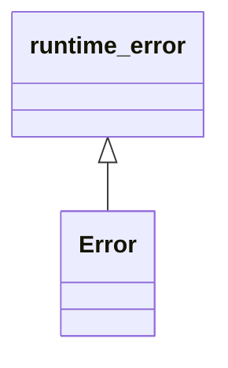

# Error

**Namespace:** `UTILSLIB` &nbsp;·&nbsp; **Library:** Utilities Library &nbsp;·&nbsp; **Source:** [`utils/error.h`](https://github.com/mne-tools/mne-cpp/blob/staging/src/libraries/utils/error.h)

`#include <utils/error.h>`

```cpp
class UTILSLIB::Error
```

Why a reader or writer failed; what() names the cause and the file.

```cpp title="src/examples/ex_fiff_api/main.cpp"
const std::filesystem::path trans = (dir + "/all-trans.fif").toStdU16String();
const FiffCoordTrans headToMri(trans, FIFFV_COORD_HEAD, FIFFV_COORD_MRI); // throws UTILSLIB::Error if it is missing
const FiffCoordTrans devHead = info.dev_head_t;                           // device -> head, from the measurement info
float r[3] = {0.0f, 0.0f, 0.0f};
FiffCoordTrans::apply_trans(r, devHead, true); // the device origin in head coordinates
```

### Inheritance



---

## Public Methods

### Error(code, message)

---

## Example

- Start here: [ex_fiff_api](../../examples/fiff/ex_fiff_api.mdx) — FIFF library: measurement info, channels, digitizer, transforms, projectors, covariance, events, annotations, evoked sets and the low-level file structure.
- Full source: [`src/examples/ex_fiff_api/main.cpp`](https://github.com/mne-tools/mne-cpp/tree/staging/src/examples/ex_fiff_api/main.cpp)
- Build target: `ex_fiff_api` (runs under CTest)

## Used in examples

### [ex_hpiFit](../../examples/inv/ex_hpiFit.mdx)

Fit continuous HPI coils on raw data with SSP and write the head positions for comparison with MaxFilter.

````cpp title="src/examples/ex_hpiFit/main.cpp, line 249"
        qInfo() << "Iteration" << i << "Of" << vecTime.size()
                << " Duration " << fTimer << "ms"
                << " Error" << hpiFitResult.errorDistances[0] * 1000 << hpiFitResult.errorDistances[1] * 1000 << hpiFitResult.errorDistances[2] * 1000 << hpiFitResult.errorDistances[3] * 1000
                << " GoF" << hpiFitResult.GoF[0] << hpiFitResult.GoF[1] << hpiFitResult.GoF[2] << hpiFitResult.GoF[3];
    }
}
qInfo() << "Iterations:" << vecTime.size()
        << "Average GoF:" << matPosition.col(7).mean() * 100 << "%"
        << "Average Error:" << matPosition.col(8).mean() * 1000 << "mm"
        << "Average Duration:" << matPosition.col(9).mean() << "ms";
````

### [ex_clustered_inverse_mne_raw](../../examples/inv/ex_clustered_inverse_mne_raw.mdx)

Average a raw recording and compute an MNE, dSPM or sLORETA estimate with a parcellation-clustered forward solution.

````cpp title="src/examples/ex_clustered_inverse_mne_raw/main.cpp, line 225"
        printf("Error while read events.\n");
        return 0;
    }
    printf("Binary event file %s read\n", t_sEventName.toUtf8().constData());
} else {
    //
    //   Text file
    //
    printf("Text file %s is not supported jet.\n", t_sEventName.toUtf8().constData());
    //            try
    //                events = load(eventname);
    //            catch
    //                error(me,mne_omit_first_line(lasterr));
    //            end
````

### [ex_clustered_inverse_pwl_rap_music_raw](../../examples/inv/ex_clustered_inverse_pwl_rap_music_raw.mdx)

Average a raw recording and localize dipole pairs with Powell RAP-MUSIC on a parcellation-clustered forward solution.

````cpp title="src/examples/ex_clustered_inverse_pwl_rap_music_raw/main.cpp, line 237"
        printf("Error while read events.\n");
        return 0;
    }
    printf("Binary event file %s read\n", t_sEventName.toUtf8().constData());
} else {
    //
    //   Text file
    //
    printf("Text file %s is not supported jet.\n", t_sEventName.toUtf8().constData());
    //            try
    //                events = load(eventname);
    //            catch
    //                error(me,mne_omit_first_line(lasterr));
    //            end
````

Also used in [ex_clustered_inverse_rap_music_raw](../../examples/inv/ex_clustered_inverse_rap_music_raw.mdx), [ex_inverse_mne_raw](../../examples/inv/ex_inverse_mne_raw.mdx).

## Authors of this file

- Christoph Dinh &lt;christoph.dinh@mne-cpp.org&gt;
