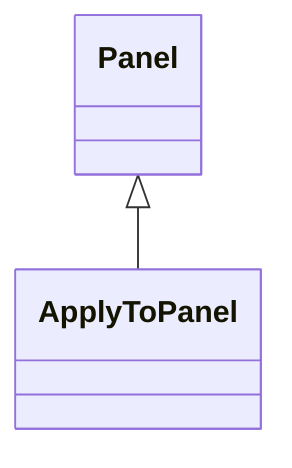

# ApplyToPanel

**Namespace:** `mne::viz` &nbsp;·&nbsp; **Library:** Visualization Library &nbsp;·&nbsp; **Source:** [`viz/panels/apply_to_panel.h`](https://github.com/mne-tools/mne-cpp/blob/staging/src/libs/mne/viz/panels/apply_to_panel.h)

`#include <mne/viz/apply_to_panel.h>`

```cpp
class mne::viz::ApplyToPanel
```

Tool panel with a check box per view (signal viewer, averaging butterfly and 2D layout view) that settings changed elsewhere apply to, and buttons to tick all or none.

### Inheritance



---

## Public Methods

### ApplyToPanel()

Constructs the panel with all views ticked.

---

### ~ApplyToPanel()

---

### select_all()

Ticks all views.

---

### clear()

Unticks all views.

---

### selected_views()

**Returns:**

- *std::vector&lt; std::string &gt;* — "null", followed by the names of the ticked views: "signalview", "butterflyview", "layoutview".

---

## Example

No example of its own: Display settings panel of MNE Scan and MNE Analyze, shown by the backends' panel hosts; works like CompensatorPanel, whose example shows the pattern.

## Authors of this file

- Christoph Dinh &lt;christoph.dinh@mne-cpp.org&gt;
