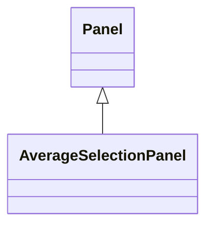

# AverageSelectionPanel

**Namespace:** `mne::viz` &nbsp;·&nbsp; **Library:** Visualization Library &nbsp;·&nbsp; **Source:** [`viz/panels/average_selection_panel.h`](https://github.com/mne-tools/mne-cpp/blob/staging/src/libs/mne/viz/panels/average_selection_panel.h)

`#include <mne/viz/average_selection_panel.h>`

```cpp
class mne::viz::AverageSelectionPanel
```

Tool panel of the averages of an evoked set: a check box and a colour per average (at most ten).

The panel lists the averages once their colours and activations name the same averages.

### Inheritance



---

## Public Methods

### AverageSelectionPanel()

Constructs the panel without averages.

---

### ~AverageSelectionPanel()

---

### set_callbacks(callbacks)

**Parameters:**

- **callbacks** : *Callbacks*
  What to call on changes.

---

### average_colors()

**Returns:**

- *const std::map&lt; std::string, [Color](/docs/api/viz/color) &gt; &* — The colour of each average, by name.

---

### average_activation()

**Returns:**

- *const std::map&lt; std::string, bool &gt; &* — Whether each average is shown, by name.

---

### set_average_colors(colors)

Replaces the colours, without a report.

**Parameters:**

- **colors** : *const std::map&lt; std::string, [Color](/docs/api/viz/color) &gt; &*
  Colour of each average, by name.

---

### set_average_activation(activation)

Replaces the activations, without a report.

**Parameters:**

- **activation** : *const std::map&lt; std::string, bool &gt; &*
  Whether each average is shown, by name.

---

### load(store, path)

Reads the colours and activations stored by AverageSelectionView (groups "averageColorMap" and "averageActivationMap"); needs a store that lists its keys.

**Parameters:**

- **store** : *const [SettingsStore](/docs/api/viz/settings-store) &*
  Settings store.

- **path** : *const std::string &*
  Settings path.

---

### save(store, path)

Stores the colours and activations as AverageSelectionView did.

**Parameters:**

- **store** : *[SettingsStore](/docs/api/viz/settings-store) &*
  Settings store.

- **path** : *const std::string &*
  Settings path.

---

## Example

No example of its own: Display settings panel of MNE Scan and MNE Analyze, shown by the backends' panel hosts; works like CompensatorPanel, whose example shows the pattern.

## Authors of this file

- Christoph Dinh &lt;christoph.dinh@mne-cpp.org&gt;
