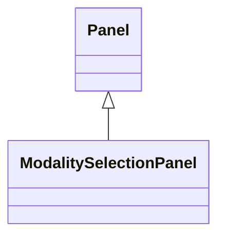

# ModalitySelectionPanel

**Namespace:** `mne::viz` &nbsp;·&nbsp; **Library:** Visualization Library &nbsp;·&nbsp; **Source:** [`viz/panels/modality_selection_panel.h`](https://github.com/mne-tools/mne-cpp/blob/staging/src/libs/mne/viz/panels/modality_selection_panel.h)

`#include <mne/viz/modality_selection_panel.h>`

```cpp
class mne::viz::ModalitySelectionPanel
```

Tool panel with a check box per channel modality (MAG, GRAD, EEG, EOG, STIM, MISC) of a recording.

The modality map holds every modality, also those the recording lacks; the form offers those it has.

### Inheritance



---

## Public Methods

### ModalitySelectionPanel(channels)

Constructs the panel with all modalities on.

**Parameters:**

- **channels** : *const std::vector&lt; [FiffChInfo](/docs/api/fiff/fiff-ch-info) &gt; &*
  Channels of the recording; their modalities get a check box.

---

### ~ModalitySelectionPanel()

---

### set_callback(callback)

**Parameters:**

- **callback** : *std::function&lt; void(const std::map&lt; std::string, bool &gt; &modalities)&gt;*
  Called with the modality map when the user switched a modality.

---

### modality_map()

**Returns:**

- *const std::map&lt; std::string, bool &gt; &* — Whether each modality is shown, by name ("MAG", "GRAD", ...).

---

### set_modality_map(modalities)

Replaces the modality map, without a report.

**Parameters:**

- **modalities** : *const std::map&lt; std::string, bool &gt; &*
  Whether each modality is shown, by name.

---

### channel_modalities()

**Returns:**

- *const std::vector&lt; std::string &gt; &* — The modalities the recording has, in the order of its channels.

---

### load(store, path)

Reads the modalities stored under the keys of ModalitySelectionView ("modalityMAG", ...).

**Parameters:**

- **store** : *const [SettingsStore](/docs/api/viz/settings-store) &*
  Settings store.

- **path** : *const std::string &*
  Settings path.

---

### save(store, path)

Stores the modalities under the keys of ModalitySelectionView.

**Parameters:**

- **store** : *[SettingsStore](/docs/api/viz/settings-store) &*
  Settings store.

- **path** : *const std::string &*
  Settings path.

---

## Example

No example of its own: Display settings panel of MNE Scan and MNE Analyze, shown by the backends' panel hosts; works like CompensatorPanel, whose example shows the pattern.

## Authors of this file

- Christoph Dinh &lt;christoph.dinh@mne-cpp.org&gt;
