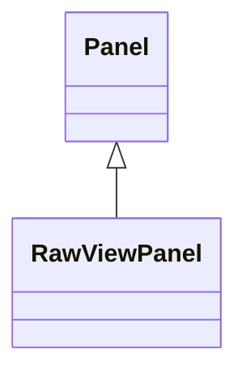

# RawViewPanel

**Namespace:** `mne::viz` &nbsp;·&nbsp; **Library:** Visualization Library &nbsp;·&nbsp; **Source:** [`viz/panels/raw_view_panel.h`](https://github.com/mne-tools/mne-cpp/blob/staging/src/libs/mne/viz/panels/raw_view_panel.h)

`#include <mne/viz/raw_view_panel.h>`

```cpp
class mne::viz::RawViewPanel
```

Tool panel of a raw or evoked data view: the number of channels shown at once, the time window, the distance of the time spacers, the signal and background colours and a screenshot button.

The settings keys are those of FiffRawViewSettings, so stored settings carry over.

### Inheritance



---

## Public Methods

### RawViewPanel(shown)

Constructs the panel: 16 channels, 10 s, spacers every 1000 ms, blue on white.

**Parameters:**

- **shown** : *const std::vector&lt; std::string &gt; &*
  Controls to show, by the names FiffRawViewSettings::setWidgetList() took: "numberChannels", "windowSize", "distanceSpacers", "backgroundColor", "signalColor" and "screenshot"; none shows all. Hidden settings keep their stored values.

---

### ~RawViewPanel()

---

### set_callbacks(callbacks)

**Parameters:**

- **callbacks** : *Callbacks*
  What to call on changes.

---

### zoom()

**Returns:**

- *double* — The number of channels shown at once.

---

### set_zoom(channels)

**Parameters:**

- **channels** : *double*
  Number of channels shown at once, without a report.

---

### window_size()

**Returns:**

- *int* — The time window in seconds.

---

### set_window_size(seconds)

**Parameters:**

- **seconds** : *int*
  Time window, without a report.

---

### time_spacer()

**Returns:**

- *int* — The distance of the time spacers in milliseconds.

---

### set_time_spacer(milliseconds)

**Parameters:**

- **milliseconds** : *int*
  Distance of the time spacers (100, 200, 500 or 1000), without a report.

---

### signal_color()

**Returns:**

- *[Color](/docs/api/viz/color)* — The signal colour.

---

### set_signal_color(color)

**Parameters:**

- **color** : *const [Color](/docs/api/viz/color) &*
  Signal colour, without a report.

---

### background_color()

**Returns:**

- *[Color](/docs/api/viz/color)* — The background colour.

---

### set_background_color(color)

**Parameters:**

- **color** : *const [Color](/docs/api/viz/color) &*
  Background colour, without a report.

---

### image_type()

**Returns:**

- *std::string* — The image type of screenshots, "PNG" or "SVG".

---

### load(store, path)

Restores the stored settings without reports.

**Parameters:**

- **store** : *const [SettingsStore](/docs/api/viz/settings-store) &*
  Settings store.

- **path** : *const std::string &*
  Settings path.

---

## Example

No example of its own: Display settings panel of MNE Scan and MNE Analyze, shown by the backends' panel hosts; works like CompensatorPanel, whose example shows the pattern.

## Authors of this file

- Christoph Dinh &lt;christoph.dinh@mne-cpp.org&gt;
