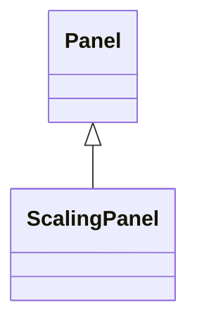

# ScalingPanel

**Namespace:** `mne::viz` &nbsp;·&nbsp; **Library:** Visualization Library &nbsp;·&nbsp; **Source:** [`viz/panels/scaling_panel.h`](https://github.com/mne-tools/mne-cpp/blob/staging/src/libs/mne/viz/panels/scaling_panel.h)

`#include <mne/viz/scaling_panel.h>`

```cpp
class mne::viz::ScalingPanel
```

Tool panel of the amplitude scales of data plots, one per channel type.

The scales are kept by channel kind (FIFFV_EEG_CH, ...), magnetometers and gradiometers by unit (FIFF_UNIT_T, FIFF_UNIT_T_M), in SI units, as `viz::channel_scale()` reads them. The form shows them in readable units (pT, fT/cm, uV, mV). Optionally the gradiometer scale follows the magnetometer scale and vice versa, linked by a factor.

### Inheritance



---

## Public Methods

### ScalingPanel(channel_types)

Constructs the panel with the default scales of MEG, EEG, EOG, ECG, STIM and MISC channels.

**Parameters:**

- **channel_types** : *std::vector&lt; std::string &gt;*
  Channel types to show scales for, as named by `FiffInfo::get_channel_types()` ("mag", "grad", "eeg", "eog", "ecg", "emg", "stim", "misc"); "all" shows all.

---

### ~ScalingPanel()

---

### set_callback(callback)

**Parameters:**

- **callback** : *std::function&lt; void(const std::map&lt; int, float &gt; &scales)&gt;*
  Called with all scales when the user changed one.

---

### scale_map()

**Returns:**

- *const std::map&lt; int, float &gt; &* — The scales by channel kind or unit, in SI units.

---

### set_scale_map(scales)

Replaces the scales, without a report; the form shows the shown channel types among them.

**Parameters:**

- **scales** : *const std::map&lt; int, float &gt; &*
  Scales by channel kind or unit, in SI units.

---

### set_mag_grad_link(linked)

Links the gradiometer to the magnetometer scale, without a report.

The link factor is set from the current scales.

**Parameters:**

- **linked** : *bool*
  Whether a change of either scale changes the other.

---

### load(store, path)

Reads the scales stored under the keys of ScalingView ("scaleMAG", "scaleGRAD", ...).

**Parameters:**

- **store** : *const [SettingsStore](/docs/api/viz/settings-store) &*
  Settings store.

- **path** : *const std::string &*
  Settings path.

---

### save(store, path)

Stores the scales under the keys of ScalingView.

**Parameters:**

- **store** : *[SettingsStore](/docs/api/viz/settings-store) &*
  Settings store.

- **path** : *const std::string &*
  Settings path.

---

## Example

No example of its own: Display settings panel of MNE Scan and MNE Analyze, shown by the backends' panel hosts; works like CompensatorPanel, whose example shows the pattern.

## Authors of this file

- Christoph Dinh &lt;christoph.dinh@mne-cpp.org&gt;
